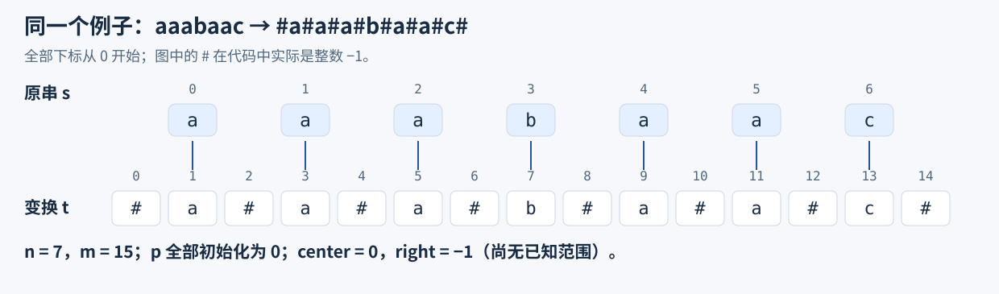
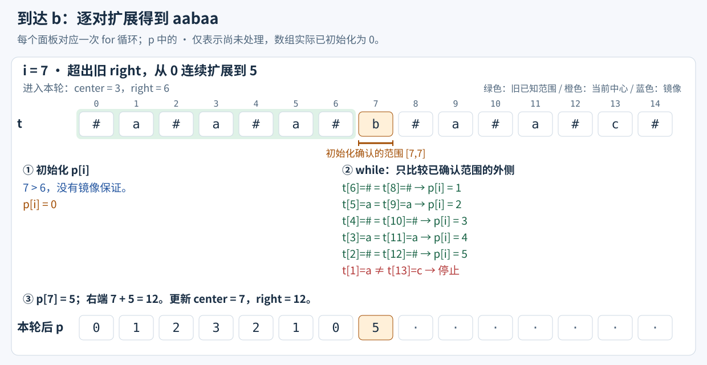
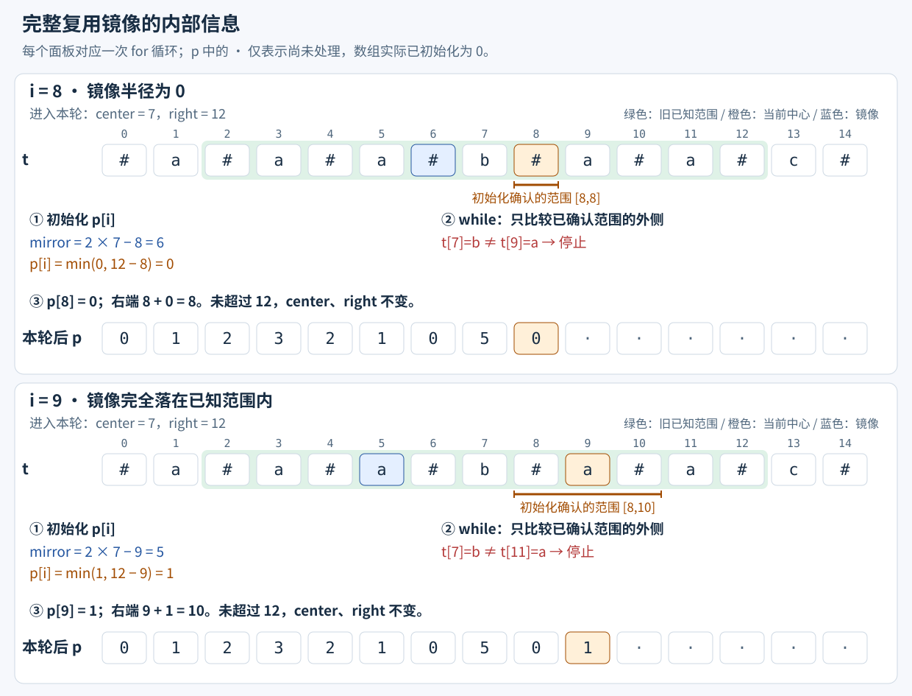
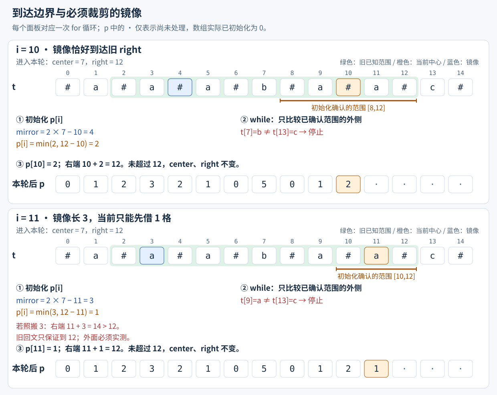
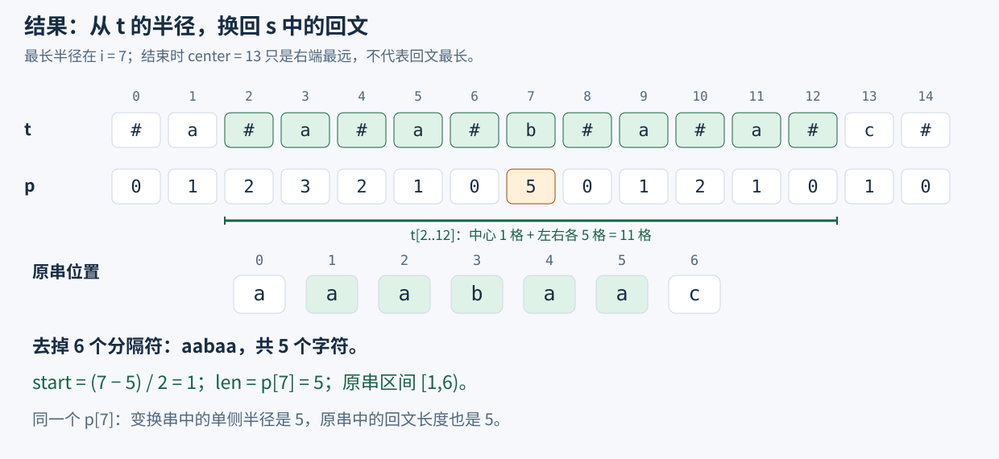
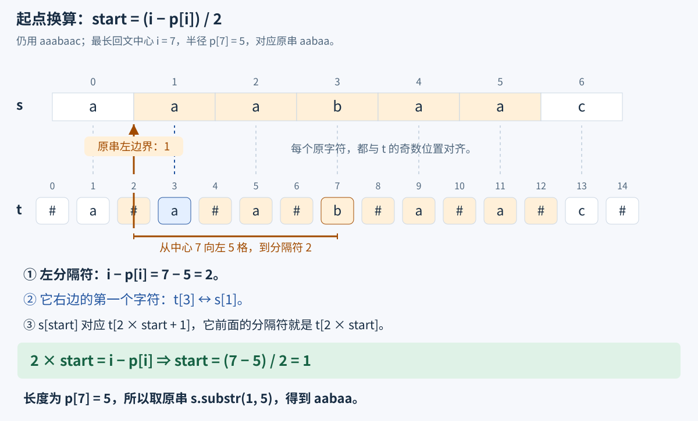
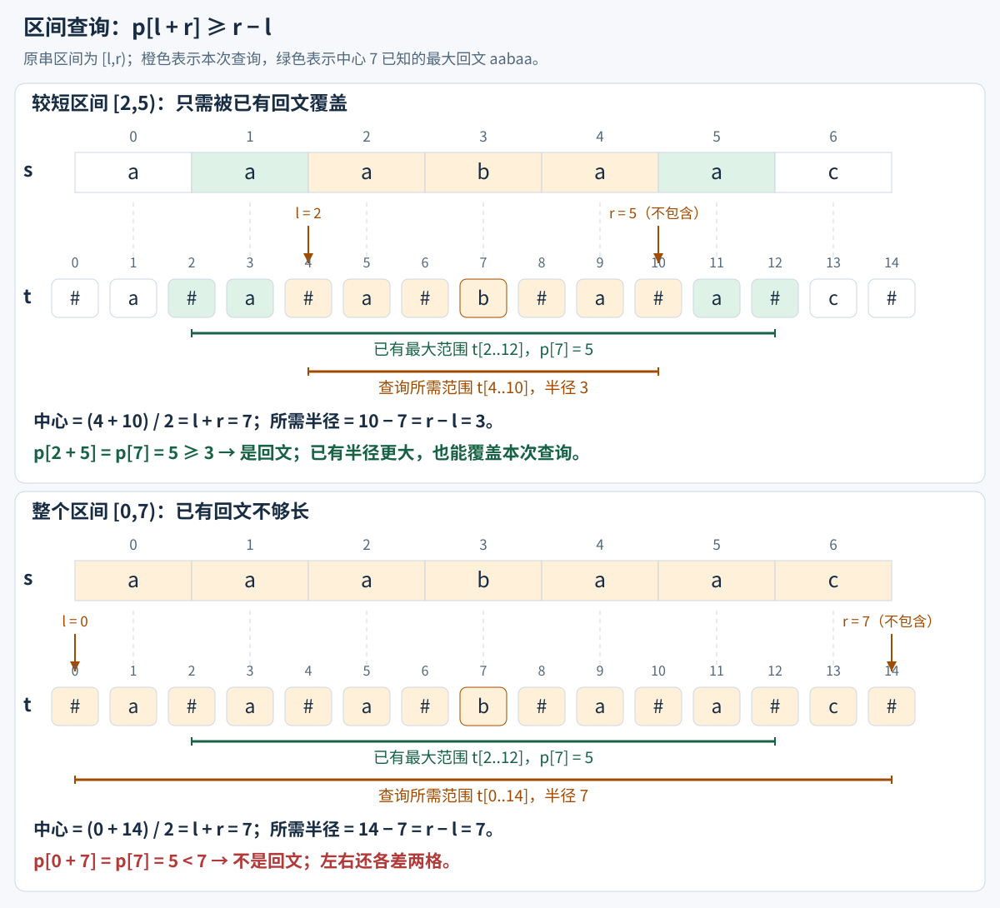
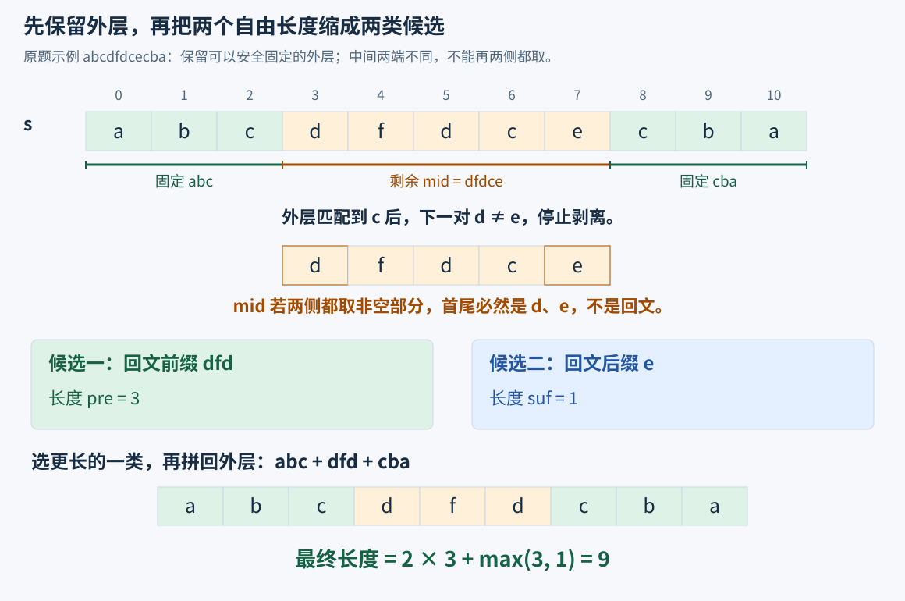
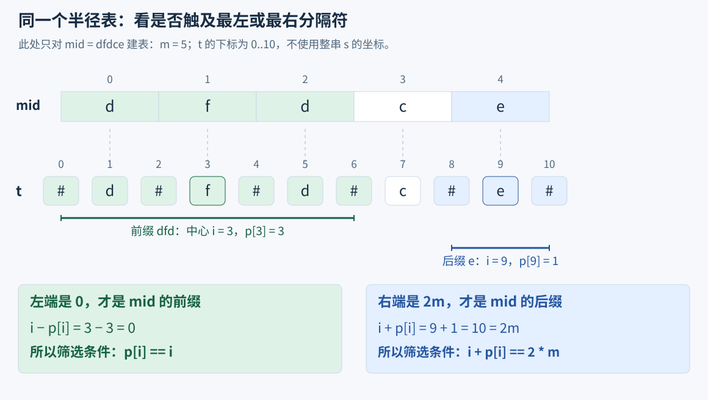

# 8.3 Manacher：用镜像信息加速回文扩展

前置：[string](../01-basic-problem-solving/04-stl/containers/03-string.md)、[复杂度](../01-basic-problem-solving/01-complexity-analysis.md)。可对照 [KMP](01-kmp.md)与[字符串哈希](02-string-hash.md)，但本节不依赖它们的实现。

**回文子串必须连续，正着读与反着读相同**，例如 `aba`、`abba`；子序列可以跳过字符，是另一个问题。

Manacher 在线性时间内求出每个中心的最大回文半径，可进一步求最长回文子串、判断指定区间是否回文。**它用半径紧凑表示结果，不在 O(n) 时间内逐一输出可能有 O(n²) 个的回文子串。**

## 0. 从问题引入：中心扩展为什么会重复？

求最长回文子串，可以枚举中心，向左右逐对比较：

- `aba` 的中心是一个字符。
- `abba` 的中心在两个字符之间。

这能正确求解。但对 `aaaaaa...`，许多中心都会反复比较相同区域，最坏时间为 O(n²)。

> **已经知道一大段是回文，能否利用对称性，跳过下一中心中已经确定相等的部分？** Manacher 在中心扩展上增加的正是这层复用。

## 1. 先给代码：统一奇偶中心，维护最右回文

本节下标全部为 **0-based**；原串 s 与改造序列 t 的下标不能混用。沿用通用框架的标准头文件与 `using namespace std;`。

```cpp
// p[i]：变换串 t 中以 i 为中心的回文半径，不含中心本身。
// 由于插入分隔符，p[i] 也恰好等于原串中对应回文子串的长度。
vector<int> manacher(const string& s) {
    int n = (int)s.size();
    int m = 2 * n + 1;
    vector<int> t(m, -1), p(m);

    // 构造变换串：偶数下标为分隔符，奇数下标为原字符。
    // 例如 s = "aba"，t 对应 #a#b#a#。
    for (int i = 0; i < n; ++i)
		// 用 int 存储字符数值，以 -1 作为不会与 unsigned char（0~255）冲突的分隔符。
        t[2 * i + 1] = (unsigned char)s[i];

    // center：当前最右回文的中心；right：该回文的最右边界。
    int center = 0, right = -1;

    for (int i = 0; i < m; ++i) {
        // ① 初始化半径：利用对称位置的已知信息，减少重复比较。
        if (i <= right) {
            int mirror = 2 * center - i; // i 关于 center 的对称位置
            p[i] = min(p[mirror], right - i);
        }

        // ② 尝试向外扩展：
        // 若镜像半径完全落在旧右边界内，下一对字符必然失配，while 不会扩展；
        // 若半径到达旧右边界，仍需继续比较，可能突破边界。
        // 若 i > right，则没有可复用的信息，从半径 0 开始扩展。
        while (i - p[i] - 1 >= 0 && i + p[i] + 1 < m &&
               t[i - p[i] - 1] == t[i + p[i] + 1]) {
            ++p[i];
        }

        // ③ 更新最右回文：若当前回文延伸得更远，就更新中心和右边界。
        if (i + p[i] > right) {
            center = i;
            right = i + p[i];
        }
    }

    return p;
}
```

> **用途速记：** 输入固定字符串，返回长度为 2n+1 的半径数组。用已知回文内的镜像信息初始化半径，再比较已确认半径外的新位置；最长原串回文长度就是 p 的最大值。函数不修改原串，也不需要额外预计算。

## 2. 跟着代码跑完一个例子

全程只看 **`aaabaac`**。其中既有偶数长度的 `aa`，也有奇数长度的 `aaa`、`aabaa`，还能遇到镜像超出已知范围的情况。

### 先构造 t，再从 i=0 开始



**橙色是当前中心，蓝色是镜像；绿色是进入本轮时已经知道的回文范围。** 每个面板按代码顺序展示：初始化半径 → while 比较 → 更新边界。`p` 行展示本轮结束后的结果。


### i=2、3：先借已知部分，再继续扩展


**i=2 是两个 a 之间的分隔符，得到偶数回文 `aa`；i=3 是字符 a，得到奇数回文 `aaa`。** 两种中心执行同一份代码。

i=3 时，先借镜像确定的 1 格，再实际比较两对，半径从 1 变成 3。因此 **p[3]=3 是这轮扩展算出的结果**：变换串中的回文为 `#a#a#a#`，含中心共 7 格，原串对应 `aaa` 三个字符。

### i=4、5、6：复用结果后，下一对自然失败


这三轮都不推进 right。**不必为“扩不动”另外写分支**：初始化后仍进入同一个 while，遇到不等字符就结束。

### i=7：从 b 向两侧逐对扩展



这里 i 已经超过旧 right，不能借镜像。五次成功比较后，回文覆盖 **t[2..12]**，对应原串的 **`aabaa`**；下一对 a、c 不等才停止。

### i=8、9：镜像落在大回文内部，直接借来用



以 i=9 为例，镜像在 5，已有 p[5]=1；借来这一格后，下一对 b、a 不等。**旧范围内部已经确认的相等部分，不再重复比较。**

### i=10、11：不能把镜像越界的部分也复制过来



i=11 的镜像在 3，虽然 p[3]=3，但旧回文只保证到 right=12。当前中心离它只有 1 格，**先借 1 格；剩下能否扩展，必须实际比较。** 本例下一对 a、c 不等，所以最终仍为 1。

### i=12、13、14：继续扫完，而不是找到最长后就结束


i=13 把 right 推进到 14，但它只有一个字符 c。**center 记录“右端最远的回文”，最长回文应另取 max(p)。**



## 3. 回看代码：只维护三件事

### 镜像给下界，right 限制可以直接借多少

镜像与当前中心到 center 的距离相等：

$$
\mathrm{mirror}=2\mathrm{center}-i.
$$

> 考虑镜像位置的已知半径时，还必须先考虑当前位置 \(i\) 到旧右边界 \(right\) 的距离：**只有旧回文覆盖范围内的信息才有保证，不能直接照搬镜像位置的全部半径。**因此取两者的较小值：

$$
p[i]\leftarrow\min\bigl(p[\mathrm{mirror}],\ \mathrm{right}-i\bigr).
$$

回看 i=11：

$$
p[11]\leftarrow\min(3,12-11)=1.
$$

> 旧回文内部左右对称，所以镜像中已经相等的部分可以映射过来；**超出旧回文的部分没有这份保证**。不在旧 right 内时，则直接从 0 开始。

### while 负责实测，最后一个 if 负责保存最右范围

本轮已确认半径为 p[i]，下一对恰好紧挨在它外侧：

$$
i-p[i]-1,\qquad i+p[i]+1.
$$

先检查下标，再比较字符；每成功一对，半径加 1。扩完后的右端为 i+p[i]，**只有比旧 right 更远，才同时更新 center、right**。

| 变量 | 保存什么 | 后续怎么用 |
| --- | --- | --- |
| t | 原字符与分隔符交替的序列，长度 2n+1 | 统一字符中心和缝隙中心 |
| p[i] | t 中以 i 为中心的最大半径，**不含中心** | 回文闭区间为 [i−p[i],i+p[i]] |
| center、right | 已处理中心中，右端最远的回文中心与右端点 | 判断能否复用镜像，right 是**闭区间右端** |
| mirror | 下标 i 关于 center 对称的位置 | i≤right 时使用，它的半径已经算过 |

### 为什么半径恰好等于原串长度？

图中 i=7 的回文从分隔符开始、到分隔符结束。**最大扩展的两端一定是分隔符**：若两端仍是原字符，外侧还有一对分隔符相等，必然还能扩一格。

所以变换串中共 2p[i]+1 格，形如 `#字#字#...#`，原字符数为：

$$
\frac{(2p[i]+1)-1}{2}=p[i].
$$

> **p[i] 数的是 t 中从中心向单侧扩展的格数，分隔符也算；它又恰好等于原串的回文长度。** 这是本节分隔方式与“不含中心”的半径定义共同决定的，不能混用其他模板的长度约定。

## 4. 怎样还原原串位置、判断一个区间？

先给两个基于同一 p 数组的短函数：

```cpp
// 返回 {原串起点, 长度}；同长取最左，空串返回 {0,0}。
pair<int, int> longest_palindrome(const vector<int>& p) {
    int start = 0, len = 0;
    for (int i = 0; i < (int)p.size(); ++i) {
        // p[i] 就是原串中以该中心对应的最长回文子串长度。
        if (p[i] > len) {
            len = p[i];

            // 变换串中，回文左边界为 i - p[i]。
            // 原串字符位于变换串奇数下标，因此原串起点为 (i - p[i]) / 2。
            start = (i - p[i]) / 2;
        }
    }
    return {start, len};
}

// p 必须由同一原串生成；0 <= l <= r <= n，原串区间为 [l,r)。
bool is_palindrome(const vector<int>& p, int l, int r) {
    // [l,r) 的回文中心在变换串下标 l+r，所需半径为 r-l。
    // p[l+r] 达到该半径，说明整个区间都是回文。
    return p[l + r] >= r - l;
}
```

> **用途速记：** **在 manacher 得到的半径表上，最长回文只需扫描一次；任意原串区间是否回文只需一次查表。**返回的是原串位置，不是 t 中位置；**空区间约定为回文**。

### 最长回文的起点怎么换回去？



**原串下标 start 对应 t[2start+1]，它前面的分隔符就在 t[2start]。** 因此，回文左分隔符的下标满足：

$$
2\mathrm{start}=i-p[i].
$$

两边除以 2，才得到代码中的起点换算；长度则直接使用 p[i]：

$$
\mathrm{start}=\frac{i-p[i]}2,\qquad \mathrm{len}=p[i].
$$

本例 i=7、p[7]=5，所以原串起点为 (7−5)/2=1，长度为 5，得到 `aabaa`。用 s.substr(start,len) 即可取出内容，但**复制子串仍需 O(len) 时间与空间**。

### 区间查询的中心怎么换过去？



**原串区间 [l,r) 对应 t 中两端分隔符之间的 [2l,2r]。** 所以中心为：

$$
\frac{2l+2r}2=l+r.
$$

从中心走到右分隔符，所需半径为：

$$
2r-(l+r)=r-l.
$$

**p[l+r] 是该中心已经算出的最大半径，达到或超过所需半径即可，不要求恰好相等。** 图中 [2,5) 只需 3 格，已有 5 格足够覆盖；[0,7) 需要 7 格，已有 5 格则不够。因此：

$$
s[l..r)\text{ 是回文}\quad\Longleftrightarrow\quad p[l+r]\ge r-l.
$$

本例 [1,6) 对应中心 1+6=7，所需半径为 6−1=5，p[7]=5 足够覆盖，因此是回文；整个 [0,7) 也以 7 为中心，但所需半径为 7，p[7]=5 不够，因此不是回文。

**l=r 时长度为 0**，对应分隔符中心，条件也自然成立。

## 5. 为什么总时间是 O(n)？

### 先分清：哪些情况可能继续成功扩展？

**min 初始化决定从哪里开始探索；真正向外比较的是 while。** i≤right 时，看镜像半径有没有触及旧边界；i>right 时，则没有这份镜像保证。

| 情况 | 初始化与后续行为 |
| --- | --- |
| `p[mirror] < right - i` | 镜像回文完全落在旧范围内，连下一对失配也能映射过来；复用半径后，下一次比较必然失败，不会继续成功扩展 |
| `p[mirror] >= right - i` | 初始半径取 `right - i`，本轮回文已经抵达旧 right；下一次从旧边界之外尝试比较 |
| `i > right` | 当前中心在已知范围之外，从半径 0 开始探索 |

**后两种情况只是可能扩展，不保证一定匹配。** 回看执行图：i=3 从半径 1 扩到 3，推进了右端；i=11 虽然也到了旧边界，但下一对 a、c 不等，右端没有推进。

### 内层看似更新 p[i]，实际上是在探索新的右边界

外层 for 只是从左到右枚举中心 i；进入本轮 while 后，**i 固定，当前回文的候选右端一直是 i+p[i]**。

每匹配一对，先执行 ++p[i]，候选右端就向右走一格：

$$
i+p[i]\ \longrightarrow\ i+p[i]+1.
$$

每次成功比较的**右侧位置，都在进入本轮时的旧 right 之外**。所以可以通俗地理解为：**while 看似在增加半径，实际是在探索、推进新的右边界。**

代码先把扩展量记在 p[i] 中；本轮比较结束后，再通过以下两行，一次性保存新的最右回文：

```cpp
center = i;
right = i + p[i];
```

**并不是每枚举一个 i，内层就重新扫描一整段。** 旧范围里的相等部分已经通过镜像跳过；只有需要探索旧边界之外时，while 才可能继续成功。i 右移也不保证 right 跟着增长：每轮 right 要么保持不变，要么被推得更远，始终不回退。

### 把所有轮次合起来算，而不是相乘

- **中心枚举：** i 从 0 到 m−1，每个中心只处理一轮；初始化、更新与最后一次停止判断都是常数开销，合计 O(m)。
- **成功扩展：** 每次成功都探索到旧 right 之外的新位置；一轮结束后立即保存新的 right，后面的轮次不会再为同一段内部相等关系逐格比较。因此所有轮次的成功扩展合计 O(m)。

right 最远只能到 **m−1**。到达这里以后，后续中心仍要处理，但已经不可能继续成功扩展到更右位置；每轮最多再作一次失配或越界判断。

把“中心枚举及每轮常数开销”和“所有成功扩展”看成两部分，总成本是相加：

$$
O(m)+O(m)=O(m),\qquad m=2n+1.
$$

> **两层循环的工作量没有按每轮重新绑定：外层负责枚举中心，内层的成功扩展则由一条只向右推进的边界统一计数。** 所以总时间是 O(n)，不是 O(n²)；这里的“两份线性工作”不表示精确执行 2m 次。

| 操作 | 时间 | 空间与原因 |
| --- | --- | --- |
| 构造 t | O(n) | 2n+1 个 int |
| 计算全部 p | O(n) | 2n+1 个 int；扩展按右边界推进合计 |
| 扫描最长回文位置 | O(n) | 额外 O(1)，不复制原串 |
| 查询一个区间是否回文 | O(1) | 复用已有 p |
| 复制最长回文内容 | O(len) | 新字符串占 O(len) |

**线性空间也要看字节常数。** 本实现构造时同时保存 t、p，两份数组约有 4n 个 int；常见 4 字节 int 下，约 16n 字节，另加原串及分配开销。处理千万长度时要对照内存限制，不能只看到 O(n) 就忽略容量。

## 6. 边界与相近工具

- **空串：** t 仍有一个分隔符，p 返回 `{0}`，最长回文为 `{0,0}`，不访问空原串。
- **单字符与偶数回文：** 都走同一套循环，不另加分支。
- **下标：** while 先检查左右是否越界，再比较 t 中元素；边界条件不能放到访问之后。
- **数值：** 2n+1、2center 及相关下标表达式须可用 int 表示；模板统一要求 n≤INT_MAX/4 且内存足够。
- **定义：** 本节 p 不包含中心，right 为闭区间右端；不套用其他“半径含中心”或“右端开区间”模板的加减一。
- **多测：** 每次调用创建局部 t、p，center、right 重新初始化；原字符串只读。

| 工具 | 常见目标 | 与本节的区别 |
| --- | --- | --- |
| KMP／前缀函数 | 模式匹配、border、前后缀关系 | 维护匹配前缀，不直接提供每个回文中心的半径 |
| 字符串哈希 | 通用子串比较、指纹分类 | 适用面更广，需考虑碰撞；Manacher 的回文判断是精确结果 |
| Manacher | 固定字符串的回文中心信息与区间回文查询 | 线性预处理，针对回文结构 |

具体题目可能有多种解法，例如部分前后缀回文问题也能转为 KMP；先看需要维护的信息。全章写法成本与场景推荐仍留到章末。

## 7. 典题与复盘

**两题共用本节开头的 manacher，不重复抄板子。** 以下保留原实现，只整理排版和注释，逻辑不改；已做本地核验，平台结果未单独提供。

### P3805：最长回文长度

[原题](https://www.luogu.com.cn/problem/P3805)：小写字母串，1≤n≤1.1×10⁷，输出最长回文子串长度。

```cpp
void solve() {
    string s;
    cin >> s;

    auto p = manacher(s);
    int len = 0;

    for (int i = 0; i < (int)p.size(); ++i)
        len = max(len, p[i]);

    cout << len << '\n';
}
```

**用途速记：** 半径表已经保存每个中心对应的最长原串回文长度，扫描最大值即可；本题只要长度，不必还原起点或复制子串。

$$
\mathrm{ans}=\max_i p[i].
$$

**时间 O(n)，空间 O(n)。** 本题长度可达千万级，峰值内存包含构造时同时存在的 t、p 与原串，沿用[上节的容量说明](#5-为什么总时间是-on)，不能只看线性复杂度。

### CF 1326D2：前后缀回文

[原题](https://codeforces.com/problemset/problem/1326/D2)：答案由原串的一个前缀与一个后缀拼成，两者允许为空；**总长度不超过原串，结果必须回文，并且尽量长**。多测总长度≤10⁶，同长答案任取。

```cpp
void solve() {
    string s;
    cin >> s;

    int l = 0, r = s.size() - 1;

    // 先保留已经成对匹配的外层。
    while (l < r && s[l] == s[r]) {
        ++l;
        --r;
    }

    if (l >= r) {
        cout << s << '\n';
        return;
    }

    string mid = s.substr(l, r - l + 1);
    int m = (int)mid.size();
    auto p = manacher(mid);
    int pre = 0, suf = 0;

    for (int i = 0; i < (int)p.size(); ++i) {
        // 左端抵达 t[0]：这是 mid 的回文前缀。
        if (p[i] == i)
            pre = max(pre, p[i]);

        // 右端抵达 t[2*m]：这是 mid 的回文后缀。
        if (p[i] + i == 2 * m)
            suf = max(suf, p[i]);
    }

    string best = (pre >= suf)
        ? mid.substr(0, pre)
        : mid.substr(m - suf);

    cout << s.substr(0, l) << best << s.substr(r + 1) << '\n';
}
```

**用途速记：** 先固定可以安全保留的相同外层；中间只比较最长回文前缀与最长回文后缀，再拼回外层。**Manacher 负责求半径，答案结构的推导负责决定扫描哪些半径。** 本题框架需读取 T，多次调用 solve。

#### 从答案的必要条件入手，而不是先枚举答案

直接枚举前缀长度与后缀长度，有 O(n²) 种组合；即使验证回文很快，候选也太多。

先问：**若答案从原串两边各取了非空部分，回文的首尾必须满足什么？** 它们就是原串的首尾字符，必须相等。

原题示例 `abcdfdcecba` 可以按这个条件逐层收缩：



外层依次匹配 a、b、c，剩下 mid=`dfdce`。它的首尾 d、e 不同，**不能再从 mid 两侧各取非空部分**，否则拼接后的首尾就不同。

因此，中间只能是以下两类之一：

- **mid 的回文前缀**：本例为 `dfd`，长 3。
- **mid 的回文后缀**：本例为 `e`，长 1。

外层已固定，只需比较这两个长度：

$$
\mathrm{anslen}=2l+\max(\mathrm{pre},\mathrm{suf}).
$$

本例得到 2×3+3=9，答案为 `abcdfdcba`。**原本同时选择前、后缀长度的问题，缩成了两个候选类别。**

#### 为什么尽量保留外层，不会漏掉更优答案？

**相同外层的这些原位置，不一定被每个最优选法采用，但至少存在一个最优选法保留它们。** 看当前首尾相同的一个字符对，例如两边都是 c：

- **答案两边都取了非空部分**：已经包含这两个 c，可以一起剥掉，继续研究内部。
- **答案只取前缀，且长度至少为 2**：它既然回文，末尾也一定是 c。把这个末尾 c 改从原串最右端取，前缀缩短一位、后缀取一位，**答案的文字和长度都不变**，于是也保留了两端。只取后缀时同理。
- **答案只有一个字符**：当前首尾相同且至少有两个位置，直接取这两个字符就能得到长度 2，不会更差。

所以可以反复保留相同的外层，直到两端不同，或指针相遇／交错。**这里需要的是“不损失最优值”的证明，而不是把“可以保留”直接说成“所有答案都必须保留”。**

#### 如何从半径表筛出前缀与后缀？

此处 p 属于 **mid**，不是整串 s；m 也表示 mid 的长度。t 的下标为 0..2m。



前缀必须抵达 t 的最左分隔符：

$$
i-p[i]=0\quad\Longleftrightarrow\quad p[i]=i.
$$

后缀必须抵达 t 的最右分隔符：

$$
i+p[i]=2m.
$$

分别取满足条件的最大半径，就是 pre、suf。**只需要完整半径 p[i]，不必再枚举同一中心的更短回文**：若某个回文已经抵达一端分隔符，就无法再向该端扩展，它必然已经是这个中心的最大半径。

| 变量 | 含义与后续用途 |
| --- | --- |
| l、r | 原串尚未处理的中间闭区间 [l,r]；固定外层为 [0,l) 与 [r+1,n) |
| mid、m | 剩余中间串与其长度；重新建立它自己的半径表 |
| pre、suf | mid 的最长回文前缀／后缀长度，范围 0..m |
| best | 较长的中间候选；两者同长时选任意一个都合法 |

#### 边界与容易混淆的目标

- **l≥r 直接输出 s**：整串已经回文，长度达到 n，不可能再更长；不必另造空 mid。
- **两端一开始就不同也成立**：l=0，没有固定外层，直接比较整串的回文前缀与后缀。
- **不能取 mid 内部任意位置的最长回文**：例如 `cabbad` 中 `abba` 虽长 4，却既不是原串前缀也不是后缀；本题只能选 `c` 或 `d`，长度为 1。
- **substr 的第二个参数是长度**：mid 用 r−l+1，外层后缀则从 r+1 开始取到末尾。

两端扫描、Manacher、半径筛选与拼接均为线性，**每组时间 O(n)，空间 O(n)**，所有测试合计按总长度计算。

> **先问合法答案必须长什么样，再证明哪些部分可以安全保留，最后只求剩余候选。** 具体的 Manacher 板子没有变化，变化的是调用前的建模与调用后的筛选。完整提炼见[先刻画答案结构，再缩小候选范围](../../patterns/04-greedy-and-construction/answer-structure-reduction.md)。

配套实现：[Manacher 模板](../../templates/08-strings/manacher/README.md)。两题复用同一通用实现，不另建专属模板。


## 8. 自查

先遮住执行图，尝试复现 i=3、7、11 三轮的初始化、比较与边界变化。

1. 为什么要用 min(p[mirror],right−i)，而不是直接复制镜像半径？
2. center 对应的回文，是当前最长还是右端最远？
3. p[i]=4 时，t 中回文长多少？原串中回文长多少？
4. 哪些 while 比较需要实际执行，为什么成功扩展不会反复计算已知内部？

算法依据可对照 [Manacher’s Algorithm](https://cp-algorithms.com/string/manacher.html)。该页还给出奇偶分开及不同半径定义；本文使用整数分隔符与不含中心的半径，代码、图解和位置换算以本节约定为准。

[本章索引](README.md) · [竞赛模板](../../templates/08-strings/manacher/README.md)
