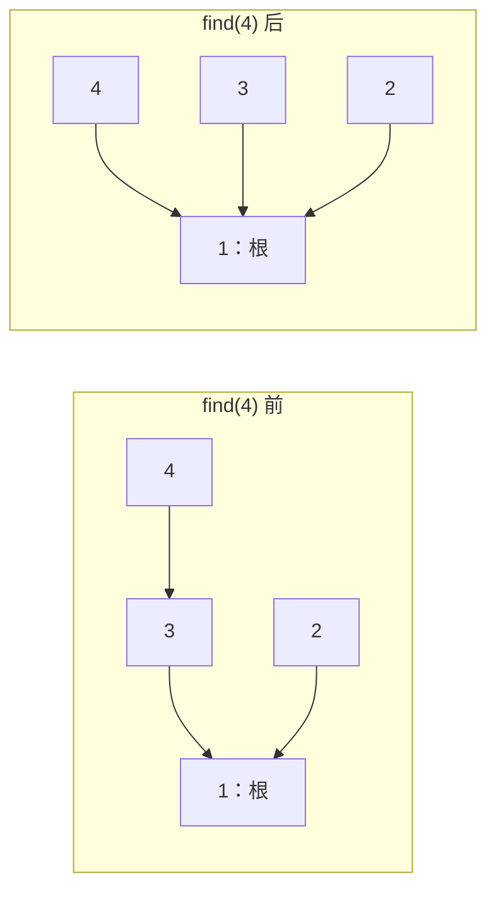

# 9.1 并查集：合并集合与判断连通

承接[图的连通块](../06-graph-and-tree/01-graph-basics.md)，已有原理通过 [ds-notes](https://github.com/zzhen0710/ds-notes) 复用。本节把重点放在竞赛中的状态、操作含义和实现边界，为后续 Kruskal 做准备。

> **并查集维护的是“哪些对象已属于同一组”，不保存原图的完整路径。** 适合不断合并关系、反复询问是否同组的场景。

## 1. 什么时候使用

一开始有 $n$ 个对象，每个对象单独一组。之后有两类操作：

- **合并**：将包含 `a`、`b` 的两组变成一组。
- **查询**：判断 `a`、`b` 是否已经属于同一组，包括通过其他对象间接连接的情况。

例如已知 1 与 2 同组，2 与 3 同组，那么 1 与 3 也同组。这类关系具有对称性与传递性；每个对象自然与自己同组。

若无向图只有加边，可把加入边理解为合并两端的连通块。静态图也能用 DFS/BFS 一次求出连通块；**并查集的便利在于关系不断加入时，无须每次重新遍历整张图**。

普通并查集不能直接删除关系，也不能把有方向的可达性当成同组关系。例如只有 $1\to2$ 时，不能由此断言 2 能到达 1。

## 2. 状态：父指针、代表元与大小

本节对象编号为 **1-based：`1..n`**。教学实现允许 $0\le n\le10^6$，但 `n = 0` 时没有可查询的对象。

| 变量 | 含义与范围 |
| --- | --- |
| `parent[x]` | 并查集内部，`x` 当前指向的父节点，不一定直接指向根 |
| 根 `r` | 满足 `parent[r] == r`；代表当前集合 |
| `find(x)` | 沿父指针找到 `x` 所在集合的根，并压缩查找路径 |
| `sz[r]` | **仅当 `r` 是根时**，表示当前整个集合的大小 |
| `components` | 当前集合总数；用于无向图时就是连通块数 |

`parent`、`sz` 按**对象数量**分配 `n + 1` 项，0 只占位。输入若是很大的稀疏编号，应先映射成连续编号，可关联[离散化](../02-sequence-techniques/03-discretization.md)。

初始化：

- 每个合法编号 `x` 都有 `parent[x] = x`。
- 每组只有一个对象，根处 `sz[x] = 1`。
- 一共有 `n` 组，所以 `components = n`。

**根只是代表元，不保证是集合最小编号，也不保证一直不变。** 后续合并可能更换根；保存旧根编号以后，还需按当前状态重新查找，不能把旧根当永久集合编号。

## 3. find：查根与路径压缩

沿着父指针不断向上，直到遇到自己指向自己的节点。两个对象属于同一组，当且仅当：

$$
\mathrm{find}(a)=\mathrm{find}(b).
$$

**不能直接比较 `parent[a]` 与 `parent[b]`**：一个对象可能指向根，另一个还隔着几层，但最后到达的是同一个根。

递归查根时，先让父节点找到最终根，再让当前节点直接指向这个根：

$$
\mathrm{parent}[x]\leftarrow\mathrm{find}(parent[x]).
$$

这就是路径压缩。它只缩短内部查找路径，**不会改变哪些对象属于同一组，也不会减少集合数量**。

下面的箭头表示并查集父指针，不是原图中的实际边：



查询过程会修改 `parent`，但同组关系不变，因此不能简单把 `find` 理解成完全不改数组的只读操作。

## 4. unite：先找两组的根，再合并

合并 `a`、`b` 时：

1. 分别查到两者当前的根。
2. 若根相同，原来就同组，不需要再次合并。
3. 若根不同，把一个根挂到另一个根下面，两组成员就都能走到同一新根。
4. 更新新根的集合大小，**集合数减一**。

**不能直接写 `parent[a] = b` 代替合并。** `a` 若不是根，可能只把它下面的一部分对象挪走，原组被拆开，没能合并整组。

为了不让内部树太高，采用**按大小合并**：小组的根挂到大组的根下面。大小比较的是整个集合的对象数，不是根编号大小。

新大小只更新在保留下来的根处。被挂走的旧根不再是根，它的 `sz` 不再表示完整集合大小，查询时必须先 `find`。

## 5. C++11 主写法

代码使用 `vector`、`iota`、`swap`，沿用[竞赛基础框架](../../templates/01-basic-problem-solving/cpp-contest-template/README.md)。本节只维护这一份通用结构，个人独立复现与模板提炼另按实际练习记录。

**为什么构造函数前加 `explicit`，后面的单参数函数不加？**

- `DSU(int n)` 是创建对象的构造函数。不加 `explicit` 时，`DSU dsu = 4;` 也能通过：整数 4 会被隐式转换成一个并查集对象。
- 加上后，仍可明确写 `DSU dsu(4);` 或 `DSU dsu{4};`，但不能再写 `DSU dsu = 4;`，避免把一个整数无意中当成整个对象。
- 记住这个区别：
  - `explicit DSU(int)`：禁止隐式地把其他类型转换成 `DSU`。
  - `explicit operator int()`：禁止隐式地把 `DSU` 转换成 `int`。
- `find(int x)`、`size(int x)` 是在**已有的 `DSU` 对象上按编号查询**，不会把参数 `x` 转换成一个 `DSU` 对象。`explicit` 限制的是构造函数或类型转换函数参与的隐式转换，**不是限制普通函数调用的开关**；因此 C++ 不允许给这类普通成员函数加 `explicit`。规则见 [C++ 标准草案](https://eel.is/c++draft/dcl.fct.spec#3)。

```cpp
struct DSU {
    vector<int> parent;
    vector<int> sz;
    int components;

    // 合法对象为 1..n，0 只占位；每次构造都重新初始化
    explicit DSU(int n) : parent(n + 1), sz(n + 1, 1), components(n) {
        iota(parent.begin(), parent.end(), 0);
        sz[0] = 0;
    }

    // 返回当前根；查找途中会压缩父指针，但不改变集合划分
    int find(int x) {
        return parent[x] == x ? x : (parent[x] = find(parent[x]));
    }

    // 返回本次是否真的合并了两个集合
    bool unite(int a, int b) {
        a = find(a);
        b = find(b);
        if (a == b) return false;

        if (sz[a] < sz[b]) swap(a, b); // 让 a 代表较大的集合

        parent[b] = a; // 只连接两个根，不直接移动某个非根对象
        sz[a] += sz[b];
        --components;
        return true;
    }

    bool same(int a, int b) {
        return find(a) == find(b);
    }

    int size(int x) {
        return sz[find(x)]; // 非根位置的旧 sz 不能直接读取
    }
};
```

`find` 的条件表达式对应两种情况：**已经是根，就返回 `x`；否则递归找到根，写回 `parent[x]`，再返回这个根**。赋值表达式也会产生被写入的值，所以一个 `return` 就能同时完成路径压缩和返回。

### 接口约定与调用流程

- 构造时 `n` 在本节范围内；所有操作参数必须在 `1..n`。
- `find` 返回当前代表元；`unite` 返回是否合并成功，**不是返回根编号**。
- `same` 返回是否同组；`size` 返回该对象所属集合的大小。
- `find`、`same`、`size` 都可能压缩父指针，集合划分与数量不变；只有成功 `unite` 才减少 `components`。
- 多组输入分别构造 `DSU(n)`，不能残留上一组的父指针、大小或集合数。

以下通用片段可放在 `solve()` 内：

```cpp
DSU dsu(4);
dsu.unite(1, 2);
dsu.unite(3, 4);

cout << dsu.same(1, 3) << '\n'; // 0：两组尚未连接

dsu.unite(2, 4);
cout << dsu.size(4) << ' ' << dsu.components << '\n'; // 4 1
```

整体流程是：**初始化单元素集合 → 逐条处理合并关系 → 用当前根回答查询**。无需为了这些操作额外建立邻接表；若还要原图路线等信息，则另行保留图。

### 竞赛模板：一个数组保存父节点与大小

上文双数组写法便于分别观察 `parent` 与 `sz`，两题原实现也保留这种结构。实际复用可使用 [DSU 竞赛模板](../../templates/09-data-structures/dsu/README.md)，按固定版本的 ei1333/library 适配：

- 根处存**负的集合大小**，如 `p[r]=-4` 表示这组有 4 个对象。
- 非根处存**父节点编号**，如 `p[x]=r` 表示沿父指针找到 `r`。
- 两根合并时，负得更多的一组较大；把两个负大小相加，再让另一根指向它。

仍采用 **1-based、`unite` 返回是否成功、成功后 `components` 减一**。省下一份数组的代价是需要区分负大小和正编号，不能把根的判定 `parent[x]==x` 原样照搬过去。原理、语义及两题历史不因此改变。

## 6. 手推父指针与集合数量

仍按上面的合并顺序，只观察有效编号 `1..4`：

| 操作后 | `parent[1..4]` | 根处的集合大小 | `components` |
| --- | --- | --- | --- |
| 初始化 | 1, 2, 3, 4 | 四个根各为 1 | 4 |
| `unite(1,2)` | 1, 1, 3, 4 | 根 1 为 2，其余根各为 1 | 3 |
| `unite(3,4)` | 1, 1, 3, 3 | 根 1、3 都为 2 | 2 |
| `unite(2,4)` | 1, 1, 1, 3 | 根 1 为 4 | 1 |
| `find(4)` | 1, 1, 1, 1 | 根 1 仍为 4 | 1 |
| 再 `unite(1,4)` | 1, 1, 1, 1 | 根 1 仍为 4 | 1 |

第三次合并后，`parent[2] = 1`、`parent[4] = 3`，直接比较会误以为不同组；沿父指针查到的根却都是 1。

最后一次合并返回 `false`。**重复关系、同一个对象与自身合并，都不能使集合数再减一**。

## 7. 正确性与复杂度

初始每个对象单独成组，父指针、大小与集合数均符合含义。

路径压缩只是把原来通向同一个根的路线缩短，不更换集合归属。成功合并时，两组原本互不相交，只连接两个根便能让两组所有成员到达共同根，其他组不受影响；大小相加，集合数恰好减一。因此所有操作后都保持同组关系的正确性。

按大小合并时，一个对象所在的树若因挂到别人下面而加深，新集合大小至少翻倍，所以不压缩时树高也至多是 $O(\log n)$。路径压缩进一步缩短后续查找。

**按大小合并与路径压缩结合**，一次操作均摊为 $O(\alpha(n))$，$\alpha$ 是增长极慢的反阿克曼函数。初始化 $O(n)$，$q$ 次操作合计 $O(n+q\alpha(n))$，空间 $O(n)$；不能理解为每次查找都严格只走一步。

### $\alpha(n)$ 到底有多小？

按竞赛资料常见的定义约定，可以用下面的上界建立直觉：

| 对象数量 $n$ | $\alpha(n)$ 的常见上界 |
| --- | --- |
| $10^6$，百万级 | 不超过 4 |
| $10^9$，十亿级 | 不超过 4 |
| $10^{18}$ | 不超过 4 |
| $10^{100}$，远超实际可存储规模 | 仍不超过 4 |

[CP-Algorithms 的复杂度说明](https://cp-algorithms.com/data_structures/disjoint_set_union.html#time-complexity)将这一范围概括为约 $n<10^{600}$。不同教材的定义起点可能不同，也常见“实际规模内不超过 5”的说法，如 [Cornell 课程说明](https://people.orie.cornell.edu/prs233/orie-6125/data-structures/union-find.html#path-compression)；这里用于理解增长速度，不必纠结相差一个常数。

> **接近常数的是一串操作的均摊成本，不是每次 `find` 最多只走 4 步。** 单次仍可能走多层，路径压缩让后续查找变短。

操作与均摊复杂度可对照 [AtCoder Library 官方并查集说明](https://atcoder.github.io/ac-library/production/document_en/dsu.html)。该文档的接口、下标约定与本节不同，本节使用上述 **1-based、合并返回 bool** 的写法。

## 8. 边界与适用条件

- **0 不属于对象集合**：不能把占位 0 当作一组，也不能传入业务查询。
- **代表元不是固定标签**：不能依赖最小编号、首次传入的编号或历史根作为当前答案。
- **只在根处维护组信息**：大小等聚合值合并到新根，查询前先查当前根。
- **同组不表示有直接边**：并查集只回答间接连通，不能直接给出路径、距离、边数或树的真实父子关系。
- **普通实现只合并不拆分**：在线删边、拆组等不能直接沿用；可撤销、带权关系等变体以后按前置知识补充。
- **关系必须适合视为同组**：单向可达或“必须分两种颜色”的约束，不等同于普通同组关系；后者已有[二分图染色](../06-graph-and-tree/02-bipartite-coloring.md)。

### 后续扩展：关系并查集

**关系并查集值得补充，本节先了解用途和冲突示例，具体状态、推导与实现留到后续专题。** 普通并查集只保留同组关系，遇到以下问题时，信息还不够：

- **同类／异类**：只有两类时，已知 A 与 B 异类、B 与 C 异类，需要推出 A 与 C 同类；只把三者合并，无法区分这两种关系。
- **差值关系**：已知两个对象的数值之差，需要维护间接推出的差值，并检查新增条件是否矛盾。
- **模关系**：例如循环的三类关系，需要记录相对类别，而不只是是否已连接。

这类维护通常称为**关系并查集或带权并查集**。其中的“权”是对象之间的相对关系，不一定是原图边的费用；常见做法是在父指针之外，记录**当前对象相对父节点的关系**。

因此，**路径压缩改了父节点，就必须同步换算关系；合并两个根时，也必须根据已知条件推导它们之间的关系**。不能只在普通 `unite` 旁边多开一个数组，就认为已经支持这些约束。

与已有[二分图染色](../06-graph-and-tree/02-bipartite-coloring.md#2-从分组变成沿边传播)的联系是：静态异色约束可以建图染色；若关系逐条加入、每次都要判断是否冲突，就需要在已有状态上继续维护。下面只演示**每条关系都要求两点异色**的情况。

#### 例子：什么时候会发现冲突？

依次加入三条约束：

| 当前要求 | 已有关系带来的结论 | 能否接受 |
| --- | --- | --- |
| 1 与 2 异色 | 原来没有关系，可以安排 | 可以 |
| 2 与 3 异色 | 1 与 3 因而同色 | 可以 |
| 1 与 3 异色 | 与已经推出的同色关系冲突 | 不可以 |

静态染色会在三角形中发现奇环；关系并查集则在**第三条约束加入时**发现矛盾，不必重新给整张图染色。

> 把每条异色约束看作一条边，前两条约束就把 1、2、3 连在了一起。但 **1 与 2 异色，1 与 3 同色**，可见“连在一起”并不能说明颜色关系。普通并查集只能判断是否连通；要判断第三条约束是否矛盾，还得额外记录这些同色／异色关系。

## 9. 典题与复盘

两题均已收到实际实现，并完成本地核验与复盘；**平台结果未单独记录**。下面的 `solve()` 只调整排版与注释，通用 `DSU` 复用第 5 节，不重复粘贴完整结构与主函数。

### 两份实现的共同检查：合法下标

原稿的 `same` 比通用版本多了以下检查，单独保留这处差异：

```cpp
bool same(int a, int b) {
    if (a > sz.size() || b > sz.size()) return false; // 原稿：检查并不完整
    return find(a) == find(b);
}
```

**这行不是完整的越界保护：**

- 若有 `n` 个对象，数组长度为 `n + 1`，最后可访问下标是 `n`；`a == sz.size()` 仍会通过 `>` 判断，之后却越界。
- 本节有效编号为 `1..n`，`0` 虽有数组位置，也不是合法对象；原检查没有排除它。
- `a`、`b` 是 `int`，`size()` 返回无符号类型，直接比较还会产生有符号、无符号比较警告。

原题输入的编号合法，因此不会触发这些问题；**不能据此认为这行检查已经保证接口安全**。本节主写法直接约定传入 `1..n`，移除这一行，不给 `same` 单独增加不完整的保护；`unite`、`size` 也遵守同一约定。

若另一个程序确实接收不可信编号，应在调用前统一检查 $1\le x\le n$，并先规定非法输入如何处理，而不是把非法编号和“两个合法对象不同组”混成同一种答案。

### 9.1 洛谷 P1551：亲戚

[题目链接：P1551 亲戚](https://www.luogu.com.cn/problem/P1551)

- **题意**：给出亲戚关系，按对称与传递规则，回答每对人员是否属于同一家族。
- **范围**：人员数、已知关系数、询问数均不超过 5000；人员编号为 $1\ldots n$。
- **收录原因**：把具有传递性的关系直接映射成集合操作，区分对象编号、当前代表元和查询结果。
- **状态**：复盘完成，本地核验通过；平台结果未单独记录。

#### 从题意到操作

亲戚关系可以间接传递，所以输入的每一对关系都应合并**两者所在的完整集合**，而不是只记住这两人之间有一条边。

查询时不必重新沿关系链搜索，只需判断当前代表元是否相同。重复关系、自身关系都不应改变已经形成的分组。

#### 原实现：先合并，再回答查询

以下 `solve()` 保留原逻辑；`DSU` 使用第 5 节主写法，原稿 `same` 的额外检查见上文。

```cpp
void solve() {
    int n, m, p;
    cin >> n >> m >> p;

    DSU d(n);

    while (m--) {
        int a, b;
        cin >> a >> b;

        d.unite(a, b); // 输入一条关系，就合并两人所属的家族
    }

    while (p--) {
        int a, b;
        cin >> a >> b;

        cout << (d.same(a, b) ? "Yes\n" : "No\n");
    }
}
```

时间为 $O(n+(m+p)\alpha(n))$，空间为 $O(n)$。本题不需要额外建图，也不需要查询每个家族的具体成员；原解已合适，不强行换成更复杂的写法。

### 9.2 Codeforces 217A：Ice Skating

[题目链接：CF 217A Ice Skating](https://codeforces.com/problemset/problem/217/A)

- **题意**：只能从雪堆出发向上下左右滑到另一雪堆，可在整数坐标添加雪堆，求使所有雪堆之间都能互相到达的最少新增数量。
- **范围**：$1\le n\le100$，坐标在 $[1,1000]$，原雪堆位置互不相同。
- **收录原因**：把坐标上的移动规则转成连通关系，再用下界与构造说明最少修改次数；认识同一图模型可以使用不同工具求解。
- **状态**：复盘完成，本地核验通过；平台结果未单独记录。

#### 先识别图：雪堆是点，同行或同列就能连通

若两个雪堆满足：

$$
x_i=x_j\quad\text{或}\quad y_i=y_j,
$$

就可以沿一条直线在它们之间移动。若中间还有雪堆，也可分几次滑过去，**这不影响它们属于同一连通块**。

于是，把每个雪堆看成图中的一个点，同行或同列的两个点建立无向关系。即使两个雪堆不同行也不同列，只要能经过其他雪堆接起来，也已经互相可达。

这里按**雪堆数量 `n`**分配空间，不按最大坐标开整张网格。`p[i]` 的数组下标为 **0-based**，并查集编号为 **1-based**，因此对应到 `i + 1`。

#### 原实现：扫描点对并合并

以下 `solve()` 保留原来的双重循环与结果表达式；`DSU` 复用第 5 节。

```cpp
void solve() {
    int n;
    cin >> n;

    vector<pii> p(n);
    for (auto& x : p)
        cin >> x.first >> x.second;

    DSU d(n);

    for (int i = 0; i < n; ++i) {
        for (int j = 0; j < n; ++j) {
            if (p[i].first == p[j].first || p[i].second == p[j].second)
                d.unite(i + 1, j + 1); // 数组下标转成并查集编号
        }
    }

    cout << d.components - 1 << '\n';
}
```

原循环会检查 `(i,i)`，也会分别检查 `(i,j)`、`(j,i)`。这不是正确性问题：**已经同组时，`unite` 返回 `false`，不会重复减少集合数**。

若要少做重复检查，把内层起点改为 `int j = i + 1` 即可。两种写法都满足本题规模，不改变后面的推理。

时间为 $O(n^2\alpha(n))$，空间为 $O(n)$。

#### 为什么答案是连通块数减一？

设原来有 $c$ 个连通块。不能只套用“连接 $c$ 块需要 $c-1$ 条边”，因为**本题增加的是雪堆，不是任意两点间的一条边**；还要检查一次新增究竟能连接几块。

**下界：一次新增最多把两块接成一块。**

1. 在当前所有雪堆中，同一横线上的雪堆本来就互相可达，所以同一横线上不会分属两个不同连通块；同一竖线也一样。
2. 一个新雪堆只能沿自己的横线、竖线接入已有雪堆，因此最多碰到两个不同连通块。
3. 即使同时接入两块，也是把两块合成一块，连通块数最多减少 1。

所以从 $c$ 块变成 1 块，至少需要 $c-1$ 个新雪堆。这个结论在每次新增后仍成立，不能靠后续新增绕过。

**构造：任意两块之间，确实只需一个新雪堆。**

从不同块各选一点 $A=(x_a,y_a)$、$B=(x_b,y_b)$，在 $(x_a,y_b)$ 放一个新雪堆。它与 A 同列、与 B 同行，就把两块接起来。

这个位置不会已有雪堆：否则 A、B 早已能经它互达，不会分属两块。坐标仍是整数，满足题目要求。

每次把剩余一块接到已合并的大块上，恰好新增 $c-1$ 个。因此：

$$
\boxed{\text{最少新增雪堆数}=c-1}.
$$

例如 `(1,1)、(1,3)、(4,3)` 已通过中间雪堆连成一块，答案是 0；不能只看第一点与第三点是否同行或同列。`n = 1` 时也已经连通，答案自然为 0。

#### 为什么还标了 dfs and similar？

[原题标签](https://codeforces.com/problemset/problem/217/A)同时包含 `dsu`、`dfs and similar`、`graphs` 等。**这些是可选择的解法，不表示必须一起使用。**

本题最终需要的只是连通块数量：

- 并查集：发现同行或同列关系，就合并两端，最后读 `components`。
- DFS/BFS：从尚未访问的雪堆出发，访问所有能互达的雪堆；每启动一次新遍历，就发现一个新连通块。

下面用 DFS 对照。**不另建邻接表**，访问一个点时扫描所有雪堆，找出与它同行或同列的邻居即可。

```cpp
// p、vis 全部使用 0-based；本题 n <= 100，递归深度也不超过 n
void dfs(const vector<pii>& p, vector<bool>& vis, int u) {
    vis[u] = true; // 已发现这个点，之后不撤销，避免重复遍历同一块

    int n = static_cast<int>(p.size());
    for (int v = 0; v < n; ++v) {
        if (vis[v]) continue;

        if (p[u].first == p[v].first || p[u].second == p[v].second)
            dfs(p, vis, v);
    }
}

void solve() {
    int n;
    cin >> n;

    vector<pii> p(n);
    for (auto& x : p)
        cin >> x.first >> x.second;

    vector<bool> vis(n, false);
    int components = 0;

    for (int s = 0; s < n; ++s) {
        if (vis[s]) continue;

        ++components; // 只有从未访问点启动搜索，才新增一块
        dfs(p, vis, s);
    }

    cout << components - 1 << '\n';
}
```

每个点只被首次访问一次，每次扫描 $n$ 个候选邻居，因此时间为 $O(n^2)$，空间为 $O(n)$，包括访问标记与递归栈。

| 写法 | 如何得到连通块 | 本题时间 | 额外空间 |
| --- | --- | --- | --- |
| 并查集 | 扫描点对后合并集合 | $O(n^2\alpha(n))$ | $O(n)$ |
| DFS | 每个未访问起点搜索一整块，邻居通过扫描得到 | $O(n^2)$ | $O(n)$ |

**本题是静态图，两种都合适，选熟悉的即可。** 并查集版本不需要维护搜索过程；DFS 版本不需要并查集结构。两者共用的关键认识是“先求连通块，再证明怎样把块连接起来”。

## 10. 自查与后续

1. 两个对象的 `parent` 不同，为什么仍可能同组？用本节第三次合并后的状态解释。
2. `find` 压缩了路径，为什么集合数不减？重复 `unite` 为什么也不能减？
3. 为什么并查集的父指针不能拿来当作原图路径或真实父子关系？

后续衔接 [Kruskal 最小生成树](../06-graph-and-tree/03-kruskal-mst.md#2-从便宜边入手但不能成环)：使用合并结果判断一条边是否连接两个不同的连通块。具体选边规则与证明在该节维护；本节仅建立并查集的竞赛基础，不表示竞赛数据结构整章完成。
