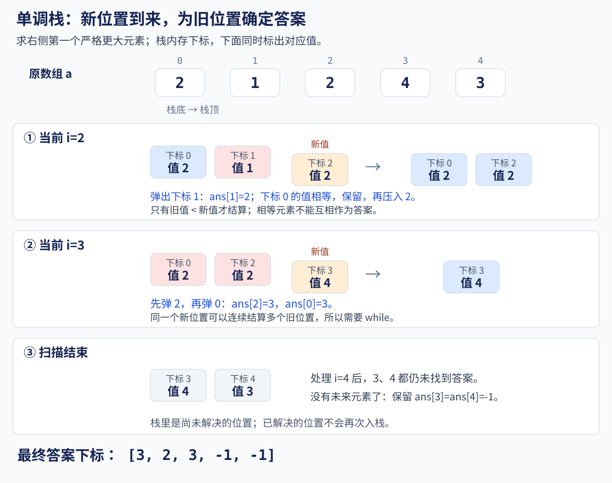
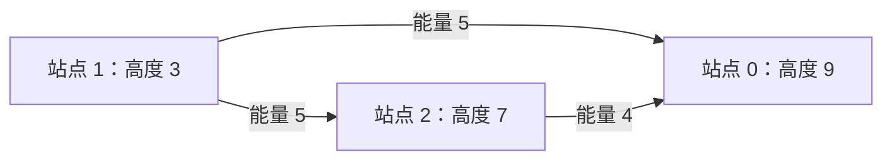

# 9.2 单调栈：让尚未解决的位置等待答案

前置：[stack 的基本操作](../01-basic-problem-solving/04-stl/containers/05-stack.md)、数组下标与顺序扫描。

本节不重新实现栈，而是用 STL 栈保存**尚未找到答案的位置**，解决“某个方向上第一个更大或更小的元素”这类问题。

> **关键不在于强行把数据排成单调，而在于：新元素到来后，哪些旧位置的答案已经可以确定？**

## 1. 从右侧第一个更大元素入手

数组：

$$
a=[2,1,2,4,3].
$$

对每个位置 i，寻找右侧满足条件的**最小下标 j**：

$$
j\gt i,\qquad a[j]\gt a[i].
$$

这里要求最近的位置，不是右边最大的值。

例如位置 1 的值是 1，右侧第一个更大值为位置 2 的 2；不必等到后面的 4。

每个位置都单独向右扫描，最坏为 O(n²)。如果数组一直下降，几乎每个位置都要看到末尾。

**改为从左到右扫描：暂时找不到答案的位置先存起来，新值到来时一起检查。**

本节统一 **0-based**。返回答案下标，无解记为 **-1**；不把数组原来的顺序排序或打乱。

## 2. 用一个栈保存等待中的位置

### 栈里存下标，不只存值

- **a[i]**：位置 i 的值，比较时通过下标取回。

- **st**：已经扫描、但右侧第一个更大元素仍未出现的下标。

- **ans[i]**：位置 i 的答案下标；初始化为 -1，找到答案后才修改。

- **当前 i**：正在到来的新位置；它既可能解决旧位置，也要等待自己的答案。

数组与答案各有 n 项；栈最多保存 n 个下标。**容量按元素数量估计，不按 a[i] 的数值大小开数组。**

保存下标后，既能找到对应值，也能回填原位置的答案；以后若需要距离，还能由两个下标计算。

### 一步步扫描

栈中下标在表内按**栈底到栈顶**书写：

| 当前位置和值 | 新值能解决什么 | 处理后的栈下标 | 对应值 |
| --- | --- | --- | --- |
| i=0，值 2 | 暂无旧位置 | [0] | [2] |
| i=1，值 1 | 1 不大于 2 | [0,1] | [2,1] |
| i=2，值 2 | 为位置 1 找到答案；不能解决相等的位置 0 | [0,2] | [2,2] |
| i=3，值 4 | 依次解决位置 2、0 | [3] | [4] |
| i=4，值 3 | 3 不大于 4 | [3,4] | [4,3] |



最终答案为：

$$
ans=[3,2,3,-1,-1].
$$

**答案中存的是下标。** 例如 ans[0]=3，表示位置 3 的值 4，而不是答案值为 3。

## 3. 为什么只检查栈顶就够

处理前，等待中的值从栈底到栈顶**非递增，允许相等**。

如果栈顶的值都不小于当前值，更下面的值也不会小于当前值；当前元素不能解决其中任何一个位置。

如果当前值更大，就先解决栈顶；弹出后，新的栈顶还可能更小，因此必须继续检查。

> **这里弹栈的含义是“答案已经确定”，不是“这个值从此没有用”。**
>
> 原数组没有删除元素，只是不再让这个位置等待答案。

### 为什么得到的一定是“第一个”

假设位置 j 在处理 i 时弹栈：

$$
a[j]\lt a[i].
$$

i 确实在 j 的右边，而且更大。

如果 j 与 i 中间早就出现过更大值，那么处理那个位置时，j 就应当已经弹栈，不会一直等到现在。

即使当时上面压着其他位置，它们的值也不大于 a[j]，会先被那个更大值依次弹出。

所以在 j 之后，**当前 i 就是第一次遇到的更大元素**。

### 为什么弹完再压入当前下标

当前 i 要先为旧位置结算，再加入栈，等待未来的位置为它结算；不能把自己当作自己的右侧答案。

当所有比当前值小的栈顶都弹出后：

$$
a[st.top()]\ge a[i].
$$

如果栈仍非空，以上关系成立；再把 i 压入，仍保持从栈底到栈顶非递增。

**栈里下标按处理顺序递增，值按比较规则保持单调。两个含义要分开。**

## 4. C++11 通用实现

输入长度须可用 int 表示，内存足够。a 的值使用 ll，函数只做比较，不对元素做加减；支持负数、重复值和 ll 两端值。

```cpp
using ll = long long;

// 返回每个位置右侧第一个严格更大元素的下标
// 0-based，无解为 -1；不修改输入，空数组返回空答案
vector<int> next_greater_right(const vector<ll>& a) {
    int n = static_cast<int>(a.size());
    vector<int> ans(n, -1);
    stack<int> st; // 下标对应的位置还在等待右侧答案

    for (int i = 0; i < n; ++i) {
        // 当前 a[i] 是这些位置遇到的第一个更大值
        // 一个新值可能连续解决多个旧位置，所以使用 while
        while (!st.empty() && a[st.top()] < a[i]) {
            int j = st.top();
            st.pop();

            ans[j] = i; // 给被弹出的位置回填答案，不是给 i 填答案
        }

        st.push(i); // 当前元素也要等待它自己的右侧答案
    }

    // 扫描结束仍在栈中的位置没有答案，保留初始值 -1
    return ans;
}
```

沿用[竞赛基础框架](../../templates/01-basic-problem-solving/cpp-contest-template/README.md)，依赖 vector 和 stack；所有状态在函数内创建，**多测无需清理全局数组或栈**。

### 对照调用

```cpp
void demo() {
    vector<ll> a = {2, 1, 2, 4, 3};
    auto ans = next_greater_right(a);

    for (int x : ans) cout << x << ' ';
    cout << '\n'; // 3 2 3 -1 -1
}
```

如果题目使用 1-based，并要求无解输出 0，可以统一把本函数的返回下标加 1；**只转换答案编号，不改变原始数值。**

## 5. 相等元素与四种比较条件

以 `[2,2,3]` 为例：

- 找右侧第一个**严格更大**：位置 0 的答案是位置 2；相等的 2 不满足要求。

- 找右侧第一个**大于等于**：位置 0 的答案是位置 1。

因此，当前值能不能为旧位置结算，必须从目标关系直接推导。

下表只对应本文这种**从左到右、弹栈时为旧位置结算**的写法：

| 要找右侧第一个什么元素 | 结算条件 | 弹栈结束后，栈内值的顺序 |
| --- | --- | --- |
| 严格更大 | `a[st.top()] < a[i]` | 非递增，允许相等 |
| 大于等于 | `a[st.top()] <= a[i]` | 严格递减 |
| 严格更小 | `a[st.top()] > a[i]` | 非递减，允许相等 |
| 小于等于 | `a[st.top()] >= a[i]` | 严格递增 |

**不要只背“递增栈／递减栈”的名称。先说清栈从哪端看、要找什么、何时弹栈。**

其他单调栈写法可能先删除候选、再给当前位置查询答案；弹栈的语义不同，不能直接照搬这里的等号规则。

### 如果要找左侧最近位置

仍采用“新位置为等待中的旧位置结算”的视角，可以把扫描方向改为**从右向左**：

```cpp
// 其他结算逻辑不变时，得到每个位置左侧第一个严格更大的下标
for (int i = n - 1; i >= 0; --i) {
    // 比较当前 a[i] 与栈顶，结算旧位置，再将 i 入栈
}
```

这是方向变化的示意，完整实现仍以本节主函数为准。n 使用 int，避免空数组时无符号的 `n-1` 下溢。

**最近**由扫描顺序保证；**更大／更小、是否相等**由比较条件保证。

## 6. 为什么 while 套 for 仍是 O(n)

一次扫描可能弹出很多元素。例如一个大值到来，可以一次解决前面所有较小值。

但对每个下标来说：

- **只会入栈一次**。

- **一旦出栈，就不再重新入栈**。

所以整个过程的入栈与出栈总次数满足：

$$
\text{入栈次数}=n,\qquad \text{出栈次数}\le n.
$$

不能把每轮 while 都独立按 n 估计，因为这些出栈操作共享同一批元素。

$$
\text{总时间}=O(n),\qquad \text{额外空间}=O(n).
$$

这是整个扫描的总量分析，不是承诺每个位置都只做一次比较。递减或全相等数组可能让栈保留 n 个元素，因此空间最坏仍为 O(n)。

## 7. 边界与使用范围

| 情况 | 主函数的行为 |
| --- | --- |
| 空数组 | 返回空答案，不访问栈顶 |
| 单元素 | 没有右侧位置，答案为 -1 |
| 全相等 | 严格更大要求不成立，全部无解 |
| 严格递增 | 除最后一项外，答案都是后一位 |
| 严格递减 | 没有右侧更大值，全部无解 |
| 栈被连续弹空 | while 先检查 empty，不能直接读 top |
| 数值很大 | 只比较，不按值分配空间，也不必做数值相减 |

**适合的线索：**保留原顺序、沿一个方向寻找最近的大小关系，或者需要由这些边界继续统计。

它不直接回答任意指定区间的最值，也不是排序后找后继；排序会破坏原来的左右和距离关系。

与已有[滑动窗口最值的讨论](../02-sequence-techniques/05-sliding-window.md#最值为什么需要额外结构)联系起来：

- 本节处理等待答案的位置，没有固定窗口的过期条件。

- 窗口最值还要移除已经离开左边界的候选，需要后续的**单调队列**等方法，不能直接把本函数当成窗口最大值模板。

完整数据结构选型与场景成本比较，留到本章收尾。

## 8. 典题与复盘

两份原实现已完成本地核验，**平台结果未单独记录**。以下仅整理排版与注释，保留原逻辑；通用头文件、类型别名和 main 沿用[基础框架](../../templates/01-basic-problem-solving/cpp-contest-template/README.md)。

### 8.1 [P5788 【模板】单调栈](https://www.luogu.com.cn/problem/P5788)

求右侧第一个严格更大元素的下标。题目要求 **1-based，无解输出 0**；n≤3×10⁶，值为 1..10⁹。

**收录原因：**把内部数组下标与输出编号分开，按答案的合法范围选择缺失标记。

#### 原实现

数组与栈使用 0-based，下标 j 被弹出时，当前 i 就是它要找的位置；存入答案时直接转换成题目要求的 i+1。

```cpp
void solve() {
    int n;
    cin >> n;

    vector<int> a(n);
    for (int& x : a) cin >> x;

    stack<int> st;
    vector<int> ans(n); // 全部初始化为 0，恰好表示题目要求的无解

    for (int i = 0; i < n; ++i) {
        while (!st.empty() && a[st.top()] < a[i]) {
            int j = st.top();
            st.pop();

            ans[j] = i + 1; // 内部下标 i -> 题目输出编号 i+1
        }

        st.push(i);
    }

    for (int x : ans)
        cout << x << ' ';
}
```

#### 为什么没有写 -1 也正确

这里 ans 保存的是**输出编号**，而非内部 0-based 下标：

$$
\text{合法编号}=1..n,\qquad \text{无解标记}=0.
$$

0 不会与任何合法答案混淆。扫描结束仍在栈内的位置，不曾被赋予有效编号，保留 0 即可。

通用函数采用“内部下标／无解 -1”，原题实现采用“输出编号／无解 0”；**两种定义都成立，只要初始化、赋值、输出始终一致**。

重复值不满足严格更大，比较条件保留 <。每个下标入栈一次、至多出栈一次，正确性与主函数相同。

时间 O(n)，输入、答案与栈共 O(n) 空间。原方案已经简洁合适，推荐沿用，不另造相同算法的第二份实现。

**状态：复盘完成，本地核验通过；平台结果未单独记录。**

### 8.2 [P1901 发射站](https://www.luogu.com.cn/problem/P1901)

高度互不相同。每个站发出的能量，由左右两边最近且更高的站接收；求接收量的最大值。

N≤10⁶，高度≤2×10⁹，能量≤10⁴；**题面保证答案不超过 32 位有符号整数范围**。

**收录原因：**先明确一条关系是否存在，再按真实关系分发贡献；把“去向”和“累计量”分开保存，避免缺失位置伪装成合法下标。

#### 原思路：先算去向，再累加接收量

- **h[i]、v[i]**：站点 i 的高度与发射能量。

- **r[i]、l[i]**：右侧、左侧最近更高站的 0-based 下标；不存在时为 -1。

- **e[i]**：站点 i 已接收的总能量，初始为 0；零接收量是合法状态。

先从左向右给旧位置结算右侧答案，再清空栈，从右向左给旧位置结算左侧答案。

**扫描方向变了，栈的待解状态也必须重新建立。**

#### 原实现

```cpp
void solve() {
    int n;
    cin >> n;

    vector<int> h(n), v(n);

    for (int i = 0; i < n; ++i)
        cin >> h[i] >> v[i];

    stack<int> st;
    vector<int> r(n, -1), l(n, -1); // 缺失去向不能与真实站点 0 混淆

    for (int i = 0; i < n; ++i) {
        while (!st.empty() && h[st.top()] < h[i]) {
            int j = st.top();
            st.pop();

            r[j] = i;
        }

        st.push(i);
    }

    st = stack<int>(); // 清空上一轮剩余位置，重新建立反向扫描的状态

    for (int i = n - 1; i >= 0; --i) {
        while (!st.empty() && h[st.top()] < h[i]) {
            int j = st.top();
            st.pop();

            l[j] = i;
        }

        st.push(i);
    }

    vector<int> e(n); // 接收量从 0 开始；这里的 0 不是“位置不存在”

    for (int i = 0; i < n; ++i) {
        if (l[i] != -1) e[l[i]] += v[i];
        if (r[i] != -1) e[r[i]] += v[i];
    }

    int mx = 0;

    for (int i = 0; i < n; ++i)
        mx = max(mx, e[i]);

    cout << mx << '\n';
}
```

#### 用一个小例子区分“发送者”与“接收者”

高度为 `[9,3,7]`，发射能量为 `[2,5,4]`：

| 发送站 i | 左侧去向 l[i] | 右侧去向 r[i] | 实际分发 |
| --- | --- | --- | --- |
| 0 | -1 | -1 | 无接收站，不累加 |
| 1 | 0 | 2 | 给站点 0、2 各加 5 |
| 2 | 0 | -1 | 给站点 0 加 4 |



接收量为：

$$
e=[9,0,5].
$$

**遍历的是发送者 i，累加的是接收者 e[l[i]]、e[r[i]]，不是 e[i]。** 原题两侧分别接收一份 v[i]，不是把 v[i] 平分。

#### 缺失去向如果误用 0，会发生什么

下面是用于对照的错误写法，**不是原实现**：

```cpp
vector<int> r(n), l(n); // 错误：默认的 0 被后续当成真实站点下标
```

例如只有一个站点，高度 7、能量 5，实际没有接收站，正确结果是 0。

如果 l[0]、r[0] 都为 0，后面的 `!= -1` 判断都会通过，能量会被错误加回站点 0 两次，得到 10。

**这不是数组越界，而是合法下标承载了错误的语义，所以更隐蔽。**

原实现用 -1 明确表示不存在，只有通过检查的去向才参与累加。

#### 正确性、类型与取舍

两次扫描分别确定左右最近更高的位置，之后按每条真实接收关系累加一次。因此每个站点的 e 恰好等于所有发向它的能量之和，再取最大值即可。

边界包括：单站、递增或递减高度、一侧缺失、只有最高站接收以及多站向同一站累加。

**本题原实现使用 int 有题面保证支撑。** 能量均非负，每次部分累计不超过该站最终接收量，而最终最大接收量保证在范围内；不能只因使用了累加就断言这里必须改 ll。移植到不含这个保证的题目时，应重新估计累计上界。

时间 O(n)，额外空间 O(n)。原版把“计算去向”与“按去向统计”分开，便于检查两个阶段的语义，推荐保留。

只需要最终接收量时，也可以在关系确定时立即累加，省去 l/r 两个数组；但这不是必要修复，本节不为减少常数而重写原方案。

**状态：复盘完成，本地核验通过；平台结果未单独记录。**

### 8.3 通用经验：存在性、零值和编号分别定义

> **先定义合法值域与缺失状态，再决定初始化；不存在不能与真实值混淆，但不要求所有场景都用 -1。**

`vector<int>(n)` 会把元素初始化为 0，并非没有初始化。关键是：**这个 0 接下来会被解释成什么？**

| 保存的内容 | 合法值 | 合适的初始或缺失状态 |
| --- | --- | --- |
| P5788 的输出编号 | 1..n | 0 表示无解 |
| P1901 的接收者下标 | 0..n-1 | -1 表示不存在 |
| 接收能量、频次、空集合累计量 | 可以合法地为 0 | 从 0 开始累计 |
| 恰好型 DP 的最大段数 | 可达时可为 0 | 用 -1 或负无穷区分不可达 |
| 求最小费用的 DP | 可达时可为 0 | 常用 INF 表示不可达，转移前检查 |
| 所有数值都可能合法 | 没有可借用的特殊值 | 另存 bool 等存在标记 |

这与已有 [DP 初始化：存在、零值与不可达](../05-dynamic-programming/01-dp-basics.md#6-初值不只是填一个数组)是同一条原则。

还要注意**标记参与后续运算的方式**：-1 不能直接当数组下标，INF 不能不加判断就继续加费用；缺失标记应先被识别，再决定是否参与访问或转移。

## 9. 自查与后续

1. 栈里为什么存下标，而不是只存值？ans 保存的是哪个量？

2. 新元素比栈顶大时，为什么能为栈顶确定最近答案？为什么需要 while？

3. 严格更大与大于等于，在相等值上分别怎样处理？

4. 一次弹出很多元素，为什么整个过程仍是线性？

5. 为什么 P5788 的 ans 可以用 0 表示无解，而 P1901 的 l/r 需要 -1，e 又应该从 0 开始？

同一次扫描也可以独立维护多个单调栈，例如分别寻找右侧第一个严格更大、严格更小的位置；各栈的比较条件与弹出含义分别判断，见[多状态协作](03-monotonic-queue.md#93-提炼多个状态协作分阶段完成一轮更新)。

两题原实现与复盘已完成本地核验，平台结果未单独记录；个人掌握另行核验。下一节继续[单调队列](03-monotonic-queue.md)，再进入树状数组等动态维护模型，不要求一次学完第九章。

竞赛短写法见[单调栈模板](../../templates/09-data-structures/monotonic-stack/README.md)：返回右侧第一个严格更大位置，不存在为 -1；其余比较关系按说明调整。
