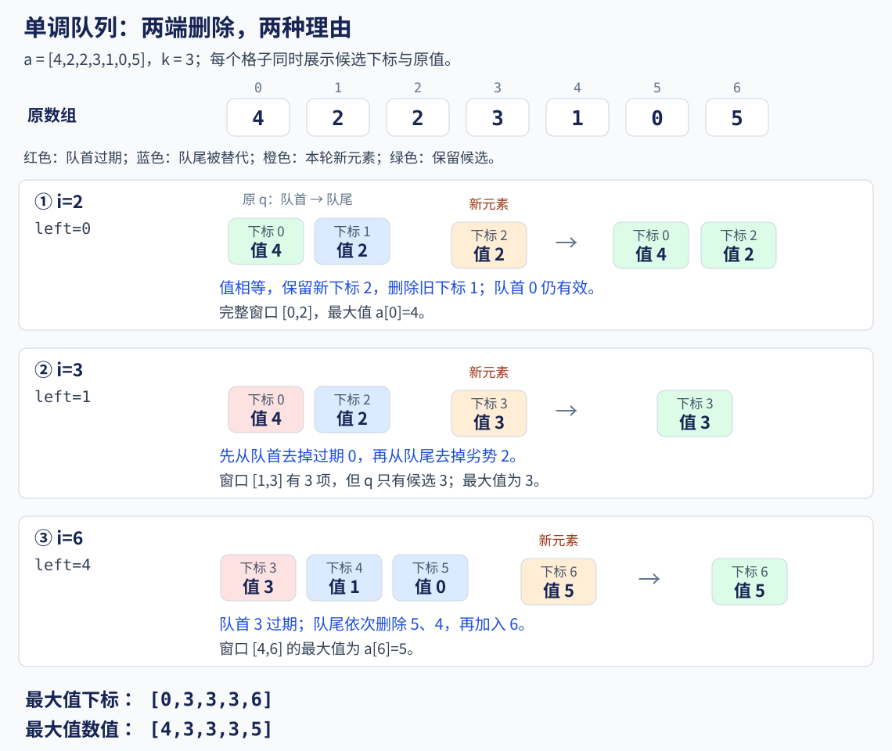
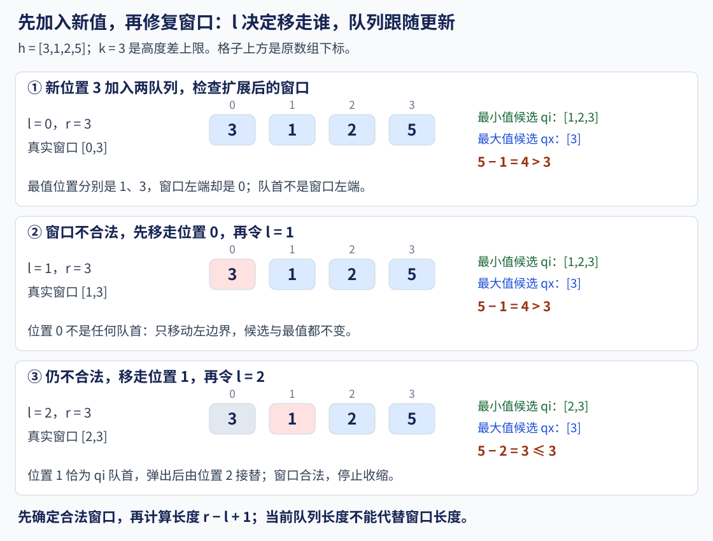

# 9.3 单调队列：只保留可能成为窗口最值的候选

前置：[deque 双端操作](../01-basic-problem-solving/04-stl/containers/04-deque.md)、[滑动窗口](../02-sequence-techniques/05-sliding-window.md)、[单调栈](02-monotonic-stack.md)。

滑动窗口已经解决“边界怎么移动”；本节补上**移动时如何维护最大值、最小值**。

> **队首删除已经过期的位置，队尾删除已经不可能更优的候选。**
>
> 两种删除各有依据，不能只记成“维护单调性时弹出”。

## 1. 为什么只记旧最大值不够

旧窗口 `[4,2,2]` 的最大值是 4。它离开后，新窗口 `[2,2,3]` 的最大值应为 3。

窗口和可以减去离开项，但最大值没有类似的减法。每次重扫长度为 k 的窗口，总时间最坏为 O(nk)。

**需要保存能接替最大值的位置，但不必保存所有位置。**

本节使用：

$$
a=[4,2,2,3,1,0,5],\qquad k=3.
$$

每个完整窗口的最大值为：

$$
[4,3,3,3,5].
$$

统一采用 **0-based**。主实现返回最值的下标，取 `a[index]` 才得到最值。

## 2. 模型变量与处理顺序

### 各变量保存什么

- **n**：数组长度；数组下标为 0..n-1。

- **k**：固定窗口长度，合法时满足 `1 <= k <= n`。

- **i**：本轮加入的右端位置。

- **left**：本轮窗口的左端，等于 `i-k+1`；完整窗口为闭区间 `[left,i]`。

- **q**：仍可能成为当前或后续窗口最大值的候选下标。下标从队首到队尾递增。

- **ans**：每个完整窗口的最大值下标；第 t 个答案对应起点为 t 的窗口。

q 按候选数量占空间，**不按数值大小分配**。它只保存部分窗口元素，q 的长度不是窗口长度。

### 主实现的四个步骤

1. **队首去过期：**移除小于 left 的下标。

2. **队尾去劣势：**移除值不大于新值的候选。

3. **加入新下标 i。**

4. **窗口凑够 k 项时，记录队首下标。**

**这是主实现采用的顺序，不是唯一合法顺序。** 两题原实现采用的“先去劣势”和“先加入、再收缩”见[过程复盘](#93-提炼多个状态协作分阶段完成一轮更新)。

名字叫单调队列，底层使用 `deque<int>`；普通 `queue<int>` 没有 `pop_back()`，不能直接完成这两端的删除。

## 3. 队尾为什么可以删除旧候选

假设旧位置 p 在新位置 i 前面，并且：

$$
p<i,\qquad a[p]\le a[i].
$$

新位置的值不小，而且出现得更晚。

对于之后继续右移的窗口，如果 p 还在窗口内，那么更晚的 i 也仍在窗口内；i 不会比 p 更早过期。

所以同时有两点：

- **比较值：**i 不比 p 差。

- **比较有效期：**i 可以保留得更久。

于是 p 不再需要作为最大值候选。若新值又被未来更优的位置替代，这个替代关系仍然成立。

> **删除的依据是“值不差，而且更晚过期”，不是只因为新值更大。**

本节遇到相等值时保留较新的下标。它不会改变最大值，但会影响“最大值来自哪个位置”，后面单独说明。

### 图解三次不同的处理



q 的内容按**队首到队尾**书写：

| 当前 i | 关键变化 | 处理后的 q 下标 | 完整窗口最大值 |
| --- | --- | --- | --- |
| 0 | 加入 4 | [0] | 未凑齐 |
| 1 | 加入 2 | [0,1] | 未凑齐 |
| 2 | 新的 2 替代旧的 2 | [0,2] | 4 |
| 3 | 0 过期；位置 2 又被新的 3 替代 | [3] | 3 |
| 4 | 加入 1 | [3,4] | 3 |
| 5 | 加入 0 | [3,4,5] | 3 |
| 6 | 3 过期；位置 5、4 被新的 5 替代 | [6] | 5 |

例如 i=3 时，真实窗口是 `[1,3]`，包含三个元素，而 q 只有一个下标 3。**候选队列不是窗口副本。**

## 4. 队首为什么要按下标判断过期

当前固定窗口为：

$$
[left,i]=[i-k+1,i].
$$

有效候选必须满足：

$$
q.front()\ge left.
$$

因此过期判断是：

```cpp
q.front() < left
```

**恰好等于 left 的位置仍属于窗口，不能提前删除。**

保存下标同时解决两个问题：

- 通过 `a[q.front()]` 得到候选值。

- 通过下标判断它是否已离开窗口。

候选下标递增，所以过期位置只会集中在队首。每次删除后继续检查新的队首，使用 while，避免把这个逻辑局限于左端只移动一格的情形。

## 5. C++11 通用实现

输入长度可用 int 表示，内存足够。a 使用 ll，下面只比较元素，不做数值相减，支持负数及 ll 两端值。

**接口约定：**返回每个完整窗口的最大值下标；相等时取窗口内最靠右的最大值。k 非法时返回空结果，空数组同样没有完整窗口。

```cpp
using ll = long long;

// 0-based；返回第 t 个窗口 [t,t+k-1] 的最大值下标
// 相等时保留较新位置；不修改输入，每次调用独立
vector<int> window_max_positions(const vector<ll>& a, int k) {
    int n = static_cast<int>(a.size());
    vector<int> ans;
    if (k <= 0 || k > n) return ans;

    ans.reserve(n - k + 1);
    deque<int> q; // 候选下标递增，对应值从队首到队尾严格递减

    for (int i = 0; i < n; ++i) {
        int left = i - k + 1;

        // 先去过期：这些位置已经离开当前窗口
        while (!q.empty() && q.front() < left) {
            q.pop_front();
        }

        // 再去劣势：当前值不小，且比旧候选更晚过期
        while (!q.empty() && a[q.back()] <= a[i]) {
            q.pop_back();
        }

        q.push_back(i);

        // 左端不为负，说明已经凑成一个完整窗口
        if (left >= 0) {
            ans.push_back(q.front());
        }
    }

    return ans;
}
```

依赖 vector 和 deque，沿用[基础框架](../../templates/cpp-contest-template/README.md)。所有状态局部初始化，多测无需清理全局队列。

### 对照调用

```cpp
void demo() {
    vector<ll> a = {4, 2, 2, 3, 1, 0, 5};
    auto pos = window_max_positions(a, 3);

    for (int i : pos) cout << i << ' ';
    cout << '\n'; // 下标：0 3 3 3 6

    for (int i : pos) cout << a[i] << ' ';
    cout << '\n'; // 数值：4 3 3 3 5
}
```

**先保存原值，再按真实候选得到最值。** 不能把最大值初始设为 0 后只取更大值，因为合法窗口可能全为负数。

## 6. 正确性与线性成本

### 为什么队首就是最大值

处理完当前 i 后，保持三件事：

1. **有效性：**候选都属于本轮已经加入的窗口部分。

2. **顺序：**候选下标递增，值严格递减，因此队首是保留候选中的最大值。

3. **不漏答案：**从队尾移除的位置都有一个不更小、且更晚过期的新位置代替，不会丢掉最大值。

队首移除过期项，队尾排除劣势项，再加入 i，以上性质可以继续保持。

窗口尚未凑齐时只维护候选；**满 k 项后才产生答案**。因此既不会输出不完整窗口，也不会漏掉第一个完整窗口。

### 为什么两个 while 仍是线性

每个下标：

- **入队一次**。

- **最多从队首或队尾删除一次；已经删除，就不会再进入队列**。

所以两端删除合计不超过 n 次：

$$
\text{总时间}=O(n).
$$

一轮可能连续删很多个候选，但不是每轮都能重新删同一批元素。

固定长度窗口内最多有 k 个候选：

$$
\text{工作队列空间}=O(k).
$$

本函数还保存全部返回下标：

$$
\text{结果空间}=O(n-k+1).
$$

因此包含输出容器在内的总额外空间为 O(n)，不能只写 O(k)。若处理一个窗口就立刻输出，则可以不保留结果数组。

## 7. 相等值、最小值与扫描边界

### 四种队尾条件

下表仍采用“新位置替代旧候选”的维护方式；**队首过期规则不变**。

| 目标与同值选择 | 队尾删除条件 | 保留下来的值顺序 |
| --- | --- | --- |
| 最大值，同值取较新位置 | `a[q.back()] <= a[i]` | 严格递减 |
| 最大值，同值取较早位置 | `a[q.back()] < a[i]` | 非递增 |
| 最小值，同值取较新位置 | `a[q.back()] >= a[i]` | 严格递增 |
| 最小值，同值取较早位置 | `a[q.back()] > a[i]` | 非递减 |

例如 `[2,2,1]`、k=2，第一个窗口的最大值都是 2；主实现返回下标 1，保留较早位置的版本则返回下标 0。

**只求最值时，两种等号处理都能得到正确的值；还要位置时，必须与题目规则一致。**

这与单调栈“是否找到严格更大元素”的等号含义不同，不能只看运算符相似就混用。

### 变长窗口时什么变、什么不变

如果右端逐步加入，左端 left 也只向右移动，过期条件仍是：

```cpp
q.front() < left
```

变化在于 left 由外层问题的合法性决定，不再固定等于 i-k+1。

左端推进后，需要重新清除过期队首，再读取最值。

**单调队列负责维护候选，滑动窗口负责决定边界。** 是否可以收缩、何时更新答案，仍需要依据题目证明，不能仅凭“队列有序”推出窗口策略。

### 与上一节单调栈的区别

| 操作 | 上节：右侧第一个更大元素 | 本节：窗口最大值 |
| --- | --- | --- |
| 保存的下标 | 尚未找到右侧答案的位置 | 仍可能成为最值的候选 |
| 从尾部移除 | 为旧位置确定答案 | 旧候选已被新位置替代 |
| 从头部移除 | 主写法没有这项操作 | 旧候选已离开窗口 |
| 当前答案来源 | 新位置回填被弹出位置的答案 | 读取有效队首 |

## 8. 边界与不适用情况

- **k=1：**每个窗口只有当前元素，最值下标就是当前 i。

- **k=n：**只产生一个完整窗口的答案。

- **全相等：**主实现保留最新下标；不是把相等元素判成不合法。

- **全负数：**最值仍从候选读取，不以 0 代替。

- **窗口左端：**下标等于 left 仍有效；小于 left 才过期。

- **空队列：**任何 front/back 访问前先确认非空；加入 i 后才读取本轮答案。

- **边界回退：**被删除的候选无法自动恢复，本节只适用于边界按上述方向推进的场景。

- **频次、总和等其他目标：**队列没有保留整个窗口，不能拿 q.size() 当元素数，也不能直接用候选计算窗口总和。

如果数据需要任意位置修改、询问的区间顺序也不受限制，需按条件选择 ST 表、线段树等其他工具；这些后续整理，本节不展开。

## 9. 典题与复盘

两份原实现均保留逻辑，仅调整排版与过程注释；**本地核验通过，平台结果未单独记录**。

### 9.1 [P1886 【模板】单调队列 / 滑动窗口](https://www.luogu.com.cn/problem/P1886)

固定长度 k 的窗口依次滑动，分别输出最小值、最大值；**先输出最小值一行，再输出最大值一行**。

范围：`1 <= k <= n <= 10^6`；元素在 32 位有符号整数范围内，可以为负数。

#### 从一个最值扩展到两个最值

**窗口只有一份，候选状态可以有多份。**

- qx 维护最大值候选，值从队首到队尾严格递减。

- qi 维护最小值候选，值从队首到队尾严格递增。

- 两者读取同一个新下标 i，也使用同一个窗口左端 left；各自独立删除候选。

这属于**同一次扫描中并行维护两个状态**，不需要让两个队列互相嵌套。一个位置从 qx 删除，不代表也应从 qi 删除。

#### 原实现

内部下标为 0-based；mx、mi 保存的是最值下标，输出时再访问原值。

```cpp
void solve() {
    int n, k;
    cin >> n >> k;

    vector<int> a(n);
    for (int& x : a) cin >> x;

    deque<int> qx, qi;
    vector<int> mx, mi;

    for (int i = 0; i < n; ++i) {
        int left = i - k + 1;

        // 新值先替代不更好的旧候选；两个队列各自判断
        while (!qx.empty() && a[qx.back()] <= a[i]) {
            qx.pop_back();
        }
        while (!qi.empty() && a[qi.back()] >= a[i]) {
            qi.pop_back();
        }

        // 再排除窗口外的位置，等于 left 的位置仍有效
        while (!qx.empty() && qx.front() < left) {
            qx.pop_front();
        }
        while (!qi.empty() && qi.front() < left) {
            qi.pop_front();
        }

        qx.push_back(i);
        qi.push_back(i);

        if (left >= 0) {
            mx.push_back(qx.front());
            mi.push_back(qi.front());
        }
    }

    for (int p : mi) cout << a[p] << ' ';
    cout << '\n';
    for (int p : mx) cout << a[p] << ' ';
}
```

**先去劣势，再去过期，这个顺序同样正确。** 第 5 节的教学实现先去过期，两者读取答案前都已排除无效候选。

过期位置只在候选队首形成前缀。从队尾去劣势时，即使顺便删到了过期项，也不会影响有效窗口的答案；之后仍会清掉残留过期项。

注意本份代码是“**去劣势 → 去过期 → 入队 → 读答案**”；还没有在清理过期项之前加入 i。下一题则明确先入队，再检查扩展后的窗口。

**推荐沿用原实现。** 已达到 O(n) 时间；两个工作队列占 O(k)，输入和结果数组使总空间为 O(n)。若要调整容器扩容次数，可为结果 reserve；不需要为减少重复代码引入复杂封装。

### 9.2 [CF 6E — Exposition](https://codeforces.com/problemset/problem/6/E)

保持书本原顺序，选择连续的一段，要求最高与最低书本的高度差不超过 k；求最长长度，并输出所有达到该长度的区间。

范围：n≤10⁵，`0 <= k <= 10^6`，高度为 1..10⁶；输出区间采用 1-based。

**这里 k 是高度差上限，不是固定窗口长度。**

#### 如何从题意推到过程

1. **连续区间、求最长：**枚举右端 r，尝试维护以 r 结尾的最长合法窗口。

2. **合法性依赖最大值和最小值：**用两份单调队列维护，不必每次重新扫描窗口。

3. **加入新值后可能不合法：**右端已经固定，只能向右收缩左端 l，直到高度差重新满足限制。

4. **再统计答案：**窗口合法后，才比较长度、清空旧答案或追加同长答案。

> **先接收新数据并更新候选，再修复整体窗口，最后读取答案。**
>
> 队列只解决“当前窗口最值是什么”，并不代替窗口合法性和答案收集逻辑。

#### 分清边界、候选和答案

| 变量 | 含义与容量依据 |
| --- | --- |
| l、r | 原数组的当前闭区间 `[l,r]`，内部均为 0-based |
| qi、qx | 该窗口的最小值／最大值候选下标，数量至多为窗口长度，不按高度值域开空间 |
| qi.front()、qx.front() | 当前最小值／最大值所在位置，**通常不等于 l** |
| best | 已处理右端中，最长合法窗口的长度 |
| ans | 所有达到 best 的 1-based 区间；最多 n 个 |

**窗口边界与候选下标有约束关系，但含义不同。** 队首可以越过一些仍在窗口内的普通元素，不能把队首当作窗口左端。

本实现每轮把 r 放到两个队尾，收缩时也不会删掉它，所以处理结束时两个 back() 恰好都是 r；**这不意味着应使用队列两端来定义窗口**。左端仍需独立维护，窗口长度始终是 r-l+1。

#### 图解：左端移动，不一定立刻改变最值

取高度 `[3,1,2,5]`，差值上限 k=3；加入最后一个 5：



| 步骤 | 当前窗口 | qi 候选下标 | qx 候选下标 | 最大值－最小值 |
| --- | --- | --- | --- | --- |
| 加入 r=3 | [0,3] | [1,2,3] | [3] | 5−1=4，不合法 |
| 移走位置 0 | [1,3] | [1,2,3] | [3] | 仍为 4 |
| 移走位置 1 | [2,3] | [2,3] | [3] | 5−2=3，合法 |

位置 0 的值 3 早已被新值 5 从最大值候选中替代，也不是最小值候选。**移走普通位置，只移动 l；移走队首候选，才弹出队首，让下一个候选接替。**

不是为了让队首变化而随意丢弃元素，而是窗口不合法时必须推进 l；队列据此同步移除过期候选。

#### 原实现

```cpp
void solve() {
    int n, k;
    cin >> n >> k;

    vector<int> h(n);
    for (int& x : h) cin >> x;

    deque<int> qi, qx;
    vector<pii> ans;

    int l = 0;
    int best = 0;

    for (int r = 0; r < n; ++r) {
        // 先更新最小值候选，较新同值位置也可以替代旧位置
        while (!qi.empty() && h[qi.back()] >= h[r])
            qi.pop_back();
        qi.push_back(r);

        // 同一新位置也要独立更新最大值候选
        while (!qx.empty() && h[qx.back()] <= h[r])
            qx.pop_back();
        qx.push_back(r);

        // 此时两队列都包含新位置，检查扩展后的窗口
        while (h[qx.front()] - h[qi.front()] > k) {
            // 将要离开的是 l；它恰为队首时才移除候选
            if (qi.front() == l)
                qi.pop_front();

            if (qx.front() == l)
                qx.pop_front();

            ++l;
        }

        // 修复完合法性，再统计当前右端能得到的最长窗口
        int len = r - l + 1;
        if (len > best) {
            best = len;
            ans.clear(); // 旧记录已不是全局最长
            ans.push_back({l + 1, r + 1});
        } else if (len == best) {
            ans.push_back({l + 1, r + 1});
        }
    }

    cout << best << ' ' << ans.size() << '\n';
    for (auto p : ans)
        cout << p.first << ' ' << p.second << '\n';
}
```

#### 为什么收缩正确，又不会漏掉答案

**固定 r，向右移动 l：**只会移除元素，最大值不会增大，最小值不会减小，高度差不会增大。

因此可以一直移除左端，直到首次合法；此时得到当前 r 的最长合法窗口。

**继续增大 r：**增加元素不会让一个原先不合法的区间变合法，已经排除的左端不需要回退。这也是 l 可以一直右移的依据。

每个右端只需记录这个最长窗口。若某个全局最长区间以 r 结尾，而本轮还能找到更长合法窗口，就与“全局最长”矛盾；同一长度、同一右端的左端也是唯一的。因此不会漏掉最终的全部最长区间。

更新答案分两种情况：

- **len > best：**旧答案全部失效，先清空，再记录新窗口。

- **len == best：**保留已有答案，追加当前窗口。

#### 原实现成立的两个前提

**为什么这里用 if 判断队首等于 l？**

进入收缩时，候选都在 `[l,r]` 内；每次只移走一个位置 l，因此只需判断队首是否恰好就是它。两个队列独立判断，不能写成二选一的 else if。

若改为一次跳动多个左端，就应在移动后用 `while (front() < l)` 清掉所有过期候选，不能原样照搬这个 if。

**为什么收缩条件可以直接读取两个 front()？**

题目保证 k≥0，单个元素的最大值与最小值相同，总是合法：

$$
\max(h[r])-\min(h[r])=0\le k.
$$

收缩最迟在 `[r,r]` 停止，不会删掉本轮的新位置 r，所以两个队列不会变空。换成其他合法条件时，需要重新核对这个前提。

本题高度至多 10⁶，差值用 int 安全；推广到较大值域时，需根据范围在相减前转换类型，不能把“元素可存入 int”当成“差也不会溢出”。

**推荐沿用原实现。** r、l 各自最多推进 n 次，每个下标在每个队列中各入队一次、至多出队一次；收集和清空答案的总工作量也为 O(n)。总时间 O(n)，空间 O(n)，不需要为两题形式统一而改写正确流程。

### 9.3 提炼：多个状态协作，分阶段完成一轮更新

两题共同的核心是**新数据只扫描一次，不同状态各自更新，再共同参与判断**。

| 阶段 | 定长窗口 | 变长窗口 |
| --- | --- | --- |
| 接收右端 | 得到新下标 i | 得到新下标 r |
| 更新候选 | 两队列各自去劣势、加入新值 | 两队列各自去劣势、加入新值 |
| 维护窗口 | 按预定 left 清理过期项；也可提前完成 | 不合法时推进 l，并同步移除离开窗口的候选 |
| 收集答案 | 满 k 项后读队首 | 合法后比较 best，并维护 ans |

表格表达的是职责划分，**不是强制唯一的代码顺序**。第 9.1 节把过期清理放在入队前，第 9.2 节先扩展再修复，都可以正确维持各自约定。

可迁移的顺序是：**新输入影响哪些状态 → 哪些旧信息应被替代或失效 → 本轮何时满足读取答案的前提。**

“新值更合法”也宜说成“**作为最值候选不更差，且更晚过期**”；新值加入后，整个窗口反而可能变得不合法。

**多单调栈也可以协作。** 例如同一扫描用两个栈，分别等待右侧第一个严格更大、严格更小的位置；新位置触发各自弹栈结算，尚未解决的位置仍留在对应栈中。

与队列一样，一个位置可以同时属于两份状态，删除含义分别判断；两个栈仍各自进出 O(n) 次。P1901 已用[两次方向扫描](02-monotonic-stack.md#82-p1901-发射站)分别维护左右答案，这是另一种按需求拆分状态的方式。

> **多个容器能否配合，取决于每个容器的职责和更新依据，而不是它们都叫“单调结构”。**

单调栈的弹出通常是为旧位置结算答案，单调队列的队尾弹出则是替换候选；不能把这两种删除的含义混成一套规则。


## 10. 自查与后续

1. 新位置为什么能替代不大于它的旧候选？“更晚过期”起什么作用？

2. q.front()==left 时为什么不能删？q.size() 为什么不等于窗口长度？

3. <= 与 < 对最大值数值和最大值位置分别有什么影响？

4. 队尾删除与上一节单调栈弹栈的含义有什么不同？

### 动笔前，先把一轮过程推通

1. 写清真实区间由谁决定，各个容器保存什么。

2. 手推“加入新值 → 更新状态 → 修复合法性 → 收集答案”，确认每一步读取的状态有效。

3. 至少走一遍相等值、连续收缩、旧队首失效和只有一个元素的情况，再开始实现。

**先推演再下笔，可以减少在混杂条件中返工。** 不必等到所有细节都绝对确定才写代码；小样例、草稿或暴力程序仍可帮助验证和修正模型。

两题原实现与复盘已完成本地核验，平台结果未单独记录。下一节继续树状数组，认识带修改的前缀维护；本节正文整理、配题状态和个人掌握分别记录。

**定义对照：**[Minimum Queue](https://cp-algorithms.com/data_structures/stack_queue_modification.html#queue-modification-method-2) 也通过记录下标识别过期候选；本节直接查询原数组，以窗口左边界判断过期，并明确保留较新同值位置的约定。
