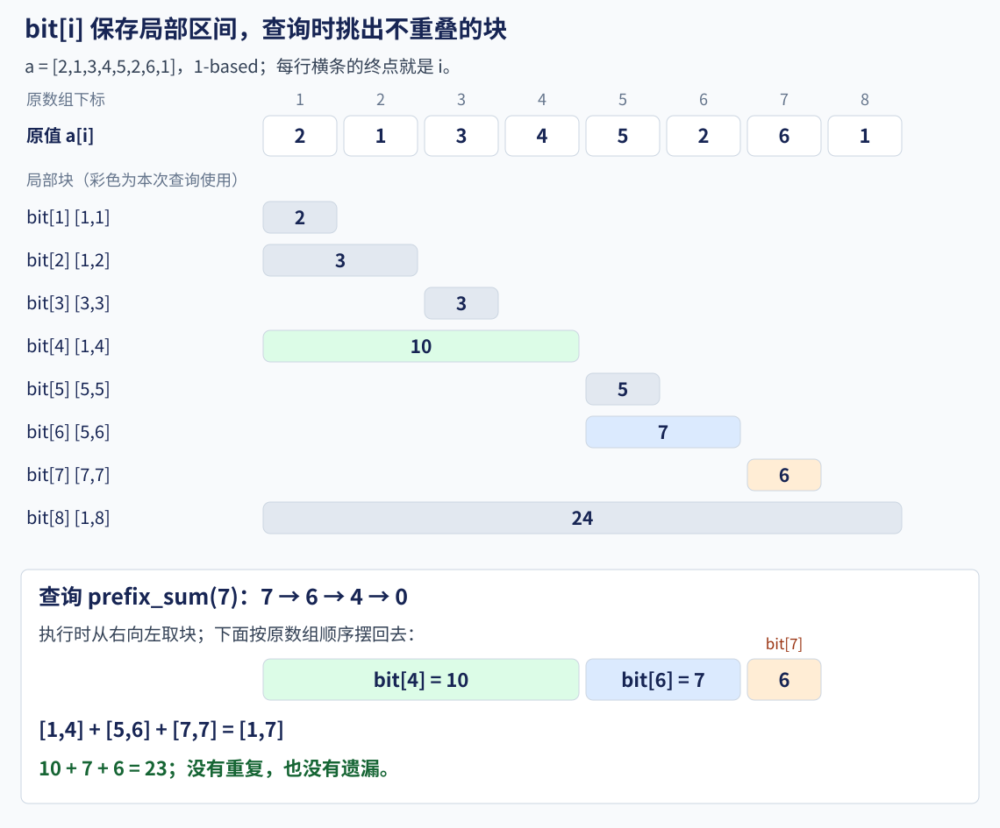
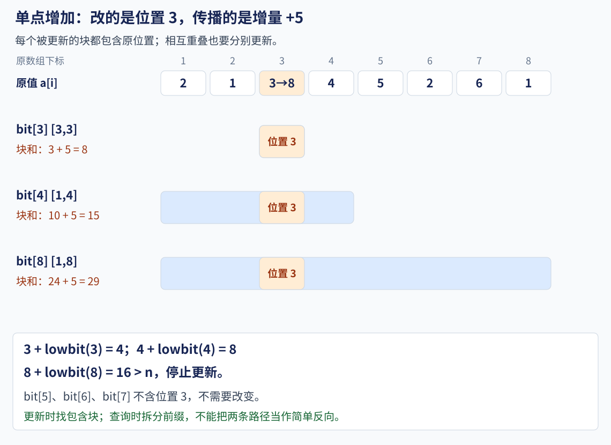

# 9.4 树状数组：单点修改与区间求和

前置：[一维前缀和](../02-sequence-techniques/01-prefix-sum.md#2-一维前缀和状态与推导)、[lowbit](../01-basic-problem-solving/05-bit-operations.md#7-lowbit-与-2-的幂)。

前缀和适合数据固定后的多次查询。本节增加**修改与查询交替发生时，及时得到区间和**的能力。

> **不保存每一个完整前缀，而是保存若干长度不同的局部区间和。**
>
> 查询时拼出前缀，修改时只更新包含该位置的相关区间。

## 1. 为什么普通前缀和不够

先看一个数组，统一采用 **1-based**：

$$
a=[2,1,3,4,5,2,6,1].
$$

如果把第 3 项增加 5，那么从第 3 项开始的所有前缀和都要增加 5。

只改 s[3] 不够；把 s[3] 到 s[n] 全部修改，又可能每次花 O(n) 时间。

**需要折中：查询不再只读一个完整前缀，修改也不必触碰所有后续前缀。**

| 维护方式 | 单点增加 | 一次区间求和 |
| --- | --- | --- |
| 只保存原数组 | O(1) | O(n) |
| 普通前缀和数组 | 最坏 O(n) | O(1) |
| 本节树状数组 | O(log n) | O(log n) |

树状数组也称 Fenwick Tree 或 BIT。实现仍然是数组，**不需要建立指针节点或邻接表**。

## 2. 变量与接口：先说明保存什么

- **n**：被维护的元素个数，合法元素下标为 1..n。

- **a[p]**：第 p 个原始元素的当前值；树状数组内部不额外保存完整 a。

- **bit[i]**：以 i 结束的一段局部区间和，长度由 lowbit(i) 决定，下面展开。

- **p、delta**：要修改的位置，以及该位置增加的量；delta 可以为负数。

- **r**：查询前 r 项之和时的右端；r=0 表示空前缀。

- **l、r**：区间查询的闭区间端点，满足 `1 <= l <= r <= n`。

bit 开 n+1 项，**按元素个数分配，不按元素最大值分配**。下标 0 不存原数组元素，也不参与更新。

本节公开接口也采用 **1-based**，不是“外部传 0-based、内部偷偷加一”的版本。

### 一次使用的流程

1. 创建大小为 n 的结构，此时所有元素视为 0。

2. 对每个初值调用一次 add，完成初始化。

3. 收到单点增加操作，调用 `add(p, delta)`。

4. 收到区间和询问，查询两个当前前缀，再相减。

**每轮操作先明确是增加量还是查询，不需要修改后重新构建。**

## 3. lowbit：这一项负责多长的区间

对正整数 i，lowbit(i) 是其二进制中**最低位的 1 所代表的数值**，不是第几位：

$$
\mathrm{lowbit}(i)=i\mathbin{\&}(-i).
$$

例如：

| i | 二进制 | lowbit(i) | bit[i] 管理的闭区间 |
| --- | --- | --- | --- |
| 3 | 0011 | 1 | [3,3] |
| 4 | 0100 | 4 | [1,4] |
| 6 | 0110 | 2 | [5,6] |
| 7 | 0111 | 1 | [7,7] |
| 8 | 1000 | 8 | [1,8] |

### 为什么选 lowbit：先拆前缀，再决定每项存什么

**希望查询前缀时，只取少量能首尾拼接的块；单点修改时，也只影响少量块。** 左端公式应当从这个设计目标推出。

前缀长度可以按二进制中的 1 拆成若干个 2 的幂。先看前 6 项：

$$
6=(110)_2=4+2.
$$

把长度 4 放在左边，长度 2 放在右边，得到：

$$
[1,6]=[1,4]\cup[5,6].
$$

查询到右端 6 时，需要能直接读取尾部的 [5,6]；因此让 bit[6] 保存这一块，剩下的前 4 项继续处理。

前 7 项则在刚才的右侧再多出一项：

$$
7=(111)_2=4+2+1.
$$

对应的分块为：

$$
[1,7]=[1,4]\cup[5,6]\cup[7,7].
$$

> **从右向左取块时，第一个取走的长度正好是二进制中最低位 1 的权值。** 所以保存尾块的规则自然是：以 i 结束，长度为 lowbit(i)。

### 一般推导：最低位对应右侧尾块，高位对应剩余前缀

将 i 拆成最低位 1 的权值 L，以及剩余高位所表示的数 b：

$$
L=\mathrm{lowbit}(i),\qquad i=b+L.
$$

**b 表示左侧还剩多少项，L 表示本次取走多少项。** 把前 i 项拆成这两部分：

$$
[1,i]=[1,b]\cup[b+1,b+L].
$$

尾块紧接在前 b 项之后，左端必须是 b+1；代入 b=i−L：

$$
[b+1,b+L]=[i-L+1,i].
$$

于是定义：

$$
\mathrm{bit}[i]=\sum_{j=i-\mathrm{lowbit}(i)+1}^{i}a[j].
$$

> **不是先猜出左端，再寻找解释；而是先按二进制确定要保存的尾块，再由剩余前缀的边界推出左端。**
>
> 左端 $j=i-\mathrm{lowbit}(i)+1$ 本质就是该块的起始点。

局部坐标中的 [1,L] 平移 b 位，确实也得到同一区间，但它只是这个分块结果的另一种表达，不能单独解释为什么选 lowbit。

若 i 只有一个 1，则 b=0，没有剩余高位，整个前缀就是本块：

$$
i=8\quad\Longrightarrow\quad L=8,\ b=0,\quad [b+1,i]=[1,8].
$$

查询时每次清掉一个 1，只取 O(log n) 个块；更新时受影响的块沿进位关系逐层扩大，也只有 O(log n) 个，见后面的更新推导。

**能接成前缀还不够，也要让修改足够快。** lowbit 的分层设计同时满足这两个目标，并不意味着其他区间划分都不能查询。

### 同一层的周期：重复的是块长，实际区间会平移

bit[i] 保存的是**一段原数组元素的和**。这里讨论的是这段有多少项，不是保存了多少个完整前缀和。

**为什么除了 1，块长不可能为奇数？** lowbit 只保留一个二进制位，因此块长只能是：

$$
L=2^t,\qquad t=0,1,2,\ldots.
$$

当这个 1 位于最低位时，块长为 1：

$$
t=0\quad\Longrightarrow\quad L=1.
$$

若这个 1 位于更高位，最低位就是 0，块长一定含因子 2：

$$
t\ge1\quad\Longrightarrow\quad L=2\cdot2^{t-1}.
$$

所以块长只能取 1、2、4、8……；其中只有 1 是奇数。3、5 等奇数的二进制最低位为 1，但还有其他 1，不可能是只保留一位的 lowbit 结果。

**注意区分下标与块长：奇数下标可以存在，它们的块长恰好都是 1。**

$$
i\text{ 为奇数}\quad\Longleftrightarrow\quad\mathrm{lowbit}(i)=1.
$$

固定某一层的块长 L。要让最低位 1 恰好是 L，下标必须是 L 的奇数倍：

$$
i=(2q+1)L,\qquad q=0,1,2,\ldots.
$$

所以同一层每隔 2L 再次出现：

$$
\mathrm{lowbit}(L)=\mathrm{lowbit}(3L)=\mathrm{lowbit}(5L)=\cdots=L.
$$

例如：

| 固定块长 L | 对应下标 i | 同层出现的间隔 |
| --- | --- | --- |
| 1 | 1、3、5、7…… | 2 |
| 2 | 2、6、10、14…… | 4 |
| 4 | 4、12、20、28…… | 8 |

在 i 上增加任意一个**比当前最低位 1 更高的位权**，不会改变低位，所以块长不变；但左右端都会随之平移。

例如在 6 上增加更高的位权 4：

$$
6+4=10,\qquad \mathrm{lowbit}(6)=\mathrm{lowbit}(10)=2.
$$

两块长度都是 2，实际区间则是：

$$
[5,6]\ \longrightarrow\ [9,10].
$$

若增加的恰好是**当前最低位的权值**，就会进位，块长反而改变：

$$
6+2=8,\qquad \mathrm{lowbit}(8)=8.
$$

**周期规律属于固定块长的这一层，不表示整个 lowbit 数列有一个固定的有限周期，也不表示块中的和相同。**


### 同一个例子的各个局部块



不同 bit 项的区间可以重叠，**同一个原值可以被多个块记录**。但查询会挑选不重叠的块，不能直接把所有 bit 项加起来。

为什么表达式能提取最低位 1？在常用的补码表示下，负数由取反加一得到：原数低位的 0 仍在相与后归零，最低位 1 被保留，更高位对应位置不能同时为 1。

这里仅对**正的、可用 int 表示的下标**计算，不把数组中的负值拿来当 lowbit 的参数。

## 4. 查询：已经加过的整块，直接跳过

查询前 7 项时，**从尾块开始**，先取以 7 结束的块：

$$
\mathrm{bit}[7]=a[7]=6.
$$

第 7 项已经处理，剩下的是前 6 项：

$$
7-\mathrm{lowbit}(7)=6.
$$

再取 bit[6] 对应的第 5、6 项，剩下前 4 项；最后 bit[4] 恰好覆盖第 1 到第 4 项。

$$
[1,7]=[1,4]\cup[5,6]\cup[7,7].
$$

三段互不重叠，也没有遗漏：

$$
\mathrm{prefix\_sum}(7)=10+7+6=23.
$$

**执行路径为 7 → 6 → 4 → 0。** 到 0 表示没有剩余元素，结束查询，不读取 $bit[0]$。

### 左端减一，就是剩余前缀的新右端

当前块为 [i−L+1,i]。取完它后，剩余部分只能在它左侧，因此新的右端是：

$$
i_{\mathrm{next}}=(i-L+1)-1=i-L.
$$

**不是从当前右端只减一，而是从当前块的左端再减一，跳过已经处理的整块。**

从区间上看，每次都是同一种拆分：

$$
[1,i]=[1,i-L]\cup[i-L+1,i].
$$

左边一段的右端是 i−L，右边一段的左端恰好是它加一，所以**两段相邻，没有空隙，也没有重叠**。

令 S(i) 表示当前前 i 项之和，S(0)=0，就得到递推关系：

$$
S(i)=S(i-L)+\mathrm{bit}[i].
$$

本块直接读取 bit[i]，剩余前缀继续用同一规则处理。直到右端为 0，所有块恰好拼成原前缀。

**剩余前缀通常还要继续拆，它不一定就是一个 bit 块。** 例如取完 bit[7] 后，剩余 [1,6]；下一步只取 bit[6] 的 [5,6]，还需继续处理 [1,4]。

### 相接要求边界相邻，不要求块长相等

本块左端减一，得到的是剩余前缀的右端 b，而不是当前块长 L：

$$
b=(i-L+1)-1=i-L.
$$

若再要求 b=L，就会额外得到 i=2L。但已经规定 L=lowbit(i)，而 L 是 2 的幂：

$$
i=2L\quad\Longrightarrow\quad\mathrm{lowbit}(i)=2L\ne L.
$$

**因此在 L=lowbit(i) 的前提下，i=2L 没有正整数解；这个等式混淆了“剩余前缀的右端”和“当前块长”。**

相接也不要求二进制中的两个 1 位于相邻位。以 5 为例，中间隔了一位 0：

$$
5=(101)_2=4+1.
$$

但对应的数组区间仍然恰好相邻：

$$
[1,5]=[1,4]\cup[5,5].
$$

**二进制位权可以跳过某一层，数组区间却不会因此留下空隙。** 前一块结束在 4，后一块就从 5 开始；查询路径为 5→4→0。

> **区间保存为一块，查询沿左端向前接下一块。**
>
> 不重不漏的依据是区间端点衔接，不只是代码恰好用了 lowbit。

## 5. 更新：所有包含修改位置的块，都加上增量

仍把 a[3] 增加 5。n=8 时，需要更新：

| bit 项 | 原来负责的区间 | 为什么要改 | 更新后的值 |
| --- | --- | --- | --- |
| bit[3] | [3,3] | 包含位置 3 | 3+5=8 |
| bit[4] | [1,4] | 包含位置 3 | 10+5=15 |
| bit[8] | [1,8] | 包含位置 3 | 24+5=29 |

bit[5]、bit[6]、bit[7] 都只管理位置 3 右侧的区间，不需要改变。



**执行路径为 3 → 4 → 8，下一步 16 超过 n，结束。** 每次沿下面的规则走向更大的包含块：

$$
i\gets i+\mathrm{lowbit}(i).
$$

### 为什么加上自己的 lowbit，就找到下一个包含块

这里“全部包含区间”指的是 **bit 中已经保存的那些块**，不是原数组中所有任意端点的区间。

原修改位置始终是 p；循环中的 i 是当前要更新的块的右端，后面会不断改变。

#### 先看进位：块长为什么会扩大

以原例的第一步为例：

$$
3=(0011)_2,\qquad \mathrm{lowbit}(3)=(0001)_2.
$$

加上最低位 1 的权值，最低位发生进位；上面若仍为 1，进位会继续：

$$
(0011)_2+(0001)_2=(0100)_2.
$$

所以右端从 3 变为 4，块长则从 1 变为 4。**由于进位，新块长至少翻倍，不一定恰好翻倍。**

一般地，令当前块长为 L，下一块的右端为 j：

$$
L=\mathrm{lowbit}(i),\qquad j=i+L.
$$

利用前面得到的“同层下标是 L 的奇数倍”，可以写成：

$$
i=(2q+1)L\quad\Longrightarrow\quad j=(2q+2)L=2(q+1)L.
$$

j 至少含有因子 2L，因此新的最低位 1 的权值至少是 2L：

$$
\mathrm{lowbit}(j)\ge2L.
$$

#### 新块一定包含旧块，因此不会多改无关块

旧块的左端是 i−L+1。新块的右端变为 i+L，长度却至少增加到 2L：

$$
j-\mathrm{lowbit}(j)+1
\le(i+L)-2L+1
=i-L+1.
$$

**新右端更靠右，新左端不更靠右**，所以整个旧块都被包含：

$$
[i-L+1,i]\subseteq[j-\mathrm{lowbit}(j)+1,j].
$$

第一次从 i=p 开始，该块一定包含 p；以后每个新块又包含旧块，因此每次访问到的块都包含 p。

**给这些块各加一次 delta，恰好反映原位置的变化；没有访问到与 p 无关的块。**

#### 中间跳过的块为什么都不包含 p

还需要排除一种担心：下标从 i 直接跳到 i+L，会不会漏掉中间也包含 p 的块？

把中间任意一个下标写成 i+d：

$$
0<d<L.
$$

因为 L 是 i 的最低位 1，i 在这一位以下原本全是 0。加入小于 L 的 d 后，低位变成 d，不向 L 那一位进位：

$$
\mathrm{lowbit}(i+d)=\mathrm{lowbit}(d)\le d.
$$

因此，这个中间块的左端至少为：

$$
(i+d)-\mathrm{lowbit}(i+d)+1
\ge(i+d)-d+1
=i+1.
$$

原修改位置 p 不会在当前右端 i 的右侧，于是：

$$
p\le i<i+1\le\text{中间块左端}.
$$

**所有被跳过的块都从 i 的右侧开始，不包含 p，所以本来就不该修改。** L=1 时，中间没有下标，直接进入下一块即可。

#### 从起点到终点：为什么已经覆盖全部

- **起点之前：**右端小于 p 的块，不可能包含 p，不需要访问。

- **每次跳转：**下一个访问块包含 p；中间跳过的块都不含 p。

- **结束时：**若 i+L 已超过 n，那么任取一个尚未检查、但仍在数组内的右端 k，都满足：

  $$
  i<k\le n<i+L\quad\Longrightarrow\quad 0<k-i<L.
  $$

  令 d=k−i，就得到前面证明过的 k=i+d、0<d<L，因此这些块的左端都至少为 i+1，不包含 p；下标更大的块已经超出数组，无需更新。

右端每次严格增大，所以同一个 bit 项不会重复更新：

$$
i_{\mathrm{next}}=i+L>i.
$$

块长每次又至少翻倍，形成逐层扩大的包含关系，所以最多经过 O(log n) 个块。

> **进位保证下一个块包含当前块，低位分析保证中间没有漏掉相关块。**
>
> 更新块之间允许重叠；“不重复”指每个应更新的 bit 项只加一次，不是要求这些块互不重叠。

查询与更新的共同点是使用局部块，但**不是把同一条路径反向走**：

> **查询负责拆分前缀，更新负责找到受影响的块**。

## 6. C++11 通用实现

约定 $0\le n<2^{30}$ 且内存足够，保证下面的 int 下标上跳安全。树中各块的和、查询累加与相减的中间结果均须可用 ll 表示。

```cpp
using ll = long long;

// x 是正的下标；返回最低位 1 对应的数值
int lowbit(int x) {
    return x & -x;
}

struct Fenwick {
    int n;
    vector<ll> bit;

    // 全部原始元素初始为 0；每组数据重新构造
    explicit Fenwick(int n) : n(n), bit(n + 1, 0) {}

    // 1 <= p <= n；将第 p 项增加 delta，不是赋值为 delta
    void add(int p, ll delta) {
        for (int i = p; i <= n; i += lowbit(i)) {
            bit[i] += delta; // 每个访问到的块都包含原位置 p
        }
    }

    // 0 <= r <= n；返回当前闭区间 [1,r] 的和
    ll prefix_sum(int r) const {
        ll ans = 0;

        for (int i = r; i > 0; i -= lowbit(i)) {
            ans += bit[i]; // 加入本块，下一步查询剩余前缀
        }

        return ans;
    }

    // 1 <= l <= r <= n；两个前缀相减，保留 [l,r]
    ll range_sum(int l, int r) const {
        return prefix_sum(r) - prefix_sum(l - 1);
    }
};
```

只依赖 vector 与 ll；沿用[竞赛基础框架](../../templates/cpp-contest-template/README.md)。explicit 的用途与[并查集构造函数](01-dsu.md#5-c11-主写法)相同，避免把一个整数隐式转换成整个结构。

这里的 p 和 r 都是按值传入，循环使用局部 i；查询不修改结构，add 只更新内部 bit，**不会同步修改外部 a**。

### 对照调用

```cpp
void demo() {
    // a[0] 留空；真实元素在 [1,8]
    vector<ll> a = {0, 2, 1, 3, 4, 5, 2, 6, 1};
    int n = static_cast<int>(a.size()) - 1;
    Fenwick ft(n);

    for (int p = 1; p <= n; ++p) {
        ft.add(p, a[p]); // 初值也通过“单点增加”放入结构
    }

    cout << ft.prefix_sum(7) << '\n'; // 23

    ft.add(3, 5);
    cout << ft.range_sum(3, 6) << '\n'; // 19
    cout << ft.range_sum(1, 8) << '\n'; // 29
}
```

**构造不是自动读入初值。** 上例不再使用外部 a 的当前值，所以修改后不需要同步它；若后面还要读取或用它计算增量，就应另行维护。

> 若题目要求“把 a[p] 改成 value”，应先得到旧值，再用 **value−旧值** 调用 add；旧值可由自己维护的数组或 `range_sum(p,p)` 获得。

## 7. 复杂度与适用边界

### 为什么操作只需 O(log n)

查询时，减去最低位 1 的权值，等价于清除这一位：

$$
i-\mathrm{lowbit}(i)=i\mathbin{\&}(i-1).
$$

例如查询前 7 项，右端的二进制变化为：

$$
(111)_2\longrightarrow(110)_2\longrightarrow(100)_2\longrightarrow(000)_2.
$$

每次去掉当前最低位的 1，下一次使用更高位对应的块；这个例子取出的块长依次为 1、2、4。

**查询步数恰好等于起始右端 r 中的 1 的个数。** 当 r≥1 时：

$$
T(r)=\mathrm{popcount}(r)\le\lfloor\log_2r\rfloor+1\le\lfloor\log_2n\rfloor+1.
$$

所以最坏为 O(log n)；r=0 时不进入循环。**并非下标每次都减半，而是每次清掉一个二进制位。**

> **块长按 2 的幂分层，查询按剩余前缀的边界递推**；这两件事结合，才同时得到不重不漏与对数级步数。

更新时，**`i += lowbit(i)` 会让最低位 1 向更高位移动，其对应块长至少翻倍，直到下标超过 n**。

| 操作 | 时间 |
| --- | --- |
| 创建全零结构 | O(n) |
| 逐项 add 初始化 | O(n log n) |
| 单点增加 | O(log n) |
| 前缀和、区间和 | O(log n) |

空间 O(n)。还有 O(n) 建树写法，基础阶段先保留逐项 add，避免同时记两份初始化逻辑；有实际需求时再补。

### 本节能做什么，不能直接套什么

- **修改值可以增大或减小：**正负 delta 均可，查询和不依赖前缀单调。

- **查询端点可以任意变化：**不要求像单调队列那样，让窗口两端只向右移动。

- **区间和仍来自两个前缀相减：**并没有丢掉前缀和的思想，只是改变前缀信息的保存与获取方式。

- **区间最值不能照搬：**不能把代码里的加法换成 max，再用两个前缀最大值相减得到区间最大值。

- **区间增加不是本接口的直接操作：**本节 add 只改一个位置。[维护差分的转化](#92-p3368-模板树状数组-2)可以组合这个接口，但不能将单次 `add(l,delta)` 当成修改整个区间。

## 8. 易错点

1. **add 不能传 0。** lowbit(0)=0，下标无法前进，会死循环；`prefix_sum(0)` 则合法，直接返回 0。

2. **bit 不等于原数组，也不等于完整前缀数组。** 不可直接用 bit[p] 读取第 p 项，或用 bit[r] 当作前 r 项之和。

3. **更新是增加量。** 连续调用两次 `add(p,x)`，结果是增加 2x，不是两次赋值成 x。

4. **区间查询减 l−1。** l=1 时自然减去空前缀，不需要额外分支。

5. **累计值用 ll。** 原值或单次增量能存 int，不代表块和、总和、连续修改后的值也能存 int。

6. **先初始化，再操作。** 每组数据重新构造，不把上一组 bit 残留带入；合法下标由调用处保证，接口不替错误下标兜底。

## 9. 典题与复盘

两份原实现均保留算法逻辑，仅调整排版与过程注释；**本地核验通过，平台结果未单独记录**。通用框架无改动，只展示 solve 与必要辅助结构。

### 9.1 [P3374 【模板】树状数组 1](https://www.luogu.com.cn/problem/P3374)

给定初始数列，交替进行单点增加和闭区间求和，按询问顺序输出结果。

规模：$1\le n,m\le5\times10^5$，位置采用 1-based。

#### 原思路与实现

**维护对象就是原数组。** 初始化把每个初值 add 进去；更新传播增量，查询用两个当前前缀相减。

辅助结构沿用[第 6 节 Fenwick](#6-c11-通用实现)。原稿查询循环的 `i >= 1` 与这里的 `i > 0` 在合法下标下等价，不重复贴同一份结构。

```cpp
void solve() {
    int n, m;
    cin >> n >> m;

    Fenwick ft(n);

    for (int i = 1; i <= n; ++i) {
        ll x;
        cin >> x;
        ft.add(i, x); // 全零结构中加入原数组初值
    }

    while (m--) {
        int op, x;
        ll ky;
        cin >> op >> x >> ky;

        if (op == 1) {
            ft.add(x, ky);
        } else {
            cout << ft.range_sum(x, ky) << '\n';
        }
    }
}
```

**原实现已经达到目标复杂度，无需为双解另造算法。** 总时间 O((n+m) log n)，空间 O(n)。

第三个输入在两种操作中含义不同：更新时是增量 k，查询时是右端 y。统一用 ll 读取 ky 不影响本题正确性：查询保证 y≤n，转成 int 仍在范围内。

更清楚的写法是**先读取 op，再按分支读取对应类型**：位置与端点用 int，增量用 ll。采用时替换原来的整段读入，不重复读取 x、ky。

```cpp
// 循环中先 cin >> op，再按该操作的语义读参数
if (op == 1) {
    int p;
    ll delta;
    cin >> p >> delta;
    ft.add(p, delta);
} else {
    int l, r;
    cin >> l >> r;
    cout << ft.range_sum(l, r) << '\n';
}
```

这是参数含义的整理，不是原实现存在越界或丢失增量的修复。

### 9.2 [P3368 【模板】树状数组 2](https://www.luogu.com.cn/problem/P3368)

操作变成给闭区间内每项增加同一个数，再即时读取某个位置的值。

规模：$1\le n,m\le5\times10^5$；原题保证每个原数组元素的绝对值不超过 $2^{30}$。

**收获：先改变维护对象，把难以直接更新的操作转成已有工具能处理的操作；再沿对象之间的还原关系得到答案。**

#### 从已有差分走到动态查询

在[差分笔记](../02-sequence-techniques/02-difference.md#3-区间加为什么只修改两处)中，区间增加已经可以变成两个差值的修改；但当时是全部操作结束后统一还原。

本题修改与查询交替发生，不能等到最后，也不应每次重新扫描整个差分数组。

**树状数组恰好支持差分上的单点增加与前缀和查询。** 保持树状数组算法不变，只把它保存的对象从 a 换成 d。


#### 为什么两次点修改就代表区间增加

约定原数组 a[0]=0，差分为：

$$
d[i]=a[i]-a[i-1].
$$

区间内部相邻两项同时增加，差值不变；只有入口和出口变化：

$$
a[l..r]\text{ 每项加 }k
\quad\Longrightarrow\quad
d[l]\gets d[l]+k,\qquad d[r+1]\gets d[r+1]-k.
$$

因此不是在树状数组里循环修改 l 到 r，而是把差分的两处变化各交给一次 add。

#### 为什么差分前缀和就是原数组的单点值

把相邻差值从头加到 p，中间项相互抵消：

$$
\sum_{i=1}^{p}d[i]
=(a[1]-a[0])+\cdots+(a[p]-a[p-1])
=a[p].
$$

所以查询没有改变树状数组接口的本职：**它仍然求维护对象的前缀和；这个前缀和在原数组视角下，恰好是一个点的值。**

| 原数组上的需求 | 差分上的对应操作 | 树状数组执行 |
| --- | --- | --- |
| 给 [l,r] 每项加 k | d[l] 加 k，d[r+1] 减 k | 两次 add |
| 读取 a[p] | 求 d[1..p] 的和 | 一次前缀查询 |

#### 小例子：前缀查询何时包含、何时抵消增量

沿用差分一节的数组：

$$
a=[2,5,5,1,4],\qquad d=[2,3,0,-4,3].
$$

给 [2,4] 增加 3，只修改 d[2] 和 d[5]：

$$
d=[2,6,0,-4,0].
$$

读取第 3 项时，差分前缀只包含入口增加：

$$
a[3]=2+6+0=8.
$$

读取第 5 项时，前缀同时包含入口与出口，增量被抵消：

$$
a[5]=2+6+0-4+0=4.
$$

**不是一份前缀和随意变成单点查询，而是差分与原数组之间本来就存在这个还原关系。**

#### 原实现

prev 始终保存前一个原值，初始化时把当前差值加入树。bit 中的各块保存差分区间和，不再保存原数组区间和。

```cpp
struct BIT {
    int n;
    vector<ll> bit;

    explicit BIT(int n) : n(n), bit(n + 1, 0) {}

    int lowbit(int x) const {
        return x & -x;
    }

    void add(int p, ll delta) {
        for (int i = p; i <= n; i += lowbit(i))
            bit[i] += delta;
    }

    ll query(int r) const {
        ll ans = 0;

        for (int i = r; i >= 1; i -= lowbit(i))
            ans += bit[i];

        return ans;
    }
};

void solve() {
    int n, m;
    cin >> n >> m;

    BIT bit(n);
    ll prev = 0; // a[0]=0，只需保存前一个原值

    for (int i = 1; i <= n; ++i) {
        ll a;
        cin >> a;

        bit.add(i, a - prev); // 初始化放入的是差分，不是原值
        prev = a;
    }

    while (m--) {
        int op, x;
        cin >> op >> x;

        if (op == 1) {
            int y;
            ll k;
            cin >> y >> k;

            bit.add(x, k);
            bit.add(y + 1, -k); // n+1 时循环不进入，不访问额外数组项
        } else {
            cout << bit.query(x) << '\n'; // 差分前缀还原原数组单点值
        }
    }
}
```

#### 末尾标记与数值范围

**y=n 时，出口标记在 n+1。** 任何合法查询 p≤n 都不会读到它，所以本结构可以不存这个标记：add 从 n+1 开始时，循环条件直接不成立。

这与[差分一节用 n+2 容量存出口](../02-sequence-techniques/02-difference.md#41-读入并构建差分)的写法都正确：前者主动不存查询范围外的标记，后者为数组写入预留位置。**不能只看到 n+1 就判越界，要看是否实际访问数组。**

与此同时，query(n+1) 不会自然跳过，仍会读取数组；**空更新的边界不能套到查询上**。

即使原数组每项能放入 int，相邻差值也可能超出 int。例如：

$$
2^{30}-(-2^{30})=2^{31}.
$$

因此原实现的 a、prev、k、bit 和查询累加都使用 ll，不能只扩大最后输出变量。

**推荐沿用原思路。** 初始化 O(n log n)，每次区间加做两次 O(log n) 点更新，每次单点查询 O(log n)，空间 O(n)；不必引入线段树，也不需要每次重新还原整个数组。

### 9.3 同一结构，改变维护对象

两题的树状数组都只做**点增量与前缀和**。区别在于“点”和“前缀”相对于哪个数组：

| 维护对象 | 一次 add 的含义 | 一次前缀查询的含义 |
| --- | --- | --- |
| 原数组 a | 原数组某项增加 | 原数组前若干项之和 |
| 差分数组 d | 某个相邻差值增加 | 原数组对应位置的当前值 |

**先确定维护对象，再解释接口返回值。** 结构本身没变，变量的业务含义可以由数学关系重新解释；不能因为名字叫 sum 就认定它一定返回原数组区间和。

竞赛短写法见 [BIT 模板](../../templates/fenwick/README.md)。只保留一份基本结构，原数组与差分初始化的区别在调用处表达；区间加与区间和同时出现时，还需要进一步推导，不能把这两题的调用直接拼接。


## 10. 自查与后续

1. bit[6] 为什么只管 [5,6]？求前 7 项时，为什么还要读 bit[4]？

2. 第 3 项增加时，为什么更新 3、4、8，而不是从 3 开始挨个改？

3. 为什么 add(0,x) 不合法，而 prefix_sum(0) 是必要边界？

4. 同一个前缀和接口，维护原数组与差分时分别返回什么？为何 n+1 可以作为空更新位置，却不能直接查询？

两题原实现与复盘已完成本地核验，平台结果未单独记录；后续通过独立重写和旧题检验巩固，再按实际前置与练习缺口安排下一单元，不把本节完成当成第九章整理完毕。静态区间最值接入 [9.5 ST 表](05-sparse-table.md)；线段树、Trie 及树状数组的组合应用仍在后续规划中。

**定义对照：**[Fenwick Tree 的 1-based 说明](https://cp-algorithms.com/data_structures/fenwick.html#one-based-indexing-approach)。本节例子、区间图和教学实现按外部也使用 1-based 的约定独立整理；对照其他代码时应先检查是否在接口内转换下标。
