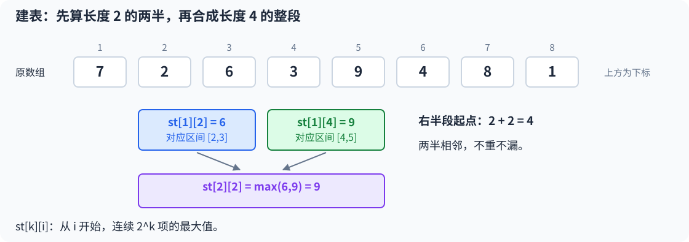
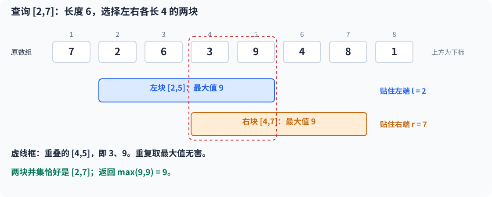

# 9.5 ST 表：倍增预处理与静态区间最值

前置：[位运算中的移位](../01-basic-problem-solving/05-bit-operations.md)、[区间查询与前缀和](../02-sequence-techniques/01-prefix-sum.md)、[状态与递推](../05-dynamic-programming/01-dp-basics.md)。

> **数组不变，却要反复查询任意区间的最大值或最小值：先保存一些区间的结果，让每次查询只读两个位置。**

## 0. 先认识三个词

- **静态查询：**建表后原数组不修改，只回答查询；查询区间可以任意变化，不要求左右端点只向右移动。
- **RMQ：**区间最值查询，常指区间最小值问题；本节先用最大值讲解，改成最小值的原理相同。
- **倍增：**这里指预存长度为 `1、2、4、8、…` 的区间。长度每次翻倍，不是把数组中的数值翻倍。

**ST 表**即 Sparse Table，也称稀疏表。它保存幂长区间，查询时用两段覆盖目标区间；并不需要先理解某种树形存储结构。

## 1. 通用实现：静态区间最大值

输入数组采用 **1-based**：`a[1..n]` 有效，`a[0]` 留空，要求 `n≥1`。查询采用**闭区间 `[l,r]`**，必须满足 `1≤l≤r≤n`。

```cpp
using ll = long long;

struct SparseMax {
    vector<int> lg;
    vector<vector<ll>> st;

    explicit SparseMax(const vector<ll>& a) {
        int n = static_cast<int>(a.size()) - 1;

        lg.resize(n + 1);
        for (int len = 2; len <= n; ++len) {
            lg[len] = lg[len / 2] + 1;
        }

        st.assign(lg[n] + 1, vector<ll>(n + 1));

        for (int i = 1; i <= n; ++i) {
            st[0][i] = a[i]; // 长度为 1，最大值就是这一项
        }

        for (int k = 1; k <= lg[n]; ++k) {
            int len = 1 << k;
            int half = len >> 1;

            for (int i = 1; i <= n - len + 1; ++i) {
                // 两个相邻半段都已在上一层算好，合成当前整段
                st[k][i] = max(st[k - 1][i], st[k - 1][i + half]);
            }
        }
    }

    ll query(int l, int r) const {
        int k = lg[r - l + 1];
        int len = 1 << k;	// 左端 / 右端长度

        // 一段贴左端，一段贴右端；允许重叠，但不能留空隙
        return max(st[k][l], st[k][r - len + 1]);
    }
};
```

依赖 `vector`、`max`，沿用通用框架的标准库头文件与命名空间。构造时复制所需结果，**不修改输入数组**；每个对象维护自己的表，多组数据重新构造即可。

## 2. 变量、容器与完整状态句

    ll query(int l, int r) const {
        int k = lg[r - l + 1];
        int len = 1 << k;
    
        // 一段贴左端，一段贴右端；允许重叠，但不能留空隙
        return max(st[k][l], st[k][r - len + 1]);
    }

**`st[k][i]` 表示：从原数组第 i 项开始，连续取恰好 2 的 k 次方项，这一整段的最大值。**

$$
\mathrm{st}[k][i]
=\max\bigl(a[i],\ldots,a[i+2^k-1]\bigr).
$$

`k` 是长度的指数，`i` 是原数组起点。**这里不直接用左右端点作为两个下标。**

| 变量或容器 | 含义 | 范围与容量依据 |
| --- | --- | --- |
| `n` | 原数组有效元素个数 | `a.size()-1`，不按元素数值开空间 |
| `lg[len]` | 不超过长度 `len` 的最大二次幂，其指数是多少 | 按长度开 `n+1` 项；`len` 有效范围为 `1..n` |
| `st[k][i]` | 起点为 `i`、长度为 `2^k` 的区间最大值 | 外层 `lg[n]+1` 层，内层各 `n+1` 项 |
| `len` | 当前层块长 | `1<<k`，即 `2^k` |
| `half` | 当前块长的一半 | `len/2`，用于找到右半段起点 |

例如长度为 `8` 的数组，只需要存长度 `1、2、4、8`，共 `4` 层。

每层也并非所有起点都有效：

$$
i+2^k-1\le n
\quad\Longleftrightarrow\quad
i\le n-2^k+1.
$$

这就是内层循环上界。后面的起点会使整块越过数组末尾，不能计算，也不能查询。

> **无效表格位置虽然默认是 0，但不代表有一段最大值为 0。** 全负数同样可以查询；正确实现只读取已构造的有效区间。

## 3. 先算两半，再合成整段

围绕这一行看：

```cpp
st[k][i] = max(st[k - 1][i], st[k - 1][i + half]);
```

例如原数组为：

$$
7,\ 2,\ 6,\ 3,\ 9,\ 4,\ 8,\ 1.
$$

要计算 `st[2][2]`，就是求从第 `2` 项开始、长度为 `4` 的 `[2,5]` 的最大值。



左半段 `[2,3]` 的最大值为 `6`，右半段 `[4,5]` 的最大值为 `9`：

$$
\mathrm{st}[2][2]
=\max\bigl(\mathrm{st}[1][2],\mathrm{st}[1][4]\bigr)
=\max(6,9)=9.
$$

**不是枚举所有切分点，只取正好相邻的两半。** 每个元素恰好落在其中一半，合并两半的最大值，就得到整段最大值。

一般情况下，令半段长度为：

$$
h=2^{k-1}.
$$

从 `i` 开始的整段，拆成：

$$
[i,\ i+2h-1]
=[i,\ i+h-1]\ \cup\ [i+h,\ i+2h-1].
$$

右半段从 `i+h` 开始，因此对应代码 `st[k-1][i+half]`。

### 为什么 k 放在外层？

当前第 `k` 层只读取第 `k-1` 层，所以依次算完长度 `1、2、4、8、…` 即可。

**先由状态依赖推出顺序，再写循环。** 若随意改成起点 `i` 在外层，可能读到尚未计算的右半段。与区间 DP 的共同点是先满足依赖，但这里仅保存幂长区间，不保存全部长度；见[范式中的倍增长度对照](../../patterns/05-dynamic-programming/dp-modeling-workflow.md#只存幂长区间按倍增长度满足依赖)。

## 4. 查询为什么只需要两段？

代码先根据查询长度选择一个块长：

```cpp
int k = lg[r - l + 1];
int len = 1 << k;
```

### 先看长度 6 的例子

查询 `[2,7]`，共有 `6` 项。不超过 `6` 的最大二次幂为 `4`，所以选择两个长度为 `4` 的块：

$$
[2,5],\qquad [4,7].
$$

一块贴左端，一块贴右端，中间虽然重叠，但没有遗漏。



这两个块的最大值均为 `9`，所以：

$$
\max(\mathrm{st}[2][2],\mathrm{st}[2][4])
=\max(9,9)=9.
$$

### 再说明任意长度为什么都能覆盖

令查询长度为 `d`，选中的块长为 `L`：

$$
d=r-l+1,\qquad k=\lfloor\log_2d\rfloor,\qquad L=2^k.
$$

选最大的不超长二次幂，意味着：

$$
L\le d<2L.
$$

**一个块不会超出查询范围，两个块的总长度足够覆盖。** 把两块分别贴在左右端：

$$
[l,\ l+L-1],\qquad [r-L+1,\ r].
$$

它们都在查询范围内。再检查中间是否有空隙：

$$
d\le 2L
\quad\Longrightarrow\quad
r-L+1\le l+L.
$$

右块起点不超过“左块终点加一”，所以两块之间不会漏元素。**覆盖完整，且没有把区间外的值算进来。**

### 为什么右块起点要加 1？

右块以 `r` 结束、包含 `L` 项，按闭区间长度公式：

$$
r-\text{起点}+1=L
\quad\Longrightarrow\quad
\text{起点}=r-L+1.
$$

因此返回值为 `max(st[k][l], st[k][r-len+1])`。

### 长度恰好为二次幂时，只需一块

若查询长度恰好是 `1、2、4、8、…`，选出的块长就等于整个查询长度：

$$
r-l+1=2^k=\mathrm{len}
\quad\Longrightarrow\quad
r-\mathrm{len}+1=l.
$$

**两块的起点都为 l，实际就是同一个完整区间，直接读取 `st[k][l]` 即可。** 现有代码统一比较左右两块，相当于对同一个值取 `max`，结果不变；因此不必专门增加分支。

## 5. 为什么重叠对最值无害，对求和却不行？

重叠部分可能在两个块里都被计算。但相同最大值取两次，不会变大：

$$
\max(x,x)=x.
$$

以 `[2,7]` 为例，两块重叠的是第 `4、5` 项，即 `3、9`。最大值仍是 `9`；但若把两块的和直接相加：

$$
20+24=44\ne32.
$$

**多算的正是重叠部分 `3+9=12`。** 所以不能把代码中的 `max` 换成 `+`，就认为区间和也能用两块查询。

这种查询依赖两个性质：**结果可以按结合律合并，重复合并同一部分不改变结果**。后一种性质也称幂等性。

| 运算 | 重复同一部分是否改变结果？ | 能否直接采用本节的两块查询？ |
| --- | --- | --- |
| 最大值、最小值 | 不改变 | 可以 |
| gcd、按位或、按位与 | 不改变，且可结合 | 可以按对应运算建表和查询 |
| 区间和 | 会重复累计 | 不可以；静态区间和优先使用前缀和 |

改求最小值时，**建表和查询两处都要由 `max` 改为 `min`**。不用同时保留多份几乎相同的类；若题目同时需要最大、最小，再分别维护对应表。

## 6. lg 的作用与执行流程

### 为什么不直接调用浮点 log2？

`lg[d]` 要的是**不超过长度 d 的最大二次幂的指数**，不是一个近似小数。

| 长度 d | 1 | 2、3 | 4、5、6、7 | 8 |
| --- | --- | --- | --- | --- |
| `lg[d]` | 0 | 1 | 2 | 3 |

长度从 `2` 开始，使用：

```cpp
lg[len] = lg[len / 2] + 1;
```

整数除以 `2` 相当于去掉二进制最低一位，非零数的最高位位置随之降低一位，所以可由较短长度递推。初值 `lg[1]=0`：长度 `1` 对应 `2⁰`。

**预处理整数表后，每次查询直接查 lg，避免浮点误差，也不必临时循环寻找块长。** `lg[0]` 没有合法查询含义，不能用来回答空区间。

### 从输入到答案

1. 输入原数组 `a[1..n]`，创建 `SparseMax`。
2. 构造 `lg`，确定所需层数；第 `0` 层保存单个元素。
3. 逐层将两个相邻半段合成整段，保存所有有效幂长区间。
4. 每次查询用闭区间长度取得 `k`，读取左右两块，合并返回。

**预处理只做一次，查询不会修改表。** 原数组若改变，旧表仍代表建表时的快照，需要重建或选择支持修改的结构。

## 7. 与已学区间工具的边界

| 已学工具 | 本节对照的模型 | 主要区别 |
| --- | --- | --- |
| [前缀和](../02-sequence-techniques/01-prefix-sum.md) | 静态区间和 | 两个前缀可以相减；最大值没有对应的相减还原方式 |
| [单调队列](03-monotonic-queue.md) | 左右边界单向移动的窗口最值 | 根据当前窗口丢弃候选；ST 则保留静态区间信息，允许任意顺序查询 |
| [树状数组的求和接口](04-fenwick-tree.md) | 单点增量与区间和 | 支持修改；本节 ST 表以静态预处理换取常数查询 |

**“区间最值”不意味着必须用 ST。** 若只是扫描全部固定长度窗口，单调队列通常只需线性时间和较少空间；若区间任意变化且数据不修改，ST 的两块查询更直接。

不能将“前缀最大值”当作前缀和来减。例如数组 `[9,2,3]` 与 `[9,2,8]` 的各项前缀最大值完全相同，但 `[2,3]` 的最大值分别是 `3、8`，无法从那两份相同的前缀信息中恢复。

## 8. 复杂度与边界检查

- **预处理：**`O(n log n)`；每层最多计算 `n` 个起点，共约 `log n` 层。
- **每次查询：**`O(1)`；查一次长度指数、读两个区间值、合并一次。
- **空间：**`O(n log n)`；本实现每层保留 `n+1` 项。`n=10⁵`、`ll` 存值时，`st` 共 `17` 层，元素约占 `13 MiB`，另计 `lg` 和输入等容器。
- **单个元素：**`k=0`，两块都是这一项，结果正确。
- **长度恰好为二次幂：**两块完全相同，也只返回该区间最值。
- **负数、相同值：**都合法；必须由原数组初始化第 `0` 层，不拿默认 `0` 作为最大值候选。
- **查询范围：**要求非空且端点合法；空数组、`l>r` 和越界查询不属于本接口。

## 9. 典题与复盘

两份原实现保留逻辑，仅整理排版和过程注释；通用框架不重复展示。**本地核验通过，平台结果未单独记录。**

### 9.1 洛谷 P3865：ST 表与 RMQ

题目：[P3865 [模板] ST 表 & RMQ 问题](https://www.luogu.com.cn/problem/P3865)。

**收录原因：**把幂长状态、相邻两半建表与两块查询连成完整实现，核对下标和区间长度。

原题查询区间最大值，`n≤10⁵`、查询次数最多 `2×10⁶`，元素在 `0..10⁹`。原实现如下：

```cpp
struct ST {
    vector<int> lg;
    vector<vector<ll>> st;

    explicit ST(vector<ll>& a) {
        int n = static_cast<int>(a.size()) - 1;

        lg.resize(n + 1);
        for (int len = 2; len <= n; ++len)
            lg[len] = lg[len / 2] + 1;

        st.assign(lg[n] + 1, vector<ll>(n + 1));

        for (int i = 1; i <= n; ++i)
            st[0][i] = a[i];

        for (int k = 1; k <= lg[n]; ++k) {
            int len = 1 << k;
            int half = len >> 1;

            for (int i = 1; i <= n - len + 1; ++i)
                st[k][i] = max(st[k - 1][i], st[k - 1][i + half]);
        }
    }

    ll query(int l, int r) {
        int k = lg[r - l + 1];
        int len = 1 << k;

        return max(st[k][l], st[k][r - len + 1]);
    }
};

void solve() {
    int n, m;
    cin >> n >> m;

    vector<ll> a(n + 1);
    for (int i = 1; i <= n; ++i)
        cin >> a[i];

    ST st(a);

    while (m--) {
        int l, r;
        cin >> l >> r;

        cout << st.query(l, r) << '\n';
    }
}
```

**原数组、ST 起点和查询端点都是 1-based，查询为闭区间。** `lg` 按长度建表，`st[k]` 的有效起点满足 `i≤n-(1<<k)+1`。

这份构造函数接收 `vector<ll>&`，但内部没有修改数组。若要表达只读，可以像第二题那样加 `const`；查询函数也可加 `const`，不改变算法。竞赛模板采用只读接口，见[ST 表模板](../../templates/sparse-table/README.md)。

> **大量查询不能重新扫描区间。** 建表一次后，每次查询只读两个表格位置；大量输入输出另需注意缓冲，是否需要快读按评测表现判断。

### 9.2 CF 514D：R2D2 and Droid Army

题目：[CF 514D — R2D2 and Droid Army](https://codeforces.com/problemset/problem/514/D)。

**收录原因：**先写出固定区间的最小代价，再把最大长度转成可行性判定；区间查询工具与二分各负责一层，返回起点即可恢复方案。

有 `n≤10⁵` 个机器人、`m≤5` 类部件，部件数量为 `0..10⁸`，最多发射 `k≤10⁹` 次。**输出每种武器的发射次数，既不是区间端点，也不是最长长度。**

#### 原实现：每列 ST 表 + 二分长度

```cpp
// 复用上面的 ST；本题原构造参数为 const vector<ll>&，其余逻辑相同
void solve() {
    int n, m, k;
    cin >> n >> m >> k;

    vector<vector<ll>> part(m, vector<ll>(n + 1));
    for (int i = 1; i <= n; ++i)
        for (int j = 0; j < m; ++j)
            cin >> part[j][i];

    // 元素类型是 ST；不能把原数组 v 直接当作填充值传给 vector<ST>(m, v)
    vector<ST> st;
    st.reserve(m); // 只预留空间，当前仍没有对象
    for (auto& v : part)
        st.emplace_back(v); // 将 v 交给 ST 构造函数，每列分别建表

    function<int(int)> check = [&](int len) -> int {
        for (int i = 1; i <= n - len + 1; ++i) {
            ll sum = 0;
            for (auto& v : st)
                sum += v.query(i, i + len - 1);

            // 只需存在一个合法区间；第一次找到即可返回起点
            if (sum <= k)
                return i;
        }
        return 0; // 起点是 1-based，所以 0 可以专门表示不存在
    };

    int l = 1, r = n;
    int s = 0;

    while (l <= r) {
        int mid = (l + r) / 2;
        int pos = check(mid);

        if (pos) {
            l = mid + 1;
            s = pos;
        } else {
            r = mid - 1;
        }
    }

    int len = l - 1; // l 是首个不可行长度；最后可行长度为 l-1
    if (len == 0) {
        for (int j = 0; j < m; ++j)
            cout << 0 << ' ';
        cout << '\n';
        return; // 不存在合法非空区间，不调用 query(s,s+len-1)
    }

    for (auto& v : st)
        cout << v.query(s, s + len - 1) << ' ';
    cout << '\n';
}
```

#### 变量与容器：分别按谁开空间？

| 变量或容器 | 含义与范围 | 容量依据 |
| --- | --- | --- |
| `part[j][i]` | 第 i 个机器人、第 j 类部件的数量 | 外层 m 列，内层 n+1；列为 `0..m-1`，机器人为 `1..n` |
| `st[j]` | 第 j 列的区间最大值表 | m 个 ST 对象，每个对象按 n 建表，不按部件数值开空间 |
| `check(len)` | 是否存在长度 len 的合法区间 | 返回 1-based 起点；0 表示不存在 |
| `l、r` | 当前尚待检查的长度范围 | 不是机器人的左右端点 |
| `s` | 最后一次成功判定找到的区间起点 | 只在 `check(mid)` 成功时更新 |
| `sum` | 当前区间各列最大值之和 | 使用 ll；每个候选区间重新计算 |

#### 先固定区间，为什么是各列最大值之和？

看三行、两列的例子，预算为 `4`：

$$
\begin{bmatrix}
1&2\\
2&1\\
0&2
\end{bmatrix}.
$$

第一种武器发射一次会同时影响所有机器人；摧毁第一列，必须满足其中要求最多的那个机器人：

$$
\max(1,2,0)=2.
$$

第二列同理需要 `2` 次。两种武器可以分别使用，于是总代价为：

$$
\mathrm{cost}=2+2=4.
$$

**不能把每行的部件数都累加：同一次射击会同时消耗整列的部件。** 一般地：

$$
\mathrm{cost}(l,r)
=\sum_{j=0}^{m-1}\max_{i=l}^{r}\mathrm{part}[j][i].
$$

每列最大值是该武器发射次数的下界；按这个次数发射，又确实能清空整列，所以该式既必要又充分。

#### 从区间代价到 check(len)，再证明单调性

长度固定为 `len` 后，枚举所有合法起点：

$$
1\le i\le n-\mathrm{len}+1,
\qquad [i,\ i+\mathrm{len}-1].
$$

**只需存在一个区间满足预算，不是要求所有同长度区间都合法。** 因而第一次找到时即可返回起点，省去另一次找方案。

再看一个合法区间和它的更短连续子区间：


设更短子区间为 `[p,q]`：

$$
[p,q]\subseteq[l,r]
\quad\Longrightarrow\quad
\max_{i=p}^{q}\mathrm{part}[j][i]
\le\max_{i=l}^{r}\mathrm{part}[j][i].
$$

每列都不增加，求和也不增加：

$$
\mathrm{cost}(p,q)\le\mathrm{cost}(l,r)\le k.
$$

因此**长度可行，则所有更短正长度都可行**；长度判定是“可行 → 不可行”，可以二分最大可行长度。不同长度不必使用同一个起点。

#### 从输入到恢复方案

1. 读矩阵时转成按列存储，每列建立一个 ST 对象。
2. 二分候选长度 `mid`；`check(mid)` 枚举起点，查询每列最大值并求和。
3. 找到合法区间就保存起点 `s`，尝试更长；全部失败则缩短。
4. 搜索结束后还原 `len=l-1`；若为正，输出 `[s,s+len-1]` 的各列最大值。

**二分只决定先尝试哪些长度；ST 只回答每个固定区间的最值。** 两者的正确性分别来自长度单调性和区间查询。

#### 踩坑：原数组不等于已构造的 ST 对象

```cpp
// 错误示意，不能编译：v 是 vector<ll>，不是 ST
// vector<ST> st(m, v);

vector<ST> st;
st.reserve(m);
for (auto& v : part)
    st.emplace_back(v); // 直接调用 ST(v)，逐列构造不同对象
```

- **`vector<ST>(m,value)` 的含义是复制 m 份 ST 填充值。** `explicit` 构造函数不会把这里的原数组隐式变成 ST；不是把 v 当作每个对象的构造参数。
- 写成 `vector<ST>(m,ST(v))` 虽能构造，但会重复同一列，仍不符合本题逐列建表的目的。
- **`reserve(m)` 只预留容量，`size()` 仍为 0。** 不能紧接着访问 `st[j]`；`emplace_back` 才会增加对象。直接 `vector<ST> st(m)` 则需要本类没有提供的默认构造函数。
- 遍历用 `auto&` 避免复制整列。原来的 `function<int(int)> check` 合法；它不递归，也可简写成 `auto check = [&](int len) -> int { ... };`。

构造语义可对照 [C++ 标准草案：vector 构造](https://eel.is/c++draft/vector.cons)及[原位插入](https://eel.is/c++draft/vector.modifiers)。

#### 踩坑：长度边界与空答案

成功后写 `l=mid+1`，说明还要寻找更长区间；失败后写 `r=mid-1`。结束时：

$$
l=r+1,\qquad \mathrm{best}=r=l-1.
$$

若所有正长度都合法，`l=n+1` 表示搜索边界，不会调用 `check(n+1)`。只要有成功判定，最后保存的 `s` 就对应最终最大可行长度；后续失败不会覆盖它。

> **若 len=0，s 仍可能是 0，必须直接输出 m 个 0。** 不要查询空区间。反过来，`k=0` 不等于没有答案：连续全零机器人可以摧毁，最长长度可能为 n。

#### 对照实现：二分长度 + 多列单调队列

下面是整理实现，**不替换上面的原代码**。输入沿用按列存储，`check(len)` 的返回含义和外层二分都不变。

```cpp
// part[j][i]：第 j 列、第 i 个机器人；列 0-based，机器人 1-based
vector<ll> shots_by_deque(const vector<vector<ll>>& part, ll budget) {
    int m = static_cast<int>(part.size());
    int n = static_cast<int>(part[0].size()) - 1;

    auto check = [&](int len) -> int {
        vector<deque<int>> q(m); // 每次检查重新建队列，各列独立维护

        for (int r = 1; r <= n; ++r) {
            int left = r - len + 1;
            ll sum = 0;

            for (int j = 0; j < m; ++j) {
                const auto& a = part[j];

                while (!q[j].empty() && q[j].front() < left)
                    q[j].pop_front(); // 离开当前窗口的旧下标过期

                while (!q[j].empty() && a[q[j].back()] <= a[r])
                    q[j].pop_back(); // 新值不小且更晚过期，替换劣势候选

                q[j].push_back(r);
                sum += a[q[j].front()];
            }

            // 等所有列都加入 r，且窗口已有 len 项，才能判断完整区间
            if (left >= 1 && sum <= budget)
                return left;
        }
        return 0;
    };

    int l = 1, r = n, s = 0;
    while (l <= r) {
        int mid = l + (r - l) / 2;
        int pos = check(mid);

        if (pos) {
            s = pos;
            l = mid + 1;
        } else {
            r = mid - 1;
        }
    }

    int len = l - 1;
    vector<ll> shots(m, 0);
    if (len == 0) return shots;

    // 最后只还原一次方案，直接扫描选中区间；不需要再建 ST 表
    for (int j = 0; j < m; ++j)
        shots[j] = *max_element(part[j].begin() + s,
                                part[j].begin() + s + len);
    return shots;
}

void solve() {
    int n, m;
    ll k;
    cin >> n >> m >> k;

    vector<vector<ll>> part(m, vector<ll>(n + 1));
    for (int i = 1; i <= n; ++i)
        for (int j = 0; j < m; ++j)
            cin >> part[j][i];

    auto shots = shots_by_deque(part, k);
    for (ll x : shots) cout << x << ' ';
    cout << '\n';
}
```

固定 `len` 后，窗口从左往右逐格移动。每列一个队列，队首是该列当前窗口的最大值下标；**真正的窗口边界仍由 left、r 决定**，不是队首、队尾。

同一次检查中，每个位置在每列最多入队、出队各一次，所以不必对每个窗口重新扫描。各列都更新完后，再把队首值求和；下一次检查不同长度时，队列重新初始化。

**最后只恢复一次方案，可以直接扫描选中区间。** 这一步最多 `O(mn)`，不改变总时间量级；迭代器右端为 `s+len`，对应闭区间 `[s,s+len-1]`。

#### 这两版分别把工作放在哪里？

| 项目 | ST 表 + 二分 | 单调队列 + 二分 |
| --- | --- | --- |
| 预处理 | 每列建表，`O(mn log n)` | 不建表 |
| 一次 check | 枚举起点，每列常数查询，`O(mn)` | 每列维护定长窗口，`O(mn)` |
| 总时间 | `O(mn log n)` | `O(mn log n)`；最后扫描恢复不增加量级 |
| 额外空间，不计输入 | `O(mn log n)` | `O(mn)`；每次 check 的队列可占满窗口 |
| 保留的信息 | 静态任意区间最值，可反复查询 | 当前扫描窗口的候选，换长度需重新扫描 |

本题的 `check` 恰好按顺序扫定长窗口，因此单调队列可以省下 ST 预处理和表空间；ST 版则直接复用已学查询接口。

进一步还可用变长窗口去掉外层二分，此处不再堆第三份实现；已有[单调队列的变长窗口复盘](03-monotonic-queue.md#92-cf-6e--exposition)可作联系。

识别过程见[二分范式：固定区间代价，再二分可行长度](../../patterns/02-sequence-techniques/binary-search-on-answer.md#固定区间代价再二分可行长度)。

## 10. 自查与后续

1. `st[k][i]` 的第二个下标是起点还是终点？为什么右半段从 `i+2^(k-1)` 开始？
2. 长度 `6` 为什么选两段长度 `4`？为什么覆盖没有缺口，而直接求和会重复？
3. 为什么同样求窗口最值，有时单调队列更合适？数组修改后旧 ST 表还代表什么？

定义与实现对照：[KACTL 的 RMQ 实现](https://github.com/kth-competitive-programming/kactl/blob/main/content/data-structures/RMQ.h)。其实现求最小值并使用 0-based 半开区间；本节为独立教学实现，改用 **1-based 闭区间、最大值和预处理整数 lg**，不能直接混用传参约定。

[返回本章索引](README.md) · [关联范式：状态与计算顺序](../../patterns/05-dynamic-programming/dp-modeling-workflow.md)
