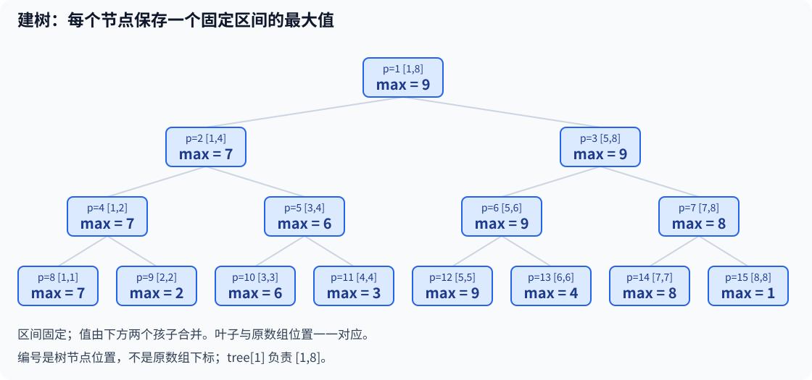
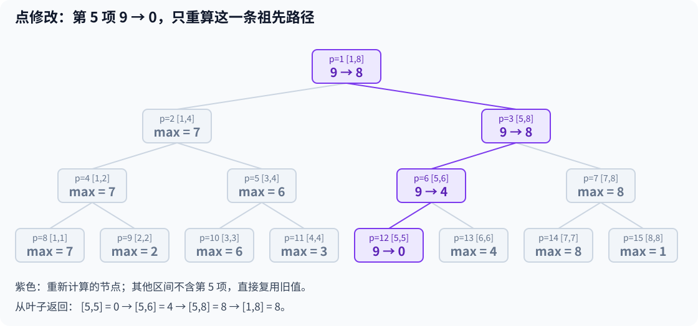
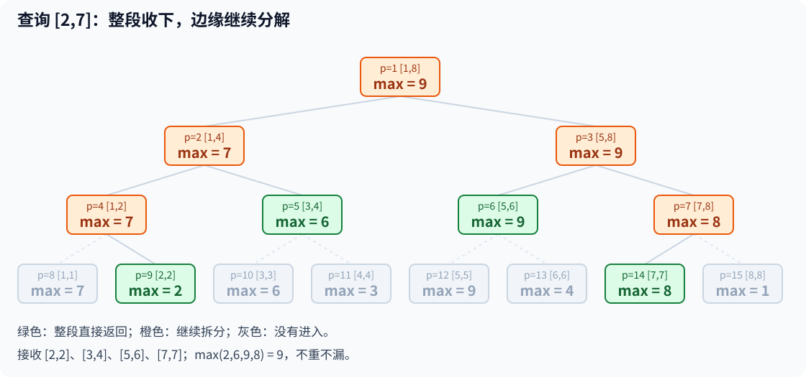
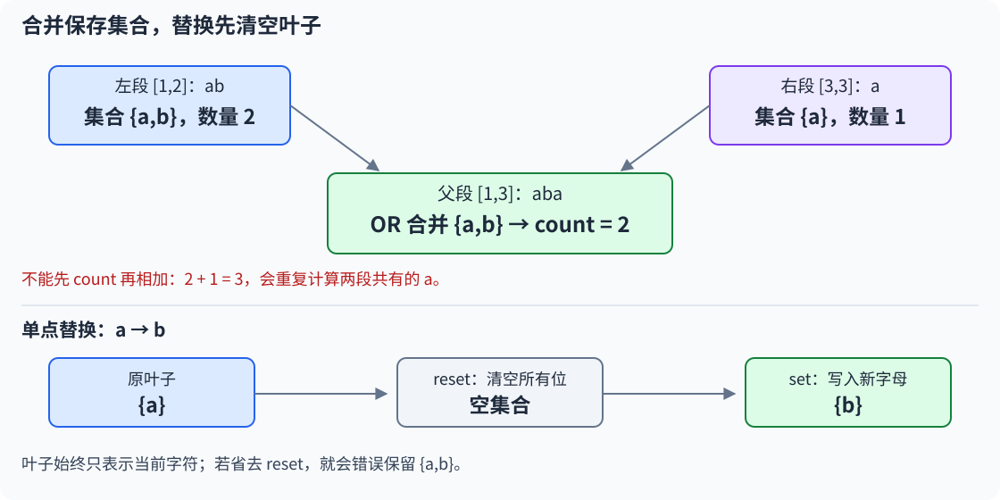

# 9.6 线段树基础：单点修改与区间查询

前置：[递归与 DFS](../03-search/01-dfs-backtracking.md)、[树状数组](04-fenwick-tree.md)、[ST 表](05-sparse-table.md)。

> **把数组分成固定的左右两半，保存各段信息。修改一个位置时，只重算包含它的那些段；查询时，把若干完整小段拼起来。**

通用实现先处理**单点赋值、区间最大值**，配套题再将摘要换成字符出现集合。先建立固定划分与局部更新的认识，区间加、区间赋值与懒标记留到后续。

## 0. 先分清原数组与这棵树

- **线段树：**每个节点代表原数组中的一个连续区间；根代表整个数组。
- **叶子：**区间只剩一个位置，保存这一项的值。
- **父节点：**保存左右两个子区间合并后的结果，本节合并方式为 `max`。

**这是按数组位置构造的区间树，不是题目另外输入的一棵关系图，也不是按元素数值大小建树。** 数组值可以变化，区间边界不随之变化。

### 已有办法遇到修改，会发生什么？

还是后面图示的八项数组：第 5 项从 `9` 改成 `0` 后，查询 `[2,7]` 的答案应从 `9` 变成 `8`。

- 每次直接扫描区间可以正确解决，但一次查询最坏要 `O(n)`。
- 已建的 ST 表保存旧快照；每次修改后重建也能解决，但一次重建需要 `O(n log n)`。

**因此需要一种办法：保留可合并的区间信息，只更新包含被修改位置的那些区间，同时还能快速拼出查询答案。** 线段树固定的二分划分，就是为这件事组织信息；下面先给实现，再围绕更新与查询过程展开。

## 1. 通用实现：单点赋值与区间最大值

原数组采用 **1-based**，`a[1..n]` 有效，`a[0]` 占位，要求 `n≥1`。查询为**非空闭区间 `[ql,qr]`**。

```cpp
using ll = long long;

struct SegMax {
    int n;
    vector<ll> tree;

    // 构造线段树：数组按 1-based 存储，预留 4n 级别的空间。
    explicit SegMax(const vector<ll>& a)
        : n(static_cast<int>(a.size()) - 1), tree(4 * a.size()) {
        build(1, 1, n, a);
    }

    // 单点赋值：将 a[pos] 修改为 value。
    void set(int pos, ll value) {
        modify(1, 1, n, pos, value);
    }

    // 区间查询：返回 [ql, qr] 内的最大值。
    ll query(int ql, int qr) const {
        return query(1, 1, n, ql, qr);
    }

    // 合并当前节点：父节点的最大值等于两个孩子最大值的较大者。
    void pull(int p) {
        tree[p] = max(tree[p * 2], tree[p * 2 + 1]);
    }

    // 建树：递归建立整个区间，因此非叶节点必须遍历左右两个孩子。
    void build(int p, int l, int r, const vector<ll>& a) {
        if (l == r) {
            tree[p] = a[l];  // 叶子对应原数组中的一个位置。
            return;
        }

        int mid = l + (r - l) / 2;

        // 顺序: 两侧都需要建立，不能像单点修改那样二选一。
        build(p * 2, l, mid, a);
        build(p * 2 + 1, mid + 1, r, a);

        pull(p);  // 子节点建好后，再合并得到当前区间的最大值。
    }

    // 单点修改：只沿目标位置所在的分支递归，返回后更新沿途祖先。
    void modify(int p, int l, int r, int pos, ll value) {
        if (l == r) {
            tree[p] = value;  // 赋值，不是累加。
            return;
        }

        int mid = l + (r - l) / 2;

        // 分支if-else: pos 只属于一侧，因此只递归一个孩子。
        if (pos <= mid)
            modify(p * 2, l, mid, pos, value);
        else
            modify(p * 2 + 1, mid + 1, r, pos, value);

        pull(p);  // 更新后重新合并，维护祖先节点的正确结果。
    }

    // 区间查询：完整覆盖则直接返回；否则递归查询与目标区间相交的部分。
    ll query(int p, int l, int r, int ql, int qr) const {
        if (ql <= l && r <= qr)
            return tree[p];  // 当前区间已被完整包含，无须继续向下搜索。

        int mid = l + (r - l) / 2;
        ll ans = LLONG_MIN;  // 合并初值，兼容数组元素全为负数。

        // 分支if-if: 查询区间与左子树相交时，才递归左子树。
        if (ql <= mid)
            ans = max(ans, query(p * 2, l, mid, ql, qr));

        // 右子树从 mid + 1 开始，因此 qr >= mid + 1，即 qr > mid，才可能相交。
        if (qr > mid)
            ans = max(ans, query(p * 2 + 1, mid + 1, r, ql, qr));

        return ans;  // 汇总所有相交部分的最大值。
    }
};
```

依赖 `vector`、`max`、`LLONG_MIN`，对应头文件为 `<vector>`、`<algorithm>`、`<climits>`；沿用竞赛框架的命名空间。

**外部调用 `set(pos,value)` 和 `query(ql,qr)`。** 递归函数中的 `p,l,r` 由入口自动传入；两个 `query` 按参数数量区分，不是相互无限调用。

```cpp
vector<ll> a = {0, 7, 2, 6, 3, 9, 4, 8, 1}; // a[0] 占位
SegMax seg(a);

ll before = seg.query(2, 7); // 9
seg.set(5, 0);              // 第 5 项由 9 改为 0
ll after = seg.query(2, 7); // 8，不会留下旧最大值 9
```

构造不改变输入数组；后续 `set` 只更新树内信息，**不会同步修改外部 a**。每组数据重新构造，多个对象独立。

## 2. 变量、下标与状态含义

**`tree[p]` 表示：节点 p 当前负责的原数组闭区间 `[l,r]` 内，所有元素的最大值。** `[l,r]` 由递归参数说明，不用另存两份端点数组。

$$
\mathrm{tree}[p]=\max(a[l],a[l+1],\ldots,a[r]).
$$

这里的 `a` 指当前逻辑数组，修改后的值由树内叶子维护，不一定等于外部建树输入数组的旧快照。

| 变量 | 含义 | 范围或容量依据 |
| --- | --- | --- |
| `n` | 原数组的有效长度 | `a.size()-1`，要求可用 int 表示且内存足够 |
| `p` | 树节点的存储编号 | 根为 1；左孩子 `2*p`，右孩子 `2*p+1` |
| `l、r` | 当前节点负责的原数组范围 | 闭区间，`1≤l≤r≤n` |
| `mid` | 当前范围的分界 | 左侧 `[l,mid]`，右侧 `[mid+1,r]` |
| `pos、value` | 要修改的原位置、新值 | `pos` 为 `1..n`；`value` 使用 ll |
| `ql、qr` | 整次查询要求的范围 | 整轮递归保持不变，不是当前节点边界 |
| `tree` | 各个固定区间的当前摘要 | 按 n 预留约 4n 项，不按值域开空间 |

> **原数组编号与树节点编号都是 1-based，但不是同一套编号。** `tree[5]` 不表示原数组第 5 项；它代表哪个区间，要沿固定划分确定。

## 3. 建树：把区间固定地分成两半

围绕 `build` 与 `pull` 看一个八项数组：

$$
7,\ 2,\ 6,\ 3,\ 9,\ 4,\ 8,\ 1.
$$



根节点 `p=1` 负责 `[1,8]`；它的两个孩子负责 `[1,4]` 与 `[5,8]`。

$$
[l,r]=[l,\mathrm{mid}]\ \cup\ [\mathrm{mid}+1,r].
$$

两半**相邻、不重叠、没有遗漏**。一直分到 `l==r`，这一段只剩一项，直接写入原值并返回。

递归先完成两边，返回时再调用 `pull(p)`：

$$
\mathrm{tree}[p]
=\max\bigl(\mathrm{tree}[2p],\mathrm{tree}[2p+1]\bigr).
$$

例如节点 `p=3` 负责 `[5,8]`，两个孩子的值分别是 `9、8`，所以保存 `9`。**递归只按固定中点划分，不是在不同划分方案中选最优。**

### n 不是二次幂，也不必手动补齐

例如 `[1,5]` 分成 `[1,3]` 与 `[4,5]`，两边长度可以相差 1。中点由当前端点计算，每次都缩短区间，仍然到达单点。

### 为什么预留约 4n 个位置？

实际有 n 个叶子，每个内部节点恰好有两个孩子，因此实际节点数为 `2n-1`。**但堆式编号可能留下空号，不能只按实际节点数开数组。**

设树高为 h，即最多分割多少次：

$$
h=\lceil\log_2 n\rceil,\qquad n\le2^h<2n.
$$

把同样高度、每一层都填满的二叉树当作编号上界：

$$
\text{最大节点编号}\le2^{h+1}-1<4n.
$$

因此按 4n 预留足够；代码使用 `4*a.size()`，即 `4*(n+1)`。**这里只读取真正建出的节点，空号默认值没有区间含义**。

因此，**不是为了单纯给最后一层多留空间，而是为了确保整棵树所有节点的堆式编号都不会越界**。

## 4. 单点修改：向下定位，向上重算

调用 `set(5,0)`，把第 5 项从 `9` 改为 `0`。



修改时只进入包含 `pos` 的一边：

$$
\mathrm{pos}\le\mathrm{mid}\Rightarrow\text{进入左半段},
\qquad
\mathrm{pos}>\mathrm{mid}\Rightarrow\text{进入右半段}.
$$

到达 `[5,5]` 后赋值为 `0`；递归返回时重新合并父区间：

$$
[5,6]:\quad\max(0,4)=4.
$$

这一段的旧最大值 `9` 被正确撤销。

$$
[5,8]:\quad\max(4,8)=8.
$$

右半段现在由第 7 项的 `8` 决定最大值。

$$
[1,8]:\quad\max(7,8)=8.
$$

根也更新完成。**不包含第 5 项的区间没有变化，直接复用它们原来的结果。**

> **不能写 `tree[p]=max(tree[p],value)` 代替重算。** 新值可能更小，旧最大值必须允许下降。通过“改叶子 → pull 祖先”才能同时处理增大和减小。

本接口是**赋值**；若题意是增加 delta，可先取得单点当前值，再赋新值，注意加法不溢出。两种更新语义不能混用。

## 5. 区间查询：整段收下，边缘继续拆

回到修改前的数组，查询 `[2,7]`。围绕 `query` 的第一个判断：

```cpp
if (ql <= l && r <= qr)
    return tree[p];
```

**被完整包含的是当前节点 `[l,r]`，包含它的是查询区间 `[ql,qr]`。** 不是要求两对端点恰好相等。



根 `[1,8]` 超出查询边界，不能直接拿根的值；继续分解。最终接收的完整节点为：

$$
[2,7]=[2,2]\ \cup\ [3,4]\ \cup\ [5,6]\ \cup\ [7,7].
$$

它们的最大值分别为 `2、6、9、8`：

$$
\max(2,6,9,8)=9.
$$

**收下 `[3,4]` 就不再读 `[3,3]` 和 `[4,4]`；收下 `[5,6]` 也一样。** 不是每次都走到所有叶子。

### 部分覆盖时，怎样决定进入哪一侧？

递归进入当前节点时，已保证它与查询范围有交集：

- `ql<=mid`：查询还碰到左半段，需要进入左孩子。
- `qr>mid`：查询还碰到右半段，需要进入右孩子。

**两个 if 不能改成 if/else。** 查询跨过中点时，两侧都要读取；不像单点修改只能落在一侧。

根调用的范围合法，孩子又按上述条件筛选，所以不会递归到完全不相交的区间。若改变为无条件递归两个孩子，就必须另加“不相交”退出判断。

### 为什么 ql、qr 不需要跟着缩小？

它们始终表示原请求 `[2,7]`；`l,r` 则随着递归变成 `[1,4]`、`[1,2]` 等节点范围。**用当前节点边界与固定请求比较，就足够判断是否整段接收。**

这也是当前实现没有单独写 `l==r` 查询分支的原因：递归一旦抵达与请求相交的单点，它必然已经被完整覆盖，在开头直接返回。

## 6. 合并信息：与 ST 的重叠规则不同

查询的初值为：

```cpp
ll ans = LLONG_MIN;
```

**它是最大值合并时不产生影响的初值，不是“不可达”。** 即使原数组某项本身等于 `LLONG_MIN`，也仍是合法值：

$$
\max(\mathrm{LLONG\_MIN},x)=x.
$$

若用 0，当整个查询区间都是负数时会错误返回 0。构造数组中的默认 0 与查询合并的初值承担不同职责，不能混为一谈。

### 改维护区间和，需要哪些变化？

> 当前查询拿到的区间**彼此不重叠**，因此可以将左右结果相加，**不会像 ST 的两块覆盖那样多算**：

$$
\mathrm{sum}([l,r])
=\mathrm{sum}([l,\mathrm{mid}])
+\mathrm{sum}([\mathrm{mid}+1,r]).
$$

改法包括：`pull` 相加、查询两侧结果相加、查询初值改为 0；叶子的赋值与下标划分不变。**合并规则和初值要一起调整。** 所有中间和还必须能用 ll 表示。

更一般地，摘要需要能按结合律合并；对空贡献使用合适的单位元。这里不要求 ST 两块查询所需的幂等性。暂不展开复杂结构体合并，先把最大值实现写清楚。

## 7. 执行流程、正确性与复杂度

### 从输入到答案

1. 输入 `a[1..n]`，构造对象，叶子存原值，父区间由孩子合成。
2. 点赋值时向下找到目标叶子，回程逐层 `pull`。
3. 查询时从根出发，接收完整覆盖的区间，拆开边缘部分。
4. 合并这些完整节点的结果并返回，不修改树。

### 为什么更新后仍能正确查询？

建树时叶子正确，父节点由两个正确孩子合成，因此所有节点都满足最大值定义。

点修改只改变一项。包含它的节点恰好是这一叶子到根的祖先；逐层重算后它们重新正确，其他节点的元素没变，因此原结果仍然正确。

查询按固定划分得到**不重不漏的覆盖**，每一段的结果正确，合并后就是原请求的结果。

### 为什么一次查询也是 O(log n)？

**不是因为“用了递归”，也不是因为查询只走一条路。** 查询可能进入两侧，但每层至多有两个需要继续拆分的边界节点；中间完整包含的节点会立即返回。

这些边界节点只产生常数个下一层访问，树高为 `O(log n)`，所以一次查询总访问数为 `O(log n)`。

| 操作 | 时间 | 原因 |
| --- | --- | --- |
| 建树 | `O(n)` | 每个实际节点只建一次；不是每个位置再做一次修改 |
| 单点赋值 | `O(log n)` | 每层只进入一个孩子，回程常数合并 |
| 区间最大值查询 | `O(log n)` | 完整节点停止，只有边界继续拆分 |
| 空间 | `O(n)` | 约 4n 表格；递归栈深度 `O(log n)` |

`n=1` 时根就是叶子，赋值和查询直接完成。此处递归深度由**二分数组**决定，不会像链形图 DFS 那样达到 n。

## 8. 与已有工具对照、边界检查

| 已学工具 | 适合的已有模型 | 本节的区别 |
| --- | --- | --- |
| [前缀和](../02-sequence-techniques/01-prefix-sum.md) | 静态区间和 | 点修改可能影响后面全部前缀；线段树只更新祖先 |
| [ST 表](05-sparse-table.md) | 静态区间最值，常数查询 | 本节支持点赋值，查询改为对数时间；建树和空间线性 |
| [树状数组](04-fenwick-tree.md) | 已实现单点增量、前缀和与区间和 | 本节固定两半合并，可直接处理任意点赋值和区间最大值 |

**已学求和 BIT 不能只把加法换成 max，就得到任意赋值的区间最大值。** 最大值不能用两个前缀相减，点减小时也需要撤销旧影响；其他特化结构需另证。

- **中点分界：**左 `[l,mid]`，右 `[mid+1,r]`，避免重叠或区间不缩小。
- **修改回程：**改完叶子必须 `pull`，不能只改叶子或只更新根。
- **查询覆盖：**条件是 `ql<=l && r<=qr`，不是反过来。
- **单点与查询：**修改进一侧；查询跨中点可能进两侧。
- **全负数：**查询合并初值不能是 0；树值由真实叶子建立。
- **区间与输入：**要求 `1≤ql≤qr≤n`、`1≤pos≤n`；空数组和越界不属于本接口。
- **能力边界：**本节没有懒标记，不能把一整段修改当作一次单点修改；逐点改长度 d 的区间仍需 `O(d log n)`。

## 9. 典题与复盘

两份原实现均保留逻辑，仅整理排版和过程注释；通用框架不重复展示。**本地核验通过，平台结果未单独记录。**

### 9.1 洛谷 P1531：I Hate It

题目：[P1531 I Hate It](https://www.luogu.com.cn/problem/P1531)。

**收录原因：**区分数据结构提供的通用操作与题意允许的更新，避免“能赋值”就忽略原题限制。

`n,m≤2×10⁵`，初始成绩为 `1..10⁹`。`Q a b` 查询闭区间最高分；**`U a b` 只有在新成绩 b 更高时才改动，否则保留原成绩**。范围与语义见[原站英文输入格式](https://www.luogu.com.cn/problem/P1531?lang=en)。

#### 原实现：查询单点当前值，再决定是否修改

```cpp
// SegMax 复用第 1 节的接口，不重复相同的建树、修改与查询结构
void solve() {
    int n, m;
    cin >> n >> m;

    vector<ll> a(n + 1);
    for (int i = 1; i <= n; ++i)
        cin >> a[i];

    SegMax seg(a);
    while (m--) {
        char op;
        int i;
        ll j;
        cin >> op >> i >> j;

        if (op == 'Q') {
            cout << seg.query(i, (int)j) << '\n';
        } else {
            ll a = seg.query(i, i); // 先查当前值，不能无条件覆盖
            if (a < j)
                seg.set(i, j);
        }
    }
}
```

原 `SegMax` 与第 1 节是同一结构，只是使用 `tree(4*n)` 和 `(l+r)/2`；**这两处在本题范围内都安全**，`pull` 仍是“递归完成孩子后，往上带调整”。正文复用第 1 节定义，不重复整份类。

**查询单点就是取得这一项的当前成绩。** 只有新值更高时调用通用赋值接口，将“只增不减”的题意约束放在数据结构外层。

`Q` 分支中 `j` 是右端点，原代码将其转为 int；原题范围保证可表示。`U` 分支中 `j` 是新成绩，继续按 ll 使用。局部 `ll a` 只是单点读值，与外层 `vector<ll> a` 不是同一个对象；若要避免遮蔽，可将局部变量命名为 `current`。

#### 另一种小调整：同步保存当前数组

原实现已经正确。若在外部数组保存当前成绩，可以省掉更新前的那次单点查询：

```cpp
// 其余输入与 Q 查询不变；a 保存与树同步的当前成绩
if (op == 'U' && a[i] < j) {
    a[i] = j;       // 不能漏：否则下一次判断会读到旧成绩
    seg.set(i, j);
}
```

**收益是少走一次树，不是改变时间量级。** 两版总时间均为 `O(n+m log n)`，空间均为 `O(n)`；原实现只依赖树保存当前值，缓存版则要额外保证数组与树始终同步。

例如初值为 `5`，先收到更新 `10`，再收到更新 `7`。若第一次只改树、没把外部数组同步成 `10`，第二次便会误把 `7` 当作更高成绩。

**该题只允许提高成绩，不代表通用 SegMax 也只能处理提高。** 通用类仍支持任意点赋值；不同目标的限制应由调用处说明。

### 9.2 CF 1234D：Distinct Characters Queries

题目：[CF 1234D — Distinct Characters Queries](https://codeforces.com/problemset/problem/1234/D)。

字符串只含小写字母，长度与操作数均不超过 `10⁵`；操作为替换一个位置的字符，或询问闭区间内不同字符数量。

**收录原因：**节点保存的信息必须足够合并。最终只问一个数量，中间也可能需要保留完整集合。

#### 原实现：线段树维护字符出现集合

```cpp
struct SegS {
    int n;
    vector<bitset<32>> tree;

    explicit SegS(const string& s) :
        n(static_cast<int>(s.size()) - 1), tree(4 * n) {
        build(1, 1, n, s);
    }

    void set(int pos, char ch) {
        modify(1, 1, n, pos, ch);
    }

    int query(int ql, int qr) const {
        return query(1, 1, n, ql, qr).count(); // 合并完集合，最后才计数
    }

    void pull(int p) {
        tree[p] = tree[2 * p] | tree[2 * p + 1];
    }

    void build(int p, int l, int r, const string& s) {
        if (l == r) {
            tree[p].set(s[l] - 'a'); // 字母映射到 0..25，不是字符串下标
            return;
        }

        int mid = (l + r) / 2;
        build(p * 2, l, mid, s);
        build(p * 2 + 1, mid + 1, r, s);
        pull(p);
    }

    void modify(int p, int l, int r, int pos, char ch) {
        if (l == r) {
            tree[p].reset();         // 先移除旧字符；这里只能保留当前的一种字母
            tree[p].set(ch - 'a');
            return;
        }

        int mid = (l + r) / 2;
        if (pos <= mid)
            modify(2 * p, l, mid, pos, ch);
        else
            modify(2 * p + 1, mid + 1, r, pos, ch);
        pull(p);
    }

    bitset<32> query(int p, int l, int r, int ql, int qr) const {
        if (l >= ql && r <= qr)
            return tree[p];

        int mid = (l + r) / 2;
        bitset<32> ans; // 默认全 0，代表空集合
        if (mid >= ql)
            ans |= query(2 * p, l, mid, ql, qr);
        if (mid < qr)
            ans |= query(2 * p + 1, mid + 1, r, ql, qr);
        return ans;
    }
};

void solve() {
    string s;
    cin >> s;
    s = ' ' + s; // 补一个占位字符，实际内容从下标 1 开始

    int n;
    cin >> n; // 这里的 n 是操作次数，不是字符串长度

    SegS seg(s);
    while (n--) {
        int op, l;
        cin >> op >> l;
        if (op == 1) {
            char ch;
            cin >> ch;
            seg.set(l, ch);
        } else {
            int r;
            cin >> r;
            cout << seg.query(l, r) << '\n';
        }
    }
}
```

#### 如何从题意想到这个状态？

1. 每次查询直接扫描子串、记录字符，最坏需要 `O(n)`；频繁修改后，静态预处理也不能直接沿用。
2. 点替换与区间查询的结构不变，可以复用线段树；关键是父区间怎样从孩子得到答案。
3. **只保存孩子的不同字符数不够。** 还需要知道两边有哪些重复字符，才能去重。
4. 字母只有 26 种，于是给每种字母一个 bit；父区间保存左右出现集合的并集，最后再计数。

#### 完整状态句与两套下标

**`tree[p]` 表示：节点 p 对应的当前字符串区间内，哪些字母至少出现过一次。** 第 `c` 位为 1，表示字母 `'a'+c` 出现过；它不记录次数，也不记录字母在区间里的位置。

| 对象 | 含义与范围 |
| --- | --- |
| 字符串位置 `pos、l、r` | `1..长度`；补占位后与输入端点一致 |
| 字母位 `ch-'a'` | `0..25`；`a` 对应 0，`z` 对应 25 |
| 树节点 `p` | 固定二分区间的编号，不等于字符串位置 |
| `bitset<32>` | 32 个字母标记位，实际只使用前 26 位，其余保持 0 |
| `SegS::n` | 字符串有效长度；solve 里的 n 则是操作次数 |

`bitset<26>` 也足够，只需相关类型统一；保留 32 位并不影响答案。这里[bitset](../01-basic-problem-solving/04-stl/containers/17-bitset.md)表达的是精确集合，不是字符串哈希，不存在哈希碰撞。

#### 为什么合并集合后才能 count？

看字符串 `aba`，左段 `ab` 有 2 种字母，右段 `a` 有 1 种：

$$
2+1=3.
$$

但整段只有 `a、b` 两种。**把数量相加，无法消除两段重复出现的 a。**



给每个字母分配一位后，按位或正好表示集合并集：

$$
\{a,b\}\cup\{a\}=\{a,b\}.
$$

同一种字母不管出现多少次，对应位都只保留一个 1：

$$
\text{不同字符数}=\text{合并后 bitset 中 1 的个数}=2.
$$

所以递归查询返回 **bitset**，外层两参数 `query(ql,qr)` 才调用 `.count()`。**不能把内部返回类型也改成数量，再将左右数量相加。**

#### 为什么修改叶子必须 reset？

一个叶子只表示当前位置的**一个**字符。原字符为 `a`，替换为 `b`：

$$
\{a\}\ \xrightarrow{\mathrm{reset}}\ \varnothing
\ \xrightarrow{\mathrm{set}(b)}\ \{b\}.
$$

若只 `.set(b)`，就会留下 `{a,b}`；查询这个单点也可能错误得到 2。建树时节点默认全零，只设置原字符即可；之后是替换，必须先移除旧集合。

**父节点不用单独 reset。** `pull` 是用两个孩子的 OR 结果整体赋值，旧标记会随重算自然消失。查询中的局部 `bitset<32> ans` 默认全零，代表空集合，也是 OR 的合并初值。

API 语义可对照 [C++ 标准草案：bitset 的 set、reset、count](https://eel.is/c++draft/bitset.members)。

#### 第一题与第二题，哪些地方相同？

| 环节 | 区间最大值 | 字符出现集合 |
| --- | --- | --- |
| 划分与递归 | 固定二分、点修改、完整覆盖返回 | 相同 |
| 一个叶子保存 | 一个数值 | 当前字符的一位标记 |
| 两个孩子合并 | 取较大值 | 按位或，取集合并集 |
| 查询初值 | `LLONG_MIN` | 全零 bitset，即空集合 |
| 最后输出 | 最大值本身 | 完整集合的 `.count()` |

**树的形状没有改变，改变的是每个区间必须保存的信息。** 26 种字母为固定小值域，本实现可将每次位集合合并看作常数操作：建树 `O(n)`，点修改和区间查询 `O(log n)`，空间 `O(n)`。若把位数推广到很大的 K，则需额外计入多字长位运算与存储成本。

#### 另一种表示：用整数保存 26 个 bit

```cpp
// 竞赛环境采用至少 32 位的 unsigned int，足以保存 26 个字母位
unsigned int letter_mask(char ch) {
    return 1u << (ch - 'a');
}

int distinct_count(unsigned int mask) {
    return __builtin_popcount(mask); // GCC / Clang 内建函数
}
```

在这一表示下，叶子直接赋为 `letter_mask(ch)`，不需要先 reset；孩子与查询结果仍按位或合并，查询初值为 0，最后调用 `distinct_count`。`vector<bitset<32>>` 则换成 `vector<unsigned int>`。

**这是同一集合状态的另一种表示，复杂度相同。** bitset 的 `.set/.reset/.count` 更直观；整数版写法短，但需要明确位宽、使用 `1u`，并注意 `__builtin_popcount` 是 GCC／Clang 扩展，不是 C++11 标准函数。不为这几处替换重复整份树。

#### 对照实现：每种字母维护出现位置的 set

这版不建线段树，改为保存每个字母当前出现在哪些位置：

```cpp
void solve() {
    string s;
    cin >> s;
    s = ' ' + s;

    int n = static_cast<int>(s.size()) - 1;
    array<set<int>, 26> pos;
    for (int i = 1; i <= n; ++i)
        pos[s[i] - 'a'].insert(i);

    int q;
    cin >> q;
    while (q--) {
        int op, l;
        cin >> op >> l;

        if (op == 1) {
            char ch;
            cin >> ch;
            pos[s[l] - 'a'].erase(l); // 原字符不再占据位置 l
            pos[ch - 'a'].insert(l);  // 位置 l 归入新字符
            s[l] = ch;               // 后续删除旧字符时，需要准确的当前字符
        } else {
            int r;
            cin >> r;
            int ans = 0;

            for (const auto& p : pos) {
                auto it = p.lower_bound(l); // 该字母第一个不在 l 左侧的位置
                if (it != p.end() && *it <= r)
                    ++ans; // 存在一个就计一次，不用统计出现次数
            }
            cout << ans << '\n';
        }
    }
}
```

**`pos[c]` 的元素是位置，不是字符值。** 查询 `[l,r]` 时，为每种字母找第一个不小于 l 的位置：

$$
\mathrm{it}=\mathrm{pos}[c].\mathrm{lower\_bound}(l).
$$

若存在，而且这个位置没有超过 r，该字母就在区间中出现：

$$
\mathrm{it}\ne\mathrm{end}
\quad\text{且}\quad *\mathrm{it}\le r.
$$

因为它已经是 l 之后最早的位置，若它仍大于 r，后面的位置更不可能落在区间内。**只判断存在性，无须把该字母的全部出现位置数一遍。**

点替换时，从原字符的 set 中删除位置，放入新字符的 set，并同步 `s[l]`。相同字符的重复赋值也正确：删除再插入后仍是同一位置。

这里使用 **set 的成员 `lower_bound`**，不是对 set 迭代器调用通用 `std::lower_bound`；成员函数按树结构查找，避免迭代器逐步移动的成本。接口见[已有 set 笔记](../01-basic-problem-solving/04-stl/containers/08-set.md)。

#### 本题两类写法的取舍

| 项目 | bitset／整数位集合线段树 | 26 个位置 set |
| --- | --- | --- |
| 建立初始数据 | `O(n)` | 逐个插入，`O(n log n)` 上界 |
| 点替换 | `O(log n)` | `O(log n)` |
| 区间查询 | `O(log n)`，合并固定大小位集合 | `O(26 log n)`，每种字母一次查找 |
| 空间 | `O(n)`，连续树表 | `O(n+26)`，每个位置保存一次，但树节点有额外开销 |
| 主要写法成本 | 保留递归树，替换摘要与合并 | 没有递归树，维护删除／插入与当前位置字符 |

本题已有线段树结构时，**bitset 版已经合适**；位掩码版可按熟悉程度替换。位置 set 版代码更少，但查询多一个字母表因子，不能仅因没有线段树就认定更快或更省空间。这是本题对照，全章场景推荐仍在主题完整收尾时整理。

## 10. 自查与后续

1. 为什么原数组第 5 项和树节点 `tree[5]` 不是同一个对象？
2. 最大值从 9 改为 0 时，为什么必须用两个孩子重算祖先，而不能只让旧答案与新值取 max？
3. 查询 `[2,7]` 为什么只接收若干完整节点，不需要访问其中每个位置？为什么两侧判断都要保留？

4. 不同字符数为什么不能直接相加？叶子替换时为什么需要 reset，而父节点不需要？

两题原实现与对照已完成本地核验，平台结果未单独记录；后续学习**区间修改与懒标记**，它需要进一步说明“整段变化后，节点摘要怎样直接更新”，不是再多写一个递归循环。

接口与合并条件可对照 [ACL 的 Segtree 文档](https://atcoder.github.io/ac-library/production/document_en/segtree.html)。ACL 接口为 0-based、半开区间；本篇独立教学实现采用 **1-based、闭区间与递归划分**，未移植其迭代代码，不混用端点约定。

[返回本章索引](README.md) · [关联范式：固定依赖与局部重算](../../patterns/05-dynamic-programming/dp-modeling-workflow.md#固定划分的区间只重算受影响的祖先)
