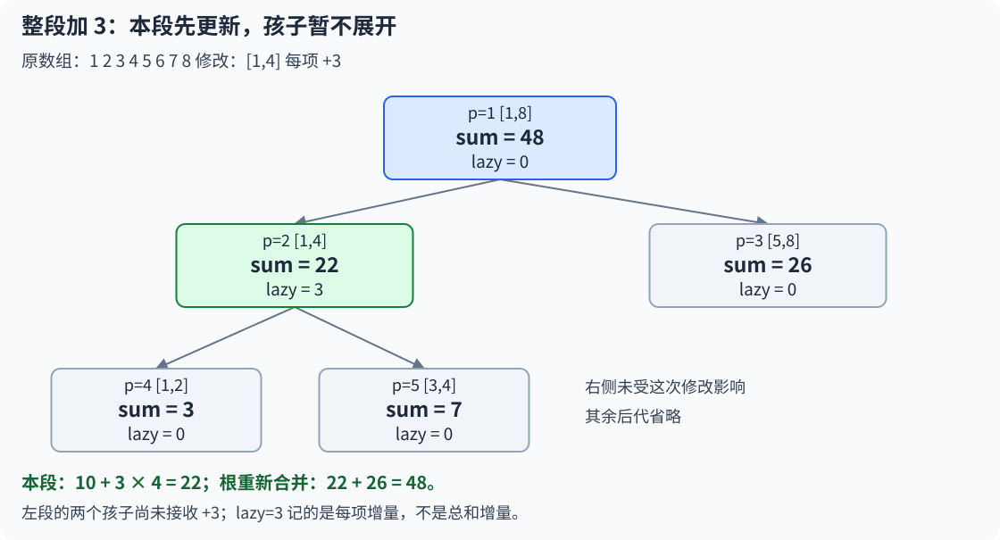
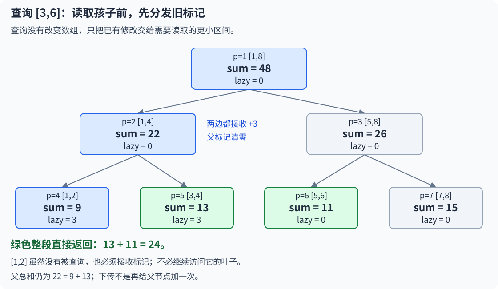
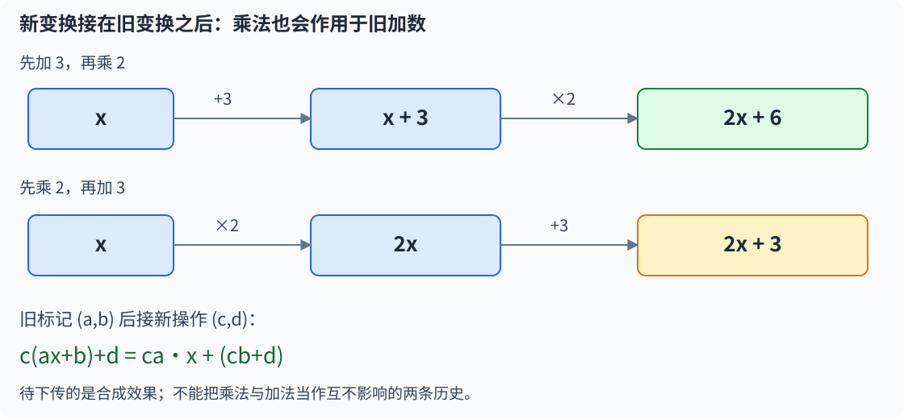
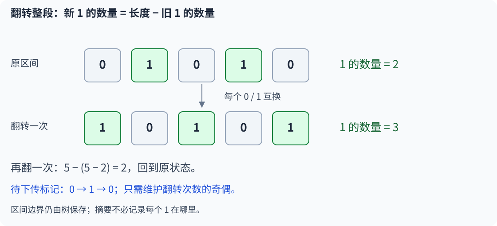

# 9.7 线段树区间修改：懒标记

前置：[线段树基础](06-segment-tree-basics.md)、[差分](../02-sequence-techniques/02-difference.md)。

> **整段都要加同一个数，可以先更新这一段的总和，把“孩子以后也要加多少”记下来；真正进入孩子时，再把修改传下去。**

先用**区间加、区间求和**理解标记生效、累积与下传；典题复盘再扩展到**乘加复合与区间翻转**，区间赋值只说明统一表示，其他混合操作按需补充。

配套实现：[线段树竞赛模板](../../templates/09-data-structures/segment-tree/README.md)。重点定位：[查询时补齐修改，为什么仍是对数复杂度](#查询时补齐修改为什么仍是对数复杂度)。

## 0. 先看问题：整段修改为什么慢？

上一节每次修改一个位置，只经过一条根到叶子的路径，时间为 `O(log n)`。

现在要把 `[l,r]` 内**每一项**都加上 d，再穿插查询任意区间的和。

- 逐点调用修改接口可以正确完成，但一段有 k 项，就需要 `O(k log n)`。
- 普通差分适合先记录修改、最后统一还原；若每次查询前都完整还原，交错操作的成本仍然很高。
- 上节已学的**单棵 BIT 接口分别处理点加／区间和、区间加／单点查**，不能直接把两个接口拼成区间加／区间和；两棵 BIT 的推导留待相应扩展。

**瓶颈不是找不到被修改的位置，而是反复把同一段修改拆到每个叶子。**

如果一个节点的区间已经全部落在修改范围中，能否只看区间长度，就直接算出它的新总和？能否将向下逐项更新推迟？

这就是**懒标记（lazy propagation，延迟下传）**解决的问题。修改已在当前节点生效，推迟的是向更小区间分发这次修改。

## 1. 通用实现：区间加与区间求和

原数组 **1-based**，`a[0]` 占位，`n≥1`。所有操作都是**非空闭区间**，满足 `1≤ql≤qr≤n`。

```cpp
using ll = long long;

struct LazySegSum {
    int n;
    vector<ll> tree, lazy;

    // 构造线段树：tree 维护区间和，lazy 记录尚未下传的区间增量。
    explicit LazySegSum(const vector<ll>& a)
        : n(static_cast<int>(a.size()) - 1),
          tree(4 * a.size()), lazy(4 * a.size()) {
        build(1, 1, n, a);
    }

    // 对外接口：将闭区间 [ql, qr] 内的每个元素增加 delta。
    void add(int ql, int qr, ll delta) {
        add(1, 1, n, ql, qr, delta);
    }

    // 对外接口：查询闭区间 [ql, qr] 的元素总和。
    ll query(int ql, int qr) {
        return query(1, 1, n, ql, qr);
    }

    // 合并当前节点：区间和等于左右子区间之和。
    void pull(int p) {
        tree[p] = tree[p * 2] + tree[p * 2 + 1];
    }

    // 建树：叶子记录原数组值，内部节点由左右孩子合并得到。
    void build(int p, int l, int r, const vector<ll>& a) {
        if (l == r) {
            tree[p] = a[l];
            return;
        }

        int mid = l + (r - l) / 2;

        // 建树需要覆盖整个区间，因此左右子树都要递归。
        build(p * 2, l, mid, a);
        build(p * 2 + 1, mid + 1, r, a);

        pull(p);
    }

    // 应用区间增量：立即更新本节点的区间和，并记录待下传的增量。
    void apply(int p, int l, int r, ll delta) {
        // 区间内每个元素增加 delta，共有 r-l+1 个元素。
        tree[p] += delta * (r - l + 1);

        // 累加而不是覆盖：多次尚未下传的修改需要合并。
        lazy[p] += delta;
    }

    // 下传懒标记：让左右孩子接收父节点尚未下传的增量。
    void push(int p, int l, int r) {
        // 叶子没有孩子；标记为 0 则没有待下传的修改。
        if (l == r || lazy[p] == 0) return;

        int mid = l + (r - l) / 2;

        // 按各自区间长度更新孩子的区间和，同时累加孩子的懒标记。
        apply(p * 2, l, mid, lazy[p]);
        apply(p * 2 + 1, mid + 1, r, lazy[p]);

        // 标记已经交给孩子，清零以免重复下传。
        lazy[p] = 0;
    }

    // 区间增加：完整覆盖时直接打标记；否则递归处理相交的子区间。
    void add(int p, int l, int r, int ql, int qr, ll delta) {
        if (ql <= l && r <= qr) {
            apply(p, l, r, delta);
            return;  // 整段已经更新，无须继续访问每个叶子。
        }

        // 部分覆盖时，先下传旧标记，保证孩子的数据是最新的。
        push(p, l, r);

        int mid = l + (r - l) / 2;

        // 关键：这里必须是两个独立的 if，而不是 if-else。
        // 区间可能跨越 mid，左右子树都需要修改。
        if (ql <= mid)
            add(p * 2, l, mid, ql, qr, delta);

        // 右子树从 mid + 1 开始，因此 qr > mid 时才可能相交。
        if (qr > mid)
            add(p * 2 + 1, mid + 1, r, ql, qr, delta);

        // 子节点更新后，重新合并父节点的区间和。
        pull(p);
    }

    // 区间查询：完整覆盖直接返回；否则下传标记并汇总相交部分。
    ll query(int p, int l, int r, int ql, int qr) {
        if (ql <= l && r <= qr)
            return tree[p];  // 本节点的区间和已经包含所有施加到本段的修改。

        // 查询更小的区间前，先确保孩子收到父节点尚未下传的修改。
        push(p, l, r);

        int mid = l + (r - l) / 2;
        ll ans = 0;  // 求和操作的合并初值。

        if (ql <= mid)
            ans += query(p * 2, l, mid, ql, qr);

        if (qr > mid)
            ans += query(p * 2 + 1, mid + 1, r, ql, qr);

        // 查询只读取并下传已有修改，没有改变区间内容，因此无需 pull。
        return ans;
    }
};
```

**`add` 是加上增量，不是赋值。** 构造后结构独立保存数据，后续操作不会同步修改传入的外部数组；多测时重新构造对象即可。

## 2. 变量与状态：两个数组分别记什么？

| 对象 | 含义与范围 |
| --- | --- |
| `n` | 原数组的有效项数，不是数值上限 |
| `p、l、r` | 当前树节点编号，以及它固定负责的原数组区间 |
| `ql、qr` | 本次请求的区间，递归中保持不变 |
| `tree[p]` | 该节点已接收的所有修改生效后，本段的总和 |
| `lazy[p]` | 已计入本段总和、尚未向孩子分发的**每项增量** |
| 两个 vector 的容量 | 均按原数组长度开约 `4n` 空间；初始值为 0 |

**孩子可能还没收到祖先的标记。** 因而不能随便读取某个深层 `tree[p]`，就认为它已经包括全部修改；**沿递归路径先 push，当前节点才会收到应有的修改**。

`lazy[p]` **不是总和增加量，也不是“本节点还没更新”**。本节点已经更新，孩子暂时没跟上。

叶子没有孩子。为统一 `apply`，叶子的 lazy 也可以累积，但不再下传；叶子的 `tree[p]` 就是当前这一项的值。

## 3. 整段命中：为什么可以直接 apply？

以数组 `1、2、3、4、5、6、7、8` 为例，把 `[1,4]` 每项加 3。

原来这一段的总和为：

$$
1+2+3+4=10.
$$

四项各增加 3，总和增加四份 3：

$$
10+3\times4=22.
$$

因此 **`[1,4]` 节点可以立即改成 22，并记录每项待下传增量 3，暂时不访问它的孩子**。

**能否先不改，等递归返回时用 pull 合并？当前写法不能这样省略。** `pull` 只把两个孩子**已有的总和**相加，不会自动执行 lazy 里记录的加法。

- **整段覆盖后直接 return，不会进入孩子，也不会执行本节点后面的 pull。** 当前这段必须在返回前就保存正确总和。
- 祖先随后虽然会 pull，但读到的是当前节点的值。若 `[1,4]` 仍为 10，根就会算成 `10+26=36`，而不是修改后的 48。
- 下次若直接查询 `[1,4]`，也会完整覆盖并返回旧值 10，不能指望未来某次递归替这次补算。

如果像普通修改那样**继续递归到叶子，把每项都改完，再逐层 pull**，当然可以得到正确结果；但整段修改就会退化为 `O(n)`，失去整段处理的优势。也可以另行设计“读取时把标记计入”的保存规则，但必须配套调整查询与合并，不能只删去当前 apply 更新总和的语句。

> **本节延迟的是向孩子分发，不是当前节点生效。apply 让这一段立即正确；pull 负责在孩子改变后重新合并，二者不能互相替代。**



设当前区间有 len 项，各项都增加 d：

$$
\sum_{i=l}^{r}(a_i+d)
=\sum_{i=l}^{r}a_i+d\times(r-l+1).
$$

**只需要原总和、增量与区间长度，就能得到新总和。** 这对应 `apply` 中的第一句。

连续每项加 3、再减 1，尚未下传的操作可以合成每项加 2：

$$
(x+3)-1=x+2.
$$

所以第二句是 `lazy[p] += delta`，**不能直接覆盖旧增量**。本节加法的无操作标记为 0；正负增量抵消成 0 时，确实无须再向下分发。

## 4. 部分命中：先 push，再进入孩子

继续前面的例子，查询 `[3,6]`。

**`[1,4]` 的总和 22 已经正确，但它的孩子 `[3,4]` 仍只存着原来的 7。** 不能直接用这个旧值回答子区间查询。

因此从 `[1,4]` 继续向下前，要把每项加 3 分别交给两个孩子：

$$
[1,2]:\quad 3+3\times2=9.
$$

左孩子有两项，总和增加 6，并接收自己的标记 3。

$$
[3,4]:\quad 7+3\times2=13.
$$

右孩子也有两项，同样增加 6。两边都接收后，父标记清零。



另一边 `[5,6]` 没有受到先前修改，仍为 11；于是：

$$
\mathrm{query}(3,6)=13+11=24.
$$

### 为什么两个孩子都要接收？

父标记表示**整段每一项**都要增加，不能只交给本次访问的那个孩子，然后就把父标记清零。

否则，未访问的另一半会永久漏掉这次修改。

**本实现 push 时一次交给两侧；本次请求具体访问哪一侧，仍由后面的两个 if 决定。** 下传标记不等于遍历孩子的整个子树，`apply` 只处理孩子这个节点。

### 为什么清零？

清零的是“父节点尚未向孩子分发的增量”，**不是把父节点的总和改回去**。

如果不清零，下次再经过父节点就会重复下传，孩子会多加一次。

## 5. 修改和查询：push、pull 的职责不同

| 情况 | 操作顺序 | 原因 |
| --- | --- | --- |
| 修改完整覆盖当前段 | `apply` 后返回 | 当前摘要能直接更新，不必展开孩子 |
| 修改只覆盖部分 | **`push → 递归修改 → pull`** | 先补旧修改，再做新修改，最后合并改变后的孩子 |
| 查询完整覆盖当前段 | 直接返回 `tree[p]` | 当前节点已经接收并算入应有修改 |
| 查询只覆盖部分 | **`push → 递归查询 → 合并答案`** | 读取孩子前先补齐修改，本段实际内容没有改变 |

### 为什么修改前必须 push？

若 `[1,4]` 还挂着标记 3，孩子总和仍是 3 与 7。直接修改某个孩子、随后 pull，会用未补齐的旧孩子覆盖父节点，**原先已经记入父总和的增量会被丢掉**。

先 push 后，孩子总和是 9 与 13；再进行局部修改和 pull，才有完整依据。

### 为什么查询后通常不用 pull？

> **push 只是把已经算过的修改交给孩子，不会再改变这一段的真实总和**：

$$
22=9+13.
$$

继续向下查询也只是读取与分发，父摘要仍然有效，不需要重新赋值。

> **查询没有改变原数组的逻辑值，但可能改变 tree、lazy 的内部保存位置，所以这里的 query 不加 `const`。** 这与上节完全只读的查询不同。

## 6. 为什么延迟以后仍然正确？

先看前面的两种保存形态：

$$
22=3+7+3\times4.
$$

下传前，孩子仍旧，父节点额外记着整段待分发的增量。

$$
22=9+13+0\times4.
$$

下传后，孩子已经接收，父标记变成 0，**总和没有改变，只是修改换了保存位置**。

一般地，对于有两个孩子的节点：

$$
\mathrm{tree}[p]
=\mathrm{tree}[2p]+\mathrm{tree}[2p+1]
+\mathrm{lazy}[p]\times(r-l+1).
$$

**这是节点与直接孩子之间的关系**。若祖先还有未下传的标记，该式两边都尚未包括那部分；真正访问当前节点前，会由祖先逐层下传补齐。

1. 建树时 lazy 全为 0，父总和等于两个孩子之和。
2. **整段修改同时更新本段总和与本段标记，上式继续成立**。
3. **push 给两个孩子加上对应贡献，再清空父标记，保存的总量不变**。
4. **局部修改先 push；递归完成后父标记为 0，pull 可以直接合并孩子**。

**完整覆盖时停下、需要细节时下传，既没有漏算，也不会把同一份增量重复计算。** 查询仍沿用上节[不重叠区间分解的依据](06-segment-tree-basics.md#5-区间查询整段收下边缘继续拆)。

## 7. 能否用懒标记，要先回答两个问题

**第一，整段操作能否只用节点已有信息，快速更新摘要？** 本节保存总和，并能从边界得到长度，因此区间加可以直接处理。

**第二，多次待处理操作能否合成一个同类标记？** 本节连续加法可以合并成一个增量。

还要保证：**先合并孩子再更新，与分别更新孩子后再合并，结果相同。** 区间加与区间和正好满足：

$$
(s_1+s_2)+d(L_1+L_2)
=(s_1+dL_1)+(s_2+dL_2).
$$

这里两边的长度分别为 L₁、L₂。它解释了父节点直接更新为何与最终分发给孩子一致。

> **懒标记不是所有区间操作都能套用的开关。先推导摘要如何变化、标记如何合并，再写 apply 和 push。**

**区间赋值不能照搬 `lazy += delta`**；如果多种操作混合，执行顺序也可能影响结果。具体复合方向见后文 [P3373 乘加复盘](#91-洛谷-p3373线段树-2)。

## 8. 复杂度与易错边界

- **建树 `O(n)`，空间 `O(n)`。** 两份约 `4n` 的 ll 数组，只多一个常数因子。
- **一次区间修改／查询 `O(log n)`。** 每层只有请求边界附近的节点需要继续拆分；完整覆盖的节点直接停下，每层处理常数个节点。整段更新根节点时可直接 `O(1)` 完成。
- 支持正、负、零增量；负数不会破坏求和规则。零增量不改变结果。
- `delta × 长度`、区间和、答案累加及标记累加都必须能用 ll 表示；**最后答案装得下，不代表每个中间乘积都一定装得下**。
- 单点区间也是合法区间；空数组、越界与颠倒端点不属于本接口。

### 查询时补齐修改：为什么仍是对数复杂度？

**可以把 push 理解为：沿本来就需要访问的递归路径，顺手补齐孩子尚未接收的修改。** 但维持对数复杂度还依赖两件事：

1. **不只查询会下传，局部修改也会下传。** 整段修改当场更新摘要，不能全部等到查询时再执行。
2. **历史被压成可快速合并的标记。** 每个访问节点只做常数次 apply／push／pull，不会因积攒许多操作而逐条重放。

因此，一次区间操作只需访问对数数量的节点。**关键收益是整段效果可直接更新、操作历史可合并（查询阶段统一执行单次操作来更新），加上按需细分；不是单纯把耗时工作换到查询阶段。**

| 易错点 | 会发生什么 |
| --- | --- |
| 只改 lazy，不改 tree | 完整覆盖查询直接读到旧总和 |
| 总和只加 delta | 忘记本段每一项都在增加，需要乘长度 |
| 直接覆盖加法标记 | 连续修改丢掉之前尚未下传的增量 |
| 局部递归前不 push | 读取旧孩子，或在 pull 时丢掉先前修改 |
| push 只交给一侧就清零 | 另一侧漏掉整段修改 |
| push 后忘记清零 | 后续重复分发 |
| 区间可能跨中点却写 else | 只处理一半；此处与点修改不同 |

单点修改、区间分解与树节点编号继续参考[上一节](06-segment-tree-basics.md)，不另写一套相同的建树解释。

## 9. 典题与复盘

以 **P3373** 练习区间乘加与操作顺序，再用 P2574 对照不同摘要；基础加法可按需复习 [P3372](https://www.luogu.com.cn/problem/P3372)，该复习题未记录实际解答。

两份原实现仅整理排版与过程注释，通用框架不重复。**本地核验通过，平台结果未单独记录。**

### 9.1 洛谷 P3373：线段树 2

题目：[P3373【模板】线段树 2](https://www.luogu.com.cn/problem/P3373)。

支持区间乘、区间加、区间和取模；`n,q≤10⁵`，原题初值与操作数值不超过 `10⁴`，除样例外模数为 `571373`。程序中的 `m` 表示操作数，`mod` 才是模数，与原题字母命名不同，但读取顺序一致。

**收录原因：**面对交替发生、顺序影响结果的操作，先寻找统一表示，再推导操作如何组合，减少逐情况打补丁。

#### 原实现：同一个 apply 接收乘数与加数

```cpp
struct LazySegMod {
    ll MOD;
    int n;
    vector<ll> tree, lazyM, lazyA;

    explicit LazySegMod(const vector<ll>& a, ll mod)
        : MOD(mod), n(static_cast<int>(a.size()) - 1),
          tree(n * 4), lazyM(n * 4, 1), lazyA(n * 4) {
        build(1, 1, n, a);
    }

    void multi(int ql, int qr, ll delta) {
        multi(1, 1, n, ql, qr, delta);
    }

    void add(int ql, int qr, ll delta) {
        add(1, 1, n, ql, qr, delta);
    }

    ll query(int ql, int qr) {
        return query(1, 1, n, ql, qr);
    }

    void pull(int p) {
        tree[p] = (tree[p * 2] + tree[p * 2 + 1]) % MOD;
    }

    void build(int p, int l, int r, const vector<ll>& a) {
        if (l == r) {
            tree[p] = a[l] % MOD;
            return;
        }

        int mid = (l + r) / 2;
        build(p * 2, l, mid, a);
        build(p * 2 + 1, mid + 1, r, a);
        pull(p);
    }

    // 新操作为 x -> c*x+d；先更新总和，再把它接到旧标记后面。
    void apply(int p, int l, int r, ll c, ll d) {
        tree[p] = (c * tree[p] + d * (r - l + 1)) % MOD;

        lazyM[p] = c * lazyM[p] % MOD;
        lazyA[p] = (c * lazyA[p] + d) % MOD;
    }

    void push(int p, int l, int r) {
        if (l == r || (lazyM[p] == 1 && lazyA[p] == 0))
            return;

        int mid = l + (r - l) / 2;
        apply(p * 2, l, mid, lazyM[p], lazyA[p]);
        apply(p * 2 + 1, mid + 1, r, lazyM[p], lazyA[p]);

        lazyM[p] = 1; // 恢复为 x -> x，而不是把两项都清零。
        lazyA[p] = 0;
    }

    void multi(int p, int l, int r, int ql, int qr, ll k) {
        if (l >= ql && r <= qr) {
            apply(p, l, r, k, 0);
            return;
        }

        push(p, l, r);
        int mid = (l + r) / 2;
        if (mid >= ql)
            multi(p * 2, l, mid, ql, qr, k);
        if (mid < qr)
            multi(p * 2 + 1, mid + 1, r, ql, qr, k);
        pull(p);
    }

    void add(int p, int l, int r, int ql, int qr, ll d) {
        if (l >= ql && r <= qr) {
            apply(p, l, r, 1, d);
            return;
        }

        push(p, l, r);
        int mid = (l + r) / 2;
        if (mid >= ql)
            add(p * 2, l, mid, ql, qr, d);
        if (mid < qr)
            add(p * 2 + 1, mid + 1, r, ql, qr, d);
        pull(p);
    }

    ll query(int p, int l, int r, int ql, int qr) {
        if (l >= ql && r <= qr)
            return tree[p];

        push(p, l, r);
        int mid = (l + r) / 2;
        ll ans = 0;
        if (mid >= ql)
            ans = (ans + query(p * 2, l, mid, ql, qr)) % MOD;
        if (mid < qr)
            ans = (ans + query(p * 2 + 1, mid + 1, r, ql, qr)) % MOD;
        return ans;
    }
};

void solve() {
    int n, m;
    ll mod;
    cin >> n >> m >> mod;

    vector<ll> a(n + 1);
    for (int i = 1; i <= n; ++i)
        cin >> a[i];
    LazySegMod seg(a, mod);

    while (m--) {
        int op, x, y;
        cin >> op >> x >> y;
        if (op == 1) {
            ll k;
            cin >> k;
            seg.multi(x, y, k);
        } else if (op == 2) {
            ll d;
            cin >> d;
            seg.add(x, y, d);
        } else {
            cout << seg.query(x, y) << '\n';
        }
    }
}
```

#### 先看例子：为什么两个标记不能各改各的？

对同一个数先加 3，再乘 2：

$$
x\ \longrightarrow\ x+3\ \longrightarrow\ 2(x+3)=2x+6.
$$

**后来的乘法也要乘到先前的加数上。** 若只修改乘法标记，保留加数 3，就错误变成了 `2x+3`。

反过来，先乘 2，再加 3：

$$
x\ \longrightarrow\ 2x\ \longrightarrow\ 2x+3.
$$

两种顺序结果不同，不能把它们当成互不相干的两项累计。



#### 用一个变换统一描述操作

**`lazyM[p]、lazyA[p]` 合起来表示：孩子将来需要接收的变换**，不是原数组的最大值、总和或操作次数。

$$
f(x)=ax+b.
$$

这里 a、b 分别对应乘法与加法标记；所有计算按 MOD 取模。

| 修改 | 乘法参数 a | 加法参数 b |
| --- | --- | --- |
| 加 d | 1 | d |
| 乘 k | k | 0 |
| 不操作 | 1 | 0 |
| 赋值为 c（模型扩展） | 0 | c |

赋值说明统一表示的扩展能力，**本题没有赋值输入接口，也不把它写成原题操作**。初始化与 push 后重置为 `(1,0)`，因为它表示保持原值；`(0,0)` 则是把整段变成 0。

#### 新操作必须接在旧标记之后

设旧标记是 `f(x)=ax+b`，新操作是 `g(x)=cx+d`。

$$
g(f(x))=c(ax+b)+d.
$$

先执行旧操作，得到的结果再交给新操作。

$$
g(f(x))=(ca)x+(cb+d).
$$

所以合成标记为：

$$
(a,b)\ \longrightarrow\ (ca,\ cb+d).
$$

对应 `lazyM = c*lazyM`、`lazyA = c*lazyA+d`。**合成方向由实际先后顺序决定，不能交换新旧。** 乘法系数相乘看不出方向差异，旧加法标记怎样变化才是容易写错的位置。

#### 节点总和为什么是两部分？

设本段有 L 项，旧总和为 S。**每个元素都变成 c 倍，再各加 d**：

$$
\sum(cx_i+d)=c\sum x_i+dL=cS+dL.
$$

所以 `tree[p]` 整体乘 c；每项附加的 d 还要乘长度。不是把总和只增加一个 d，也不是只让“剩余部分”接收函数。

例如 `[1,2,3]` 原和为 6，先每项加 3，再每项乘 2：

$$
6\ \longrightarrow\ 6+3\times3=15
\ \longrightarrow\ 2\times15=30.
$$

同一过程合成 `x→2x+6`，直接作用到总和也得到：

$$
2\times6+6\times3=30.
$$

**节点总和更新与标记合成是两件配套的事**：前者让当前节点立即正确，后者让孩子将来接收同样的完整操作。

#### push 时，为什么父标记是“较新的操作”？

若孩子已经挂着旧标记，而父节点后来整段修改，就先在父节点等待；下次局部访问前，父标记才传给孩子。因此应把父标记接在孩子旧标记之后。

反过来，若之后又局部修改孩子，必须先 push 父标记，再进入孩子处理新操作。**时间顺序由“局部递归前先下传”这一流程保证**，不用另外保存每条操作的时间。

#### 范围与实现取舍

- 原实现的 `multi/add` 两份递归都正确，共用同一个 `apply`；可再抽成接收 `(c,d)` 的统一修改函数，但不是正确性修复，本篇保留原结构。
- 外部数组 1-based，树也按 `1..n` 划分；`4n` 空间与中点计算在原题范围内安全。对象不改传入数组，多测重新构造。
- **原题范围下 ll 足够容纳取模前的乘加。取模不能挽救已经发生的溢出。** 若推广到很大模数或任意 ll 系数，需要另行检查乘积及两项之和；负参数还需要规范化余数，不能直接把本实现当作任意整数通用版。
- `(1,0)` 是实际使用的恒等标记。将模型额外用于 `MOD=1` 时，取模后的乘法标记可能变成 0，仍然正确，但可能多做无效下传；原题不依赖这一特例。
- 建树 `O(n)`，每次操作 `O(log n)`，空间 `O(n)`。未更改递归结构，变化的是摘要更新与标记复合。

更一般的识别与复合方法见[统一变换，按顺序复合](../../patterns/09-data-structures/composable-transformations.md)，本题完整实现只在这里维护。

### 9.2 洛谷 P2574：XOR 的艺术

题目：[P2574 XOR 的艺术](https://www.luogu.com.cn/problem/P2574)。

长度为 n 的 01 串；`op=0` 翻转闭区间，`op=1` 查询其中 `1` 的数量；`n,m≤2×10⁵`。

**收录原因：**根据查询目标与整段操作选择足够的摘要；不保留无须读取的逐项细节，并利用操作抵消压缩历史。

#### 原实现：计数与翻转奇偶

```cpp
struct LazySegF {
    int n;
    vector<int> tree, lazy;

    explicit LazySegF(const string& s)
        : n(static_cast<int>(s.size())), tree(n * 4), lazy(n * 4) {
        build(1, 1, n, s);
    }

    void flip(int ql, int qr) {
        flip(1, 1, n, ql, qr);
    }

    ll query(int ql, int qr) {
        return query(1, 1, n, ql, qr);
    }

    void pull(int p) {
        tree[p] = tree[p * 2] + tree[p * 2 + 1];
    }

    void build(int p, int l, int r, const string& s) {
        if (l == r) {
            tree[p] = s[l - 1] - '0'; // 树区间 1-based，原字符串仍是 0-based。
            return;
        }

        int mid = (l + r) / 2;
        build(p * 2, l, mid, s);
        build(p * 2 + 1, mid + 1, r, s);
        pull(p);
    }

    void apply(int p, int l, int r) {
        tree[p] = (r - l + 1) - tree[p];
        lazy[p] ^= 1; // 待下传翻转次数的奇偶；翻两次就抵消。
    }

    void push(int p, int l, int r) {
        if (l == r || lazy[p] == 0) return; // 排除不必下传的情况。

        int mid = (l + r) / 2;
        apply(p * 2, l, mid);
        apply(p * 2 + 1, mid + 1, r);
        lazy[p] = 0; // 两个孩子已接收，清除本层的待下传标记。
    }

    void flip(int p, int l, int r, int ql, int qr) {
        if (l >= ql && r <= qr) {
            apply(p, l, r);
            return;
        }

        push(p, l, r);
        int mid = (l + r) / 2;
        if (mid >= ql)
            flip(p * 2, l, mid, ql, qr);
        if (mid < qr)
            flip(p * 2 + 1, mid + 1, r, ql, qr);
        pull(p);
    }

    ll query(int p, int l, int r, int ql, int qr) {
        if (l >= ql && r <= qr)
            return tree[p];

        push(p, l, r);
        int mid = (l + r) / 2;
        ll ans = 0;
        if (mid >= ql)
            ans += query(p * 2, l, mid, ql, qr);
        if (mid < qr)
            ans += query(p * 2 + 1, mid + 1, r, ql, qr);
        return ans;
    }
};

void solve() {
    int n, m;
    cin >> n >> m;
    string s;
    cin >> s;
    LazySegF seg(s);

    while (m--) {
        int op, x, y;
        cin >> op >> x >> y;
        if (op == 0)
            seg.flip(x, y);
        else
            cout << seg.query(x, y) << '\n';
    }
}
```

#### 如何想到只保存数量？

先看一段 `01010`：长度为 5，其中有两个 1。全部翻转后得到 `10101`，有三个 1。

$$
\text{新 1 的数量}=\text{旧 0 的数量}=5-2=3.
$$

**翻转整段时，原来每一个 0 都变成 1；只需要旧 1 的数量与总长度，不需要知道这些 1 分别在哪个位置。**



一般地，长度为 L、原先有 C 个 1：

$$
C'=L-C.
$$

两个孩子保存的计数可以直接相加。局部修改仍需树的区间划分、下传与回程合并；**不在摘要里保存具体位置，不等于整个数据结构丢掉了区间边界**。

#### 标记为什么用异或？

把同一段连续翻两次：

$$
C\ \longrightarrow\ L-C
\ \longrightarrow\ L-(L-C)=C.
$$

因此待下传历史只剩“翻奇数次”或“翻偶数次”：

$$
0\oplus1=1,\qquad 1\oplus1=0.
$$

这对应 `lazy[p] ^= 1`。**不能直接写成 1**，否则两次翻转本应抵消，却还会多向孩子翻一次。push 后清零的含义仍是本层已分发完成。

#### 与修改字母那题有什么区别？

| 比较 | CF 1234D：不同字母数 | P2574：1 的数量 |
| --- | --- | --- |
| 查询需要什么 | 哪些字母出现过，最后去重计数 | 1 出现了多少次 |
| 区间摘要 | 26 种字母的出现集合 | 一个计数 |
| 两段合并 | 集合取并集 | 计数相加 |
| 这一版修改 | 单点替换字母 | 整段翻转 0/1 |

**上一题的 `bitset<32>` 保存字母种类，不保存原字符串位置。** 每个节点只有固定 32 位，总空间仍为 `O(n)`；不能把它理解为“关注位置所以必须 bitset”。原题回看 [CF 1234D](06-segment-tree-basics.md#92-cf-1234ddistinct-characters-queries)。

本题若只保存“0/1 是否出现过”，`00001` 与 `01111` 都是两种符号，却分别只有 1 个、4 个 1，信息不足。也可以另用位集合保留逐项位置，但并非必须爆内存；**每个节点机械开 n 位会浪费空间，真正的选择依据是计数已经足够，而不是 bitset 这个类型不可用**。

#### 下标与数值边界

原字符串没有补空格，仍是 0-based；树区间及输入端点为 1-based，所以叶子读取 `s[l-1]`。`n` 取完整 `s.size()`，不能沿用上一题补空格后的 `size()-1`。

节点计数不超过 n，因此本题 `vector<int>` 足够；查询返回 ll 也合法。原字符串只用于建树，之后由树维护，不必同步改动 s。两次相同整段翻转、相交区间翻转、全零／全一与单点查询都应按同一规则处理。

建树 `O(n)`，每次操作 `O(log n)`，空间 `O(n)`；不需要枚举区间里每个字符。

#### 与统一变换的联系

对 0/1 单值，翻转也能写成：

$$
f(x)=1-x.
$$

但这里只有恒等与翻转两种可能，**一个奇偶标记比通用两参数更简洁**。统一模型用于推导，最终实现仍应选择足够、好写的表示。

## 10. 自查与衔接

1. `tree[p]` 已经变了，为什么孩子还能暂时不变？`lazy[p]` 到底欠哪一层什么操作？
2. 先加 3 再乘 2，为何旧加法标记也要乘 2？push 时父标记应接在孩子旧标记哪一边？
3. P2574 为何可以只保存计数，而 CF 1234D 需要字符出现集合？两次翻转为何不必保存两条记录？

本节的**区间加、乘加复合、翻转计数**及两题原实现已完成复盘与本地核验；平台结果未单独记录。赋值的统一表示已说明，更多混合操作的实际题目与全章选型仍留到后续。

合并、整段映射与标记复合的条件可对照 [ACL Lazy Segtree 文档](https://atcoder.github.io/ac-library/production/document_en/lazysegtree.html)。该库采用通用接口与 0-based 半开区间；本篇为独立 C++11 教学实现，使用 1-based 闭区间，未移植其代码。

[返回本章索引](README.md) · [统一变换与操作复合](../../patterns/09-data-structures/composable-transformations.md) · [固定依赖与局部维护](../../patterns/05-dynamic-programming/dp-modeling-workflow.md#固定划分的区间只重算受影响的祖先)
