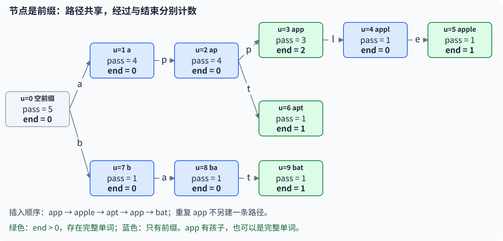
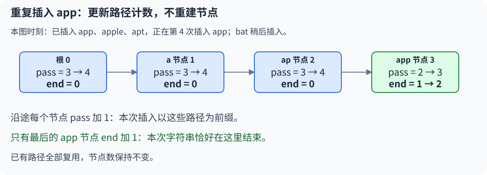
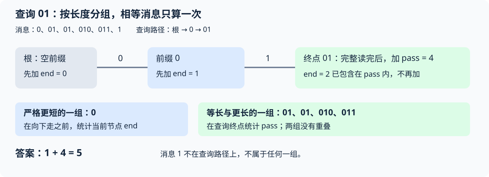

# 9.8 Trie：共享前缀与字符串计数

前置：[string](../01-basic-problem-solving/04-stl/containers/03-string.md)、[vector](../01-basic-problem-solving/04-stl/containers/01-vector.md)、[图与树的基本表示](../06-graph-and-tree/01-graph-basics.md)。

> **从根出发，每读一个字符走一条边。相同前缀共用路径，完整单词在哪里结束，再单独标记。**

Trie（字典树／前缀树）保存一组字符串。本节处理插入、完整字符串出现次数与前缀计数；不扩展删除、最大异或或多模式子串匹配。

配套实现：[Trie 竞赛模板](../../templates/09-data-structures/trie/README.md)。正文先用小写字母，模板另允许指定连续字符表。

## 0. 为什么需要按前缀组织字符串？

已有字符串 `app、apple、apt、app、bat`，反复询问：

- 完整单词 `app` 插入过几次？
- 有多少次插入的字符串以 `ap` 开头？
- 沿着 `ap` 这条前缀继续走，可以接哪些字符？

只查完整字符串时，`map`／`unordered_map` 已能正确统计，不必强行换结构。

**但每次扫描全部单词、逐一检查前缀，会重复比较相同的开头。** 也可以给所有前缀各存一个键，只是重复保存前缀字符可能占用较多空间；静态数据还可以排序后定位前缀范围。

这里选择另一种组织方式：**相同前缀只建一条公共路径，把计数放在路径对应的节点上。** 查询时只沿给定字符串走，不扫描整份词典。

## 1. 通用实现：插入、完整计数与前缀计数

输入只含 `'a'..'z'`。原字符串从下标 0 开始，**树根编号为 0，缺失的边为 -1**；节点编号与字符编号是两套东西。

```cpp
#include <array>
#include <string>
#include <vector>

struct Trie {
    struct Node {
        // next[c] 表示：从当前节点代表的前缀后面追加字符 'a' + c 后，
        // 得到的子节点在 tr 中的下标。
        // -1 表示该字符对应的子节点不存在。
        std::array<int, 26> next;

        // pass：有多少个插入字符串经过当前节点所代表的前缀。
        int pass = 0;

        // end：有多少个插入字符串恰好结束在当前节点。
        int end = 0;

        Node() { next.fill(-1); }
    };

    // 节点池。节点通过下标访问，下标 0 固定为根节点。
    // 根节点代表空前缀 ""。
    std::vector<Node> tr;

    // 初始只有根节点，代表空前缀。
    Trie() : tr(1) {}

    // 插入字符串 s。
    // 插入过程中维护每个经过节点的 pass；
    // 若路径不存在则动态创建节点；
    // 最后在 s 对应节点上增加 end。
    void insert(const std::string& s) {
        int u = 0;

        // 任何字符串都经过空前缀，因此根节点的 pass 增加 1。
        // 所以根节点的 pass 最终等于插入字符串的总次数。
        ++tr[u].pass;

        for (char ch : s) {
            int c = ch - 'a';

            // 如果当前前缀后接字符 ch 的子节点不存在，则创建新节点。
            if (tr[u].next[c] == -1) {
                int v = static_cast<int>(tr.size());
                tr[u].next[c] = v;

                // 新节点的 next 全为 -1，pass 和 end 均为 0。
                tr.emplace_back();
            }

            // 沿字符 ch 走到对应子节点。
            u = tr[u].next[c];

            // 当前插入字符串经过该节点代表的前缀，因此 pass 增加 1。
            ++tr[u].pass;
        }

        // 当前插入字符串恰好结束在节点 u。
        ++tr[u].end;
    }

    // 返回字符串 s 对应的节点下标。
    // 如果 Trie 中不存在这条路径，则返回 -1。
    int find_node(const std::string& s) const {
        int u = 0;

        for (char ch : s) {
            int v = tr[u].next[ch - 'a'];
            if (v == -1) return -1;
            u = v;
        }

        return u;
    }

    // 返回字符串 s 作为完整字符串被插入的次数。
    // 即：有多少次插入恰好以 s 结束。
    int count(const std::string& s) const {
        int u = find_node(s);
        return u == -1 ? 0 : tr[u].end;
    }

    // 返回以字符串 s 为前缀的插入字符串数量。
    // 即：有多少个插入字符串经过 s 对应的节点。
    // 注意：若 s 为空串，则返回根节点的 pass，也就是插入字符串总次数。
    int prefix_count(const std::string& s) const {
        int u = find_node(s);
        return u == -1 ? 0 : tr[u].pass;
    }

    // 清空整个 Trie，只保留根节点，所有计数归零。
    void clear() {
        tr.assign(1, Node{});
    }
};
```

`insert` 按**插入次数**累计，重复字符串不会重复建同一路径，但会再次增加计数。`find_node/count/prefix_count` 都只读，不会因查询未知字符串而扩充词典。

## 2. 一个节点究竟代表什么？

从根走过的边标签拼起来，就是这个节点对应的前缀。**字符放在边上；节点表示已经读完哪一段。**



图中按 `app、apple、apt、app、bat` 的顺序插入。数字是实际创建的节点编号，与单词长度、字母编号无关。

| 对象 | 含义与范围 |
| --- | --- |
| `tr[0]` | 根，代表空前缀；不是无效节点 |
| `u` | 当前前缀对应的节点编号 |
| `c=ch-'a'` | 字母编号 `0..25`，用于选择出边 |
| `next[c]` | 沿字符 c 到达的节点编号；`-1` 表示没有这条边 |
| `pass[u]` | 以当前前缀开头的已插入字符串数量，重复插入重复计数 |
| `end[u]` | 恰好等于当前前缀的已插入字符串数量 |
| `tr.size()` | 已创建节点数，不是字符串数量或最大长度 |

本实现的字段实际写作 `tr[u].pass/end`。节点数最多为：

$$
V\le 1+\sum |s_i|.
$$

根占一个节点，每次插入一个字符最多新建一个节点。共享前缀会复用节点，所以实际数量通常更少。

**不是最多开 n 个节点，也不是只开最长字符串长度。** 

> **容量依据是所有插入字符串的总长度上界；普通查询不增加节点。**

## 3. 为什么路径存在，不代表完整单词存在？

`apple` 插入后，`a、ap、app、appl、apple` 都有路径。

但只凭路径，无法知道原来插入的是 `app`，还是仅仅插入了更长的 `apple`。

在图中的完整词典里，前缀 `ap` 对应节点 2：

$$
\mathrm{pass}[2]=4,\qquad \mathrm{end}[2]=0.
$$

四次插入经过这里，但没有一个单词恰好是 `ap`。

前缀 `app` 对应节点 3：

$$
\mathrm{pass}[3]=3,\qquad \mathrm{end}[3]=2.
$$

两次 `app`、一次 `apple` 共经过三次；只有两次在这里结束。

> **前缀查询读 pass，完整单词查询读 end。完整字符串也算自己的前缀。**

一个节点可以既是完整单词终点，又有后续孩子；不能只把叶子当作单词终点。

## 4. 插入过程：旧前缀复用，新分支才建节点

从根读入 `app`，每读一个字符，就移动到更长的前缀状态：

$$
\varepsilon\ \longrightarrow\ a\ \longrightarrow\ ap\ \longrightarrow\ app.
$$

这里 ε 表示空串。若路径已经存在，沿旧边走；某一步缺边，才创建新节点并接上。

**每次经过的节点 pass 都加 1，最后一个节点的 end 才加 1。** 根也经过，所以先给根 pass 加 1。

第二次插入 `app` 时，所有边都已存在：



最后节点的两个字段都会增加，原因不同：pass 表示本次经过它，end 表示本次恰好在这里结束。

### 为什么新边要初始化为 -1？

新节点还没有任何孩子，所有字符方向都不存在，必须全部设置为 -1。

`array<int,26> next = {-1}` **只会将第一个元素设为 -1，其余值初始化为 0**，会把尚不存在的边误写成根编号。这里用 `next.fill(-1)`，与[已有 array 初始化说明](../01-basic-problem-solving/04-stl/containers/02-array.md)一致。

### vector 扩容时，要保留编号，不要保留引用

`emplace_back()` 可能重新分配底层内存。**不要跨这一步保留 `tr[u]` 或它某个字段的引用、指针、迭代器，再继续访问。**

本实现先把新节点编号写到旧节点，再创建节点；随后通过整数 u 重新索引 `tr[u]`，不持有旧地址。

**扩容会改变地址，不会改变现有节点的整数编号**。

已知节点总量上界且内存允许时，可在插入前 `tr.reserve(上界)` 减少重分配；reserve 不是创建有效节点，仍需逐个 emplace。

## 5. 查询过程：走完整条路径，再决定读哪个字段

查询 `app` 时，沿三条边抵达节点 3；完整计数返回 2，前缀计数返回 3。

查询 `ap` 时，可以抵达节点 2，但完整计数为 0。**合法零值与“没有这条路径”不同。**

查询 `ape` 时，到 `ap` 后没有 `e` 边：

$$
\mathrm{find\_node}(\text{ape})=-1.
$$

此前已有的前缀状态不能继续走，说明没有任何已插入字符串以 `ape` 开头。两种计数都返回 0。

三个状态需要分开理解：

| 情况 | 返回或计数 |
| --- | --- |
| 路径不存在 | `find_node=-1`；计数为 0 |
| 路径存在，当前前缀不是完整单词 | 节点编号有效；end 为 0，pass 可以大于 0 |
| 路径存在，且是完整单词 | 节点编号有效；end 大于 0，也可能还有孩子 |

普通查询不修改任何状态。若题目要求记录“已经查询过”“属于哪篇文章”等，**这些是额外业务状态，不应偷换 end 的原本含义**；实际配题复盘再展开。

## 6. 正确性：为什么计数就是答案？

每个节点对每个字符至多有一条出边。因此，同一个前缀不管来自哪个字符串，都沿同一条路径到同一个节点；不同前缀不会被合成同一个节点。

插入字符串 s 时，逐个经过的恰好是它的所有前缀，并给对应 pass 加 1；只给完整 s 的终点 end 加 1。

所以插入全部完成后，对任意存在的前缀 p：

$$
\mathrm{pass}(p)
=\#\{\text{以 p 开头的插入记录}\}.
$$

每条满足条件的记录恰好经过一次这个节点，不满足的记录不会经过。

$$
\mathrm{end}(p)
=\#\{\text{完整字符串等于 p 的插入记录}\}.
$$

查询只需找到对应前缀节点，再读取适当字段；不需要遍历这个节点下面的所有单词。

## 7. 各种操作的时间复杂度

设一次操作的字符串长度为 L，当前节点数为 V。先按本节固定的 **26 字母／2 字符表**讨论，节点的孩子数组长度是常数。

| 操作 | 时间复杂度 | 原因 |
| --- | --- | --- |
| 构造空 Trie | `O(1)` | 只创建根节点，初始化固定长度的孩子数组 |
| `insert(s)` | **摊还 `O(L+1)`** | 每个字符至多走一条边、新建一个节点，并维护两个计数；扩容成本分摊到一系列插入 |
| `find_node(s)` | 最坏 `O(L+1)` | 沿一条路径走，缺边可以提前结束 |
| `count(s)` | 最坏 `O(L+1)` | 找到节点后，只读取一次 end |
| `prefix_count(s)` | 最坏 `O(L+1)` | 找到节点后，只读取一次 pass，不遍历下面的单词 |
| 模板的 `prefix_related_count(s)` | 最坏 `O(L+1)` | 沿查询路径累加严格前缀的 end，最后读取一次 pass，见[第二题复盘](#102-p2922沿途结束次数加上终点经过次数) |
| 已知节点编号后读取 end／pass | `O(1)` | 字段已经维护好，不需要重新统计 |
| `clear()` | `O(V)` 上界 | 将旧节点池重置为一个根；具体类型与实现可能优化清理，但不保证释放 capacity |

写 `L+1` 是为了覆盖空串：**即使长度为 0，也要处理根或返回值，耗时仍为常数。** 本节配题的字符串都非空，可以简写为 `O(L)`。

### 插入为什么要注明“摊还”？

`vector` 容量不足时，`emplace_back()` 可能搬迁已有的 V 个节点。**一次很短的插入也可能触发扩容，单次最坏可达 `O(V+L+1)`，不能把每次插入都承诺成最坏 O(L)。**

但节点只向末尾追加，一系列追加的总扩容成本是线性的。因此，若插入 N 条消息、总字符数为 S，从空树开始：

$$
\text{总建树时间}=O(S+N),\qquad V\le S+1.
$$

每次插入处理自己的字符与根；共享路径可以减少新节点，查询数量不会改变 V。**不能把字符值、整串的二进制数值当作循环次数。**

## 8. 字符表与内存

若将字符种类上限 K 作为变量，每个新节点初始化 K 条出边：非空串插入的**摊还**上界变成 `O(KL)`，查询仍为 `O(L+1)`。从空树建立 N 条消息、总字符数 S 的词典，成本为 `O(S+N+KV)`，存储为 `O(KV)`；根的初始化为 `O(K)`，清空为 `O(KV)` 上界。

小字母表用定长孩子数组，索引直接；字符种类很大时应重新考虑稀疏映射，不盲目扩大数组。

**查询只读一条路径，不需要读全树。** 前缀计数快，依靠的是插入时已把数量记在前缀节点上。

### 01 字符也能用同一棵模型

字符表换成 `'0','1'`，每个节点只需两条出边，映射为 `ch-'0'`。**0/1 是边标签，不是节点编号。**

配套模板写作 `Trie<2,'0'>`；`Trie<>` 默认是 26 个小写字母。只是字符表变化，不等于已经学了最大异或等额外算法。

若原输入给的是空格分开的 0/1 数字，可先按题意读取成字符串或字符序列，再使用相同路径模型；不要把整段长二进制串直接塞进一个整数，以免丢掉前导 0 或溢出。

### 需要检查的容量与计数

节点编号与计数都用 int，要求节点数和累计插入次数可用 int 表示，且分配内存足够。26 个 int 孩子加两个计数，在 int 为 4 字节的常见环境中约 112 字节／节点，**还要考虑 vector 的 capacity 与扩容瞬间的额外内存**。

根代表空前缀。本实现允许程序直接插入空串：只更新根的 pass/end；查询空前缀统计所有插入记录。配题都按各自输入约束，不用 `cin >> s` 读取空串。

`clear()` 恢复为一个干净根，原非根节点编号全部失效；vector 可能保留已分配容量。多测也可以每组重新构造，让对象退出作用域后释放其存储。

## 9. 与已学字符串工具对照

| 需求 | 可优先考虑 | 区别 |
| --- | --- | --- |
| 只做完整单词计数 | map／unordered_map | 接口直接，不一定需要逐前缀结构 |
| 共享前缀、沿字符扩展、前缀计数 | Trie | 节点直接对应前缀，字母表与空间要合适 |
| 一段文本中找固定模式的出现位置 | [KMP](../08-strings/01-kmp.md) | 不同于从根检索词典前缀 |
| 大量子串取指纹、比较与去重 | [字符串哈希](../08-strings/02-string-hash.md) | 指纹有碰撞风险，普通 Trie 沿原字符精确区分 |

> **Trie 不会自动完成一般子串搜索；例如 `apple` 含有子串 `ppl`，不表示根有一条 `ppl` 路径。子串与前缀不能混用。**

## 10. 典题与复盘

### 10.1 P2580：完整名字与点名状态分开

题目：[于是他错误的点名开始了](https://www.luogu.com.cn/problem/P2580)。名单中的名字互不相同；点名需要区分 `OK / WRONG / REPEAT`。

**收录原因：把“对象原本是否存在”和“后来是否处理过”分开保存，避免把两种状态混为一谈。**

#### 原实现

保留原逻辑与类名 `Tire`，只调整排版和过程注释，省略通用主函数。标准术语写作 Trie；类名拼写不影响程序运行。

```cpp
struct Tire {
    struct Node {
        array<int, 26> next;
        bool end;    // 是否有完整名字结束在这里；本题不需要记录插入次数
        bool repeat; // 这个完整名字是否已经被正确点名

        Node() : end(false), repeat(false) {
            next.fill(-1);
        }
    };

    vector<Node> tr;
    Tire() : tr(1) {}

    void insert(const string& s) {
        int u = 0;

        for (char ch : s) {
            int c = ch - 'a';

            if (tr[u].next[c] == -1) {
                int v = static_cast<int>(tr.size());
                tr[u].next[c] = v;
                tr.emplace_back(); // 新节点的所有出边为 -1
            }

            u = tr[u].next[c];
        }

        tr[u].end = true;
    }

    int find(const string& s) const {
        int u = 0;

        for (char ch : s) {
            int v = tr[u].next[ch - 'a'];
            if (v == -1) return -1;
            u = v;
        }

        // 走完路径仍要检查 end，已有前缀不一定是名单中的完整名字
        return tr[u].end ? u : -1;
    }
};

void solve() {
    Tire tr;

    int n;
    cin >> n;
    while (n--) {
        string s;
        cin >> s;
        tr.insert(s);
    }

    int m;
    cin >> m;
    while (m--) {
        string s;
        cin >> s;

        int u = tr.find(s);
        if (u == -1) {
            cout << "WRONG\n";
        } else if (tr.tr[u].repeat) {
            cout << "REPEAT\n";
        } else {
            cout << "OK\n";
            tr.tr[u].repeat = true; // 只记录名单内完整名字的首次正确点名
        }
    }
}
```

#### 三种输出，来自两个独立问题

只插入 `apple`，先查询 `app`：路径存在，但 `end=false`，仍应输出 `WRONG`。不能因为共享了前缀就接受这个名字。

再两次查询 `apple`：第一次 `end=true、repeat=false`，输出 `OK` 并标记；第二次输出 `REPEAT`。

| 字段 | 回答的问题 | 什么时候改变 |
| --- | --- | --- |
| `end` | 名单中是否有这个完整名字？ | 建名单时设置，点名不修改 |
| `repeat` | 这个合法名字是否已经被点过？ | 首次正确点名后设置 |

> **重复报出错误名字，仍然是 WRONG；查询不会把错误名字加入名单。**

本题只需存在性，布尔 `end` 已足够；没有前缀数量查询，也就不必维护 `pass`。通用模板保留次数，方便其他题复用，两种设计的目标不同。

总耗时与读入字符总量成正比，插入按摊还计算；空间由名单的不同前缀数决定。仅做完整名字查询时，`unordered_map<string, bool>` 也能直接表达“是否存在、是否点过”；这里保留 Trie 练习路径与终点状态。

### 10.2 P2922：沿途结束次数，加上终点经过次数

题目：[Secret Message G](https://www.luogu.com.cn/problem/P2922)。两个 01 串只需在**较短串的全部长度上相同**，因此任意一方可以更长；相同消息出现多次也要重复计数。

**收录原因：按长度关系把答案分成互不重叠的两组，再把每组计数对应到明确的处理时刻。**

#### 原实现

保留原逻辑、类名与先统计当前节点再向下走的顺序，只调整排版和注释；`count` 在这里统计前缀兼容消息，**不同于通用类中统计完整相等次数的 count**。

```cpp
struct Tire {
    struct Node {
        array<int, 2> next;
        int pass = 0;
        int end = 0;

        Node() { next.fill(-1); }
    };

    vector<Node> tr;
    Tire() : tr(1) {}

    void insert(const string& s) {
        int u = 0;
        ++tr[u].pass;

        for (char ch : s) {
            int c = ch - '0';

            if (tr[u].next[c] == -1) {
                int v = static_cast<int>(tr.size());
                tr[u].next[c] = v;
                tr.emplace_back(); // 新节点的所有出边为 -1
            }

            u = tr[u].next[c];
            ++tr[u].pass; // 当前节点：有多少插入字符串经过这里
        }

        ++tr[u].end; // 有多少字符串恰好在这里结束
    }

    int count(const string& s) const {
        int u = 0;
        int cnt = 0;

        for (char ch : s) {
            cnt += tr[u].end; // 先计当前前缀；此时尚未读入 ch，长度严格小于 s

            int v = tr[u].next[ch - '0'];
            if (v == -1)
                return cnt; // 后面无法匹配，但更短且已结束的消息仍然有效

            u = v; // 下一个前缀由下一轮统计，不在这里重复加 end
        }

        return cnt + tr[u].pass; // 完整读完 s：相等与更长的消息统一在这里计入
    }
};

void solve() {
    Tire tr;

    int n, m;
    cin >> n >> m;

    while (n--) {
        int t;
        cin >> t;
        string s;

        while (t--) {
            char c;
            cin >> c; // 跳过空白，保留每个 0/1；前导 0 不会丢失
            s += c;
        }

        tr.insert(s);
    }

    while (m--) {
        int t;
        cin >> t;
        string s;

        while (t--) {
            char c;
            cin >> c;
            s += c;
        }

        cout << tr.count(s) << '\n';
    }
}
```

#### 从匹配定义，找到应该统计的两组

固定查询串 `01`，已插入消息为 `0、01、01、010、011、1`。

- `0` 更短，全部字符都与查询开头相同，匹配。
- 两条 `01` 等长，完全相同，都匹配。
- `010、011` 更长，以查询串开头，也匹配。
- `1` 第一个字符就不同，不匹配。



**每条匹配消息只会落入一组：比查询串短，或者至少与它等长。**

$$
\text{匹配数}
=\text{查询串的严格前缀消息数}
+\text{以查询串为前缀的消息数}.
$$

第一组只统计严格更短的消息；第二组包含完全相同的消息，因而两组不重叠。

$$
\text{查询 01 的答案}=\mathrm{end}(0)+\mathrm{pass}(01)=1+4=5.
$$

这里 `pass(01)=4` 已经包含两条 `01`，不能再额外加一次 `end(01)=2`。

#### 为什么 end 要在向下走之前统计？

每轮开始时，`u` 代表**已经读完的前缀**，`ch` 是**这一轮尚未读入的字符**。

查询 `01` 时，按执行时刻跟踪：

| 时刻 | 当前节点表示 | 本轮统计 | 累计 |
| --- | --- | --- | --- |
| 准备读 `0` | 空前缀 | 根的 end 为 0 | 0 |
| 准备读 `1` | `0` | end(0)=1 | 1 |
| 已读完全部字符 | `01` | 不再进入循环，返回时加 pass(01)=4 | 5 |

> **循环中的 end 只负责严格前缀，循环后的 pass 负责等长与更长。终点的 end 留在 pass 内，不单独统计。**

若改成走到下一个节点后立即加 `end`，就会把终点的 `end(01)` 也算进去；随后再加 `pass(01)`，完全相同的消息便被重复计数。本例会误得 `1+2+4=7`。

反过来，若一开始只加 `pass(01)`，更短的 `0` 又会漏掉。**不是计数语句随便前后移动，而是每处语句都有自己的长度范围。**

#### 缺边时，为什么保留已有 cnt？

仍用这份词典，查询 `001`：到节点 `0` 时先加 `end(0)=1`，再尝试第二个 `0`，发现缺边。

$$
\text{不存在 00 路径}\quad\Longrightarrow\quad
\text{不会再有匹配的等长或更长消息}.
$$

但更短的 `0` 已经满足要求，所以返回 1，不能一遇缺边就返回 0。

#### 思考顺序：先明确本轮，再处理下一轮

1. **本轮开始：** 当前节点对应已读前缀，先结清它的 `end`。
2. **准备向下：** 缺边就返回已得到的答案；有边只移动节点。
3. **下一轮开始：** 更长一层的前缀由下一轮负责。
4. **读完整串：** 终点不再作为严格前缀处理，统一加 `pass`。

值得迁移的是：**先划清状态与统计范围，再决定更新顺序，让同一对象恰好被处理一次。** “先统计再移动”是本题的具体安排；其他循环仍需按各自状态含义判断。

固定二值字符表，单次查询为 `O(L+1)`；建树按插入摊还，总时间为 `O(全部输入字符数+消息条数+查询条数)`，空间为 `O(V)`。题目单条串非空，可将每次操作简写为 `O(L)`；V 只由插入消息的不同前缀决定，查询不建节点。

**原实现已把两类计数分开，逻辑合适，不必为换写法再造一份完整解答。** 通用模板新增 `prefix_related_count(s)` 复用这一查询，原有 `count(s)` 仍只表示完整相等次数。

两份原实现均已完成本地核验与复盘；平台 AC 结果未单独记录。

## 11. 自查与衔接

1. 只插入 `apple`，查询 `app` 的路径存在，为什么完整计数仍为 0？
2. 重复插入同一单词，哪些计数会增加，节点数为什么可以不变？
3. 根编号 0、字母编号 0、缺边 -1 分别表示什么？为什么不能拿其中一个随便替代另一个？
4. 第二题为什么在向下走之前统计 end？读完整串后，为什么只加 pass，不再加当前 end？

这一节先建立**共享前缀、终点与经过计数**。删除、不同字符表的空间选型、01 Trie 的其他应用按题目逐步补充；本章完整选型与场景推荐仍留在章末。

Trie 的路径定义可对照 [cp-algorithms 的 Construction of the trie](https://cp-algorithms.com/string/aho_corasick.html#construction-of-the-trie)；这里只核对前缀树部分，不引入该页面后面的自动机内容。代码为独立教学实现，保留 -1 哨兵与重复插入计数，未移植外部实现。

[返回本章索引](README.md) · [Trie 竞赛模板](../../templates/09-data-structures/trie/README.md)
