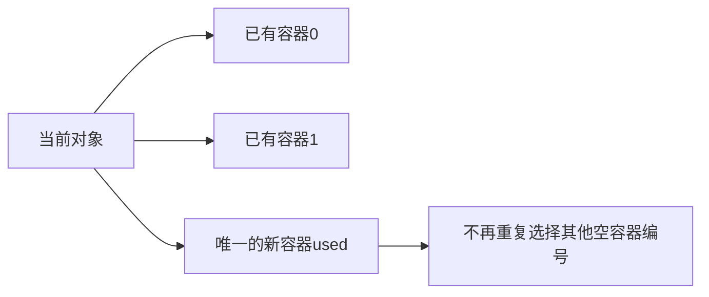

# 逐个对象分配容器：先定一层工作，再记录容器状态

[本章范式](README.md) · [对应剪枝笔记](../../notes/03-search/04-search-pruning.md#92-p10483小猫爬山与一维装箱)

## 什么时候想到

题目要求把**全部不可拆对象**分配给若干容器，每个容器有容量或其他局部约束，目标是最少容器、最小代价，或判断能否完成。

先区分三种选择：

| 题意 | 本层自然的决策 |
| --- | --- |
| 允许放弃物品，有限资源下收益最大 | 当前物品选不选，常考虑背包 |
| 全部对象都要安排，分到不同容器 | 当前对象放进哪个容器 |
| 把一个总量分为若干份，忽略顺序 | 下一份多大，并规定统一的生成顺序 |

**先把“所有对象怎么一起安排”改成“下一件由谁接收”。** 下面适用于对象数少、能承受搜索且有有效剪枝的情形，不是所有分配问题都应使用 DFS。

## 1. 一层只安置一个对象

```text
dfs(i, used)
    若已有容器数不能改善真实答案：停止
    若所有对象都已安置：更新完整答案

    对每个已有容器：
        若放得下当前对象：
            放入 → 搜索下一件 → 撤销本次放入

    开一个新容器 → 搜索下一件
```

**用途速记：** 已知对象大小、各容器约束和优化目标，依次枚举下一件的去向。已有容器逐一试放；允许新增容器时另开一个，再用合法性与最优性判断减少搜索。

`i` 决定处理到哪件，`used` 决定已有多少容器，**每个容器的实际状态也必须保存**。当前对象放入后，下一个状态必须足以判断下一件还能去哪。

## 2. 参数之外的共享数组，也是状态

最少车辆模型需要整个有效载重列表，不能只看“放了几件、开了几车”。

容量为 10，前面三件是 `6、3、3`，可能留下两种载重：

$$
(9,3)\qquad\text{或}\qquad(6,6).
$$

若后面还有四件重量 2，前者仅第二车能接收，最多再放三件；后者两车各放两件就全部装下。**总载重与容器数相同，后续选择仍然不同。**

因此，仅按 `(i,used)` 缓存不足。若要合并状态，需先证明保存的容量分布与其他限制足以决定未来；不能因 DFS 只写了两个形参，就把共享数据忽略。

## 3. 容器完全等价时，只给新容器一种编号

若容器无区别，可统一按第一次接收对象的先后编号：已经用了 `used` 个，新增时只使用下标 `used`。



任何最终分组都可以这样重命名，不改变方案目标与约束，因此不漏解。已有容器状态相同时，还可在同一层只尝试一个；是否值得增加去重结构，再比较实际开销。

**容器有不同容量、费用、可接收对象或身份要求时，不能仅因当前载重相同就合并。** 最优化去掉等价标签，与按标签计数也有不同要求。

数的划分采用另一种统一表示：每个无序划分只生成排序后的非降序版本。两者共同点是**先证明只是标签／生成顺序不同，再删除重复分支**；具体参数不应混用。详见 [P1025 复盘](../../notes/03-search/04-search-pruning.md#91-p1025数的划分)。

## 4. 界要对应目标，顺序只负责帮助搜索

最少容器模型中，已有数目只增不减，因此是最终数量的下界；若已经不小于真实可行答案，便不能改善最小值。

先处理较难安置的对象、先尝试已有容器，可能早些暴露冲突或找到好方案。**没有额外证明时，其余候选仍需保留**；“先搜这一支”不能直接变成“只搜这一支”。

回溯分别检查：修改已有有效状态要撤销；新增槽位若靠有效长度排除且下次必覆盖，可以不清零；全局最好答案不撤销。完整图示与原代码见 [3.4 装箱复盘](../../notes/03-search/04-search-pruning.md#哪些要撤销哪些只需覆盖)。

## 复用前的检查顺序

1. 全部对象都必须安排，还是允许不选？一层决定对象、位置还是一个分组？
2. 后续合法性需要哪些容器信息？有没有藏在形参之外的共享状态？
3. 容器标签是否重要？哪两支的全部后续真的一一对应？
4. 最优答案是否已经来自合法完整方案？当前界能否保证不误剪？
5. 哪些修改要撤销，哪些位置由有效范围和覆盖赋值管理？
6. 一层有多少个候选、深度多大？不能把多容器分配直接写成二叉选择的 $O(2^n)$。

与[记忆化／递推选型](../05-dynamic-programming/memoization-vs-tabulation.md#剪枝停止探索不等于已经算完子问题)的联系是完整状态与缓存语义；不因采用 DFS 就自动具备可合并的低维状态。
