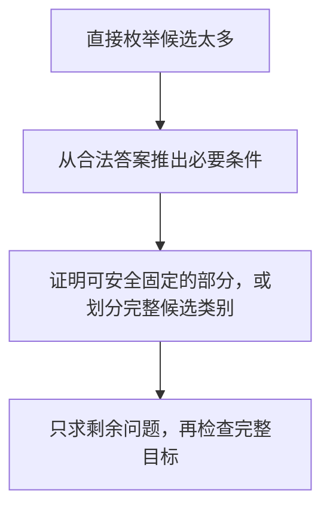

# 先刻画答案结构，再缩小候选范围

[本章范式索引](README.md) · [全部范式](../README.md)

## 什么时候想到

题目要求构造或寻找最优答案，直接枚举时有多个自由选择，但**合法答案受到很强的整体约束**，例如对称、同类、先后关系或边界位置。

先不急着填出完整答案，换一个问题：

> **答案必须满足什么？这些条件能否排除一大类选择？有没有一部分能先固定下来，而且不损失最优值？**

重点是让条件真正减少候选，不是把题意换一套说法，也不是随意选一个满足必要条件的方案。

## 从条件走到算法

1. **明确目标与自由选择。** 要求最长、最少，还是任意合法？哪些位置或数量原本需要同时选择？
2. **推出必要结构。** 假设答案合法，它的首尾、类别或依赖关系必然满足什么？据此排除不可能的组合。
3. **证明缩减不会漏解。** 分类要覆盖全部可能；固定某部分时，则证明至少存在一个最优解包含它，必要时通过交换把其他最优解变成这种形式。
4. **解决剩余问题。** 看候选减少到了多少，再选择枚举、贪心、DP 或已有工具；最后恢复并验证完整答案。

**必要条件负责排除，安全性证明负责保住最优值，后续算法负责完成剩余求解。** 三者不能互相替代。

## 代表例子：前缀加后缀，要求最长回文

[CF 1326D2 的完整复盘与实现](../../notes/08-strings/03-manacher.md#cf-1326d2前后缀回文)留在 Manacher 笔记。

直接选前缀、后缀长度，有 O(n²) 种组合。换成观察答案的结构：

- **两侧都取非空部分时，原串首尾必须相同**，否则答案不可能回文。
- **首尾相同时，可以安全保留这一对**：至少可以选这两个字符。若更长的最优答案只取一边，可把它末端／首端的相同字符改从另一端取，文字与长度不变；重复这个交换即可保留整层匹配外壳。
- **剥掉相同外层后，剩余两端不同**：不能继续从两边各取非空部分，只剩“中间串的回文前缀”和“中间串的回文后缀”两类。

于是：

$$
\text{两个长度共同枚举}\quad\longrightarrow\quad\text{固定外层，再比较两类边界回文}.
$$

Manacher 让剩余两类候选在线性时间内求出，因此整题为 O(n)。**候选缩减来自答案结构，线性回文查询来自具体工具；这个范式本身不保证所有问题都能线性解决。**

“安全保留”只需证明**存在一个最优解能够这样选**，不要求每个最优答案原本都包含这些位置。若交换会违反数量、位置、成本或其他约束，结论就需要重新证明。

## 如何迁移

| 已有例子 | 从答案推出的结构 | 缩减后的选择 |
| --- | --- | --- |
| CF 1326D2：前后缀拼回文 | 两侧非空就必须首尾相同；相同外层可安全保留 | 只比较剩余串的回文前缀与后缀 |
| [CF 1352B：同奇偶拆分](../../notes/04-greedy-and-construction/03-basic-construction.md#cf-1352b--same-parity-summands) | 所有项同奇偶，只可能全奇或全偶 | 分两类铺基值、检查剩余量，见[基值与剩余量](baseline-residual-construction.md) |

不必都固定一段外层；有时收获只是**把大量候选分成少数完整类别**。真正共通的是先研究答案受什么约束，再减少需要主动选择的部分。

## 三个检查问题

- **条件必要吗？** 每个合法答案都满足，还是只是部分样例碰巧满足？例如把“回文首尾相同”改成“必须是某个指定字符”，就已经擅自缩小范围。
- **固定安全且分类完整吗？** “可以选”不等于“先选一定不亏”；存在一个更优解必须排除这一步时，贪心就失败了。
- **剩余问题真的更简单吗？** 还剩多少候选、各自怎样求解、拼回后是否仍合法？不能省去复杂度与完整目标的检查。

## 与已有范式的区别

- [枚举降维](../01-basic-problem-solving/enumeration-dimension-reduction.md)：利用数值关系直接算出某个变量；本篇着重利用答案结构排除整类组合，剩余选择未必唯一。
- [分阶段解耦](staged-constraint-decoupling.md)：强调各阶段的职责与状态交接；本篇先证明为什么可以缩减候选、保留最优值，之后才决定怎样组织实现。

**回顾入口：不是先猜怎么构造，而是先问“合法的最优答案里，有什么结构可以利用？”**

## 固定目标范围，再研究跨界交换

当目标只取决于某一组元素，而操作允许交换两个位置时，先按目标确定一个分界：

1. **保留侧：** 哪些元素真正参与目标计算？
2. **候选侧：** 哪些元素可换入，但当前不直接贡献目标？
3. **同侧操作是否无效：** 若目标只依赖集合、不依赖内部顺序，同侧交换就可排除。
4. **跨侧交换：** 分别确定需要补入什么、移出什么，再证明选择不会损失最优值。

例如 [CF 2272A](../../contests/codeforces/2272.md#先固定一个分界再看两侧怎样交换)，前缀 MEX 单调，使第 k 大固定为第 n−k+1 个前缀的 MEX；由此把数组分成目标前缀与剩余后缀。排列条件又保证缺失值恰为后缀最小值，随后才推导出“左侧最大值换右侧最小值”。

**分界来自目标，极值选择来自本题证明。** 不能见到两组元素，就默认交换最大值与最小值；若目标还依赖顺序，同侧交换也可能有效。
