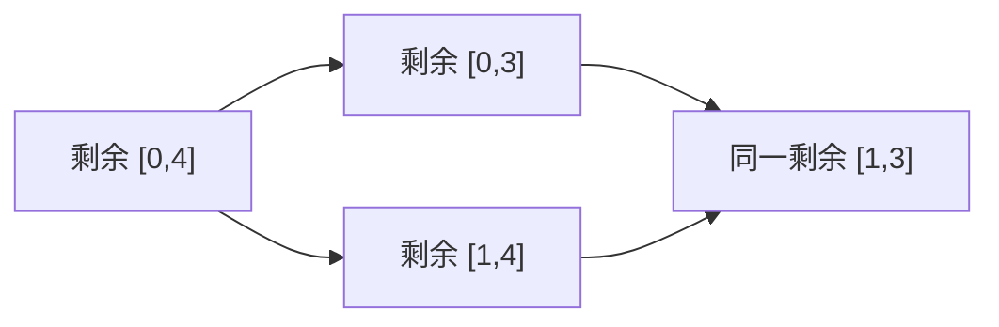

# DP 三步走：找到状态、推导转移、写成代码

[本章范式索引](README.md) · [全部范式](../README.md)

来源：[区间 DP 的三题推导](../../notes/05-dynamic-programming/06-interval-dp.md#8-典题与复盘)，并对照 [LIS](../../notes/05-dynamic-programming/04-sequence-dp-lis.md)、[LCS 与编辑距离](../../notes/05-dynamic-programming/05-two-sequence-dp-lcs.md)。

本篇保存**通用建模过程**；具体题目的代码与完整复盘留在 Notes，[拓扑处理与图上传播](../06-graph-and-tree/dag-dp.md)仍由 DAG DP 范式说明。

> **先找到状态，再推导状态之间的数学关系，最后把关系写成代码。**
>
> 不是先猜循环，再给数组补一个勉强对应的解释。

## 1. 第一步：找到状态——一个格子到底在回答什么？

先画几个小状态或盒子，沿题目允许的操作连线，再观察不同过程是否会到达同一处。

**完整状态句要说明对象范围、已经完成什么、表值保存什么。** 不能只写“最优值”，而不说是哪一部分、什么目标。

- 石子合并：`[l,r]` 内部全部合成一堆的最少花费。
- 零食出售：从完整区间走到剩余 `[l,r]` 时，沿途区间和的最大累计值。

同样的两个端点，可以代表不同问题；不能仅凭数组形状判断状态含义。

### 画出共同到达的格子，再检查能否合并历史

两条路线到达同一格，提示出现了重复子问题。但还要检查：**剩余资源、当前时间与后续限制是否也相同？** 位置相同而资源不同，未必能用同一个状态。

销售题的当前天数由剩余数量确定，因此可以只用区间；若时间不能由其他信息推出，就需要重新考虑状态。

## 2. 第二步：推导转移——它能从哪里来，为什么可以只留最优？

从一次明确的选择入手：最后怎样合并、刚才删掉哪端、当前能接在哪个前驱后。

$$
\text{当前结果}=\text{合法来源提供的结果}+\text{本次贡献}.
$$

这是思考提示，不是统一转移公式：**来源可能有一个或多个，目标也可能需要取最大、最小或求和**。石子合并先相加两个子问题，再在不同切分之间取小；出售题比较两个父状态，再加当前区间和。

要同时说明：每个候选是否合法、所有必要选择是否覆盖，以及同一状态下更差的历史为什么没有后续优势。**只有比较完整，取 `max/min` 才有依据。**

### 取最优值，不等于只走一条贪心路线

**合并只针对同一个完整状态。** 若此前两种方案的代价不同，但后续允许的选择和新增代价相同，较贵方案才可以被丢弃；状态里漏掉剩余资源等限制时，这个替换不一定合法。

编辑距离会先算好左上、上方、左方三个不同前缀状态，再比较“子问题最少代价＋一次操作”。这不是只选一个眼前看起来最好的操作，其余分支都不再考虑。

LIS 同理：固定同一个结尾，较短前段没有优势；不同结尾仍要检查并比较。**最优子结构说明同一状态为什么只保留最优值，完整的转移则保证没有漏掉必要来源。**

具体反例、替换论证与两种状态的推导，见 [编辑距离复盘](../../notes/05-dynamic-programming/05-two-sequence-dp-lcs.md#为什么使用子问题最优值这不是贪心)与 [LIS 的固定结尾论证](../../notes/05-dynamic-programming/04-sequence-dp-lis.md#为什么固定同一结尾后只需要保留最长前段)。

**上述“只留最优”针对最优化问题。** 计数问题保存的是数量，不是最好的一条；不同分支如何相加、是否会重复计数，仍要单独推导。

## 3. 第三步：写成代码——让实现逐项对应数学关系

| 数学上已经明确的内容 | 代码中的对应位置 |
| --- | --- |
| 状态下标与范围 | 数组维度、容量、0/1-based 与开闭区间 |
| 最小或最初已经成立的问题 | 初值、合法零值、不可达标记或候选初始上界 |
| 当前状态依赖哪些已知状态 | 循环顺序，必要时长度递增／递减 |
| 所有合法选择 | 枚举范围与条件判断 |
| 各种来源怎样组合 | `max/min`、相加、计数等更新语句 |
| 原问题最终问什么 | 返回完整区间，或对多个终态再取最优 |

**初值、计算顺序和答案位置没有被三步省掉，它们都属于把状态与转移完整落成代码。** 写完后用小例子沿图检查，而不是只看代码能否编译。

### 从依赖推出顺序：对照已经学过的模型

以下不是额外的“第四步”，而是把数学关系落实为循环的具体例子。

### 从序列中识别隐式 DAG

图不一定以边表输入。若序列中的位置满足 `j < i` 且 `a[j] < a[i]`，就允许从 `j` 接到 `i`，这些关系可以看作隐式边。

$$
\text{合法边 }j\to i\quad\Longrightarrow\quad j<i.
$$

下标沿边严格增大，因此无环；原数组下标顺序本身就是拓扑序，直接按位置循环即可。

**固定以第 `i` 个元素结尾，保留合法前驱的最优长度再追加当前元素**，就是“到达当前点”的最长链状态；无需为了套用图算法额外保存全部边。

完整状态句、不能只留前缀最优的反例与实现见 [5.4 序列 DP](../../notes/05-dynamic-programming/04-sequence-dp-lis.md#2-为什么不能只留前面最长的一条)。若需要枚举所有较早位置判断连边，时间仍可能为 `O(n²)`，不能因为无环就直接称为线性。LIS 还可改为[同长度保留最小末尾](../../notes/05-dynamic-programming/04-sequence-dp-lis.md#8-二分优化同长度只保留最小结尾)，利用有序性二分；这一步依赖该问题的状态比较性质，不是 DAG 自动提供的通用优化。

同一序列还可以从两个方向分别求解，再围绕一个位置组合状态。**先确认两侧是否都必须包含该位置，再判断哪些贡献重复、应该扣几次**；不能只因为两个数组都是最优值，就直接相加。

逐位置长度与前缀整体最优也不能混为一谈；更换状态后，旧的组合证明未必继续成立。例证与另一种状态的单独论证见 [合唱队形的峰值合并与二分复盘](../../notes/05-dynamic-programming/04-sequence-dp-lis.md#92-洛谷-p1091合唱队形)。

### 两个前缀也能组成隐式 DAG

LCS、编辑距离的一个状态不是原序列中的单个位置，而是“两个序列各可使用多少项”：`(i, j)`。

它依赖上方、左方或左上方；每个来源都减少至少一个前缀长度：

$$
\text{来源状态的 }i+j\ <\ \text{当前状态的 }i+j.
$$

因此依赖无环，按行从左向右填写就满足顺序，无需额外建图。

**无环只解释先算谁，不能解释为何状态足够。** 两个维度分别保留两侧的可用范围；状态是否必须使用末尾、怎样选择或匹配，仍要按题目推导。状态有约 `nm` 个，常数次转移的总时间也为 `O(nm)`。

状态对照、转移图与滚动时的新旧值见 [5.5 双序列 DP](../../notes/05-dynamic-programming/05-two-sequence-dp-lcs.md#2-变量与状态为什么需要两个维度)。

### 区间状态按长度组织依赖

把闭区间 `[l,r]` 合成一堆时，最后分界 k 对应 `[l,k]` 与 `[k+1,r]` 两个子问题。

$$
k-l+1<r-l+1,\qquad r-k<r-l+1.
$$

**两个来源都比当前区间短**，所以按长度递增即可满足依赖，不需要建图或额外拓扑排序。不能照搬两个前缀的下标和：右侧子区间的左端点反而变大，真正减小的是区间长度。

每个切分先把**两个**子问题代价相加，再付最后一次操作，最后才在不同切分之间取最小值。它不是只沿一条入边延伸的最短路转移；依赖无环不等于组合规则相同。

状态为何足够、最后切分如何覆盖全部方案，以及前缀和与 DP 的职责，见 [5.6 区间 DP](../../notes/05-dynamic-programming/06-interval-dp.md#4-转移最后一次合并之前一定剩下哪两堆)。

### 树上状态：先看依赖父亲，还是依赖孩子

根路径前缀依赖父亲，前序处理即可；从当前点向下的最优结果依赖孩子，需要后序或逆前序。

**遍历顺序只保证结果已经算好，不能决定结果怎样组合。** 只允许走一个孩子、允许同时采用多个孩子、需要共享预算，分别是不同的合法选择；不能因为都叫树形 DP，就统一把孩子结果相加。

父亲若会根据当前点的选择施加不同限制，状态还要保留这项条件；先把含义说清，再决定是否增加一维。固定根选择后怎样独立合并孩子，见 [子树条件状态](subtree-boundary-state.md)。代码、状态图与逆前序证明见 [5.7 树形 DP](../../notes/05-dynamic-programming/07-tree-dp.md)。

### 只存幂长区间：按倍增长度满足依赖

ST 表中的 `st[k][i]` 保存从 i 开始、长度为 2 的 k 次方的区间信息，只需要相邻两段 `k-1` 层的结果。

**因此按 k 从小到大逐层计算，而不必枚举全部区间长度或全部切分点。** 这是按已知区间信息递推建表，不是枚举不同方案取最优。

状态范围可以围绕后续真正需要读取的信息设计，不因问题含有区间就机械建立全部 `[l,r]`。查询为什么能只用两块、什么运算允许重叠，见 [9.5 ST 表](../../notes/09-data-structures/05-sparse-table.md#4-查询为什么只需要两段)。

### 固定划分的区间：只重算受影响的祖先

线段树的父节点固定依赖左右两半。先建孩子再合成父区间；修改一个位置后，不含它的区间仍然有效，只需要重算目标叶子到根的祖先。

**先明确依赖，再判断哪些旧结果失效。** 这是维护已知区间摘要，不是在不同方案间寻找最优；不能因为保存了 max 就自动叫作最优化 DP。

与 ST 的完整预处理、区间 DP 的切分选择对照，见 [9.6 线段树基础](../../notes/09-data-structures/06-segment-tree-basics.md#4-单点修改向下定位向上重算)。

**节点摘要还必须保留合并所需的信息。** 比如字符段 `ab` 与 `a` 的不同字符数为 2 和 1，只留数量就不知道两段共享了 a；保留出现集合，先取并集、最后计数，才能得到 2。

最终输出是一个数，不代表中间也能只存一个数。状态是否足够，要看相邻结果能否据此正确合并；完整代码、图与替代写法见 [CF 1234D 复盘](../../notes/09-data-structures/06-segment-tree-basics.md#92-cf-1234ddistinct-characters-queries)。

**当整段变化能直接更新摘要，向更小区间分发还可以推迟。** 懒标记先在当前节点算入修改并保存待下传操作，只有需要读取或修改孩子时才分发；前提是摘要更新与操作合并都有明确规则。它是动态维护中的延迟处理，不是增加一个 DP 最优状态，见 [9.7 懒标记](../../notes/09-data-structures/07-lazy-segment-tree.md#4-部分命中先-push再进入孩子)。

操作如何统一表示、怎样按实际顺序合成，见[第九章：统一变换与操作复合](../09-data-structures/composable-transformations.md)；这里只保留依赖与局部维护的联系，不重复完整推导。

### 同是区间，也可能从大状态走向小状态

若状态问“怎样完成区间内部的问题”，可能依赖更短子区间；若问“从完整序列走到当前剩余区间的最好累计值”，则可能依赖大一项的父区间。

两端删除时，可以先画盒子：`[0,4]` 到 `[0,3]`／`[1,4]`，后两者又共同到达 `[1,3]`。**共同到达的盒子提示了重复状态；剩余对象与后续选择相同，才说明可以只留最优历史。**

前一种常按长度递增，后一种按长度递减；不是由“区间 DP”这个名称统一决定顺序。完整图示、沿途区间和与出售收益的等价关系，见 [P2858 收缩状态复盘](../../notes/05-dynamic-programming/06-interval-dp.md#83-洛谷-p2858treats-for-the-cows)。
