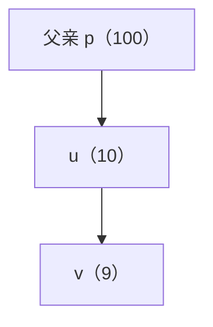

# 固定节点状态：让孩子子树独立求最优

[本章范式](README.md) · [全部范式](../README.md)

来源：[P1352 没有上司的舞会复盘](../../notes/05-dynamic-programming/07-tree-dp.md#82-洛谷-p1352没有上司的舞会)。

> **先固定当前节点的选择，只求它的子树内部最优解；父亲稍后再按自己的条件，读取合适的结果。**

## 1. 从树本身识别递归结构

以 u 为根的子树，由 **u 自身＋若干孩子子树**组成。每个孩子 v 面对的仍是同一个问题，只是子树的根换成了 v。

难点不是同时考虑上下级，而是：**父亲需要知道子树的什么条件，才能把它合法接上？**

若相邻点不能同时选择，子树里“u 选不选”会影响父亲能否使用这个方案。因此分别保存：

- **dp[u][0]：** u 子树内，不选 u 时的最大收益。
- **dp[u][1]：** u 子树内，选 u 时的最大收益。

这两个值都只统计 u 的子树，**不包含父亲的收益，也不假设父亲已经作出选择**。

## 2. 代码对应：先自身，再孩子

下面假设 g[u] 只存孩子，孩子状态已算好；若双向存边，循环中还需跳过 parent[u]。

```cpp
dp[u][0] = 0;
dp[u][1] = w[u];

for (int v : g[u]) {
    dp[u][0] += max(dp[v][0], dp[v][1]);
    dp[u][1] += dp[v][0];
}
```

**u 不选，孩子两种状态都兼容，分别取优：**

$$
dp[u][0]=\sum_{v\in\mathrm{child}(u)}\max\bigl(dp[v][0],dp[v][1]\bigr).
$$

**u 选，孩子不能选，只能读取它的不选状态：**

$$
dp[u][1]=w[u]+\sum_{v\in\mathrm{child}(u)}dp[v][0].
$$

同一条规则递归应用到每个孩子。叶子没有孩子，初值自然就是 0 和 w[u]；实现可以递归返回，也可以逆序读取父亲先于孩子的 order。

## 3. 为什么不能只留下一个最大值？

看一条父子链，括号中是点权：



u 子树的两个结果为：

$$
dp[u][0]=9,\qquad dp[u][1]=10.
$$

如果只留下最大值 10，父亲 p 被选时就没有兼容的结果可读；强行接上 10，会同时选择相邻的 p 与 u。

保留两个条件后，父亲选中时可以读取 9：

$$
100+dp[u][0]=109.
$$

**较小的 9 不是劣质结果，它是另一种边界条件下的最优结果，不能提前丢掉。**

| 父亲的选择 | 可以读取 u 的什么结果 |
| --- | --- |
| 父亲选中 | dp[u][0] |
| 父亲不选 | max(dp[u][0],dp[u][1]) |

因此，“暂不考虑父亲”是**把父亲将来需要的条件留在状态里**，而不是忽略父子约束。

## 4. 为什么各个孩子可以独立取优，再相加？

固定 u 的状态后：

1. 每棵孩子子树允许采用哪些状态，已经确定。
2. 树上不同孩子子树没有交叉边，选择不会互相冲突。
3. 收益直接相加，也没有总预算、总数量等共享限制。

**任取每个孩子的一个最优兼容方案，放在一起仍然合法。** 若某个孩子采用了更差方案，直接替换成更优的同条件方案，不影响其他孩子，也只会提高总收益。

这才是能“各自取优后相加”的依据，**不是因为用了树形 DP，就一定把孩子相加**。

若题目要求恰好选 k 个点、共享一个容量，孩子之间就会争用资源；需要增加数量／容量状态并设计合并，不能照搬上面的求和。非树图中存在跨子树边时，也不能直接认定独立。

## 5. 可复用的识别顺序

1. **找重复结构：** 当前子树能否拆成当前节点与同类型的孩子子树？
2. **找父子间的条件：** 父亲需要知道当前点的颜色、选取状态，还是其他信息？
3. **带条件定义状态：** 固定这个条件，子树内部最优值是否已经能独立确定？
4. **先放自身贡献：** 再根据当前条件，枚举孩子允许使用的结果。
5. **证明能独立合并：** 检查交叉约束、共享预算和重复计数。
6. **落实顺序与答案：** 孩子先算；根没有上级限制时，再在根的合法状态间取优。

状态不一定是 0/1，也不一定求最大；核心是**把父子间必要的条件保存完整，让子树内部可以独立计算**。一般建模流程见 [DP 三步走](dp-modeling-workflow.md)，计算先后与状态方向见 [DAG DP](../06-graph-and-tree/dag-dp.md)。

两状态模型每个节点、每条边只处理常数次，时间 O(n)、空间 O(n)。推广到更多状态时，仍需计入状态数与合并代价。

[最大权独立集竞赛模板](../../templates/05-dynamic-programming/tree-dp/README.md) · [返回两题复盘](../../notes/05-dynamic-programming/07-tree-dp.md#8-典题与复盘)
