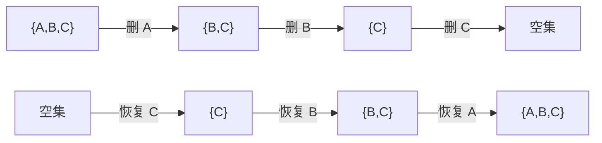

# 逆序离线：把难维护的删除变成恢复

[本章范式索引](README.md) · [全部范式](../README.md)

## 什么时候想到

- **全部操作事先给出**，可以改变计算顺序，最后恢复答案的输出顺序。
- 正向删除、撤销后，维护的最值或连通关系难以恢复。
- 反向加入、恢复时，可以复用此前状态，增量更新更简单。

> **操作不好维护时，先问：倒过来处理，对应的变化是否更容易维护？**

离线指可以先读完操作再安排计算；逆序是其中一种安排。**不要求必须用动态 sum，也不涉及必须压缩坐标。**

## 先画状态，再确定答案属于哪一步

假设删除顺序是 A、B、C：

逆序处理原来编号为 t 的删除操作时，**恢复该对象之后，正好对应正向第 t 步删除之前的状态。** 例如先恢复 C，对应正向删除 C 之前，而不是删除 A 之前。

| 原题询问时机 | 逆序时何时记录 |
| --- | --- |
| 删除某对象之前 | 先恢复该对象，再记录 |
| 删除某对象之后 | 恢复该对象之前记录 |

**不能只把循环改成倒序，还要核对初始状态与记录时机。** 若不是删光所有对象，逆序应从全部操作结束后的剩余状态开始，而非默认空集。

## 为什么可能更容易

| 正向难点 | 逆向可能使用的信息 |
| --- | --- |
| 删除后原最短路失效，距离可能增大 | 恢复一个中转点，只需比较新路线能否改善距离 |
| 删除边可能拆开连通块，并查集不便直接拆分 | 从最终图出发恢复边，通过合并维护连通块 |
| 某次删除破坏此前最优候选 | 检查恢复候选后，能否只更新当前摘要 |

第二、三行只是识别方向，仍需根据问题证明更新规则；**倒序不会自动生成可用的数据结构。**

## 来源例证：Floyd 按恢复顺序扩展

[CF 295B 的完整复盘](../../notes/06-graph-and-tree/09-floyd.md#82-cf-295b逆序加点复用-floyd-的阶段状态)中，删除顺序由 order 保存。

逆序恢复节点 k，只把它加入允许的中转点集合：

$$
\mathrm{dp}[i][j]\leftarrow
\min\bigl(\mathrm{dp}[i][j],\ \mathrm{dp}[i][k]+\mathrm{dp}[k][j]\bigr).
$$

**所有端点都更新，只有当前存在的端点参与答案。** 前者提前保存将来要用的信息，后者对应题目当前询问的图。

原来每次删除后重算 Floyd 为 O(n⁴)；逆序后每点只新增一个阶段，总时间 O(n³)。收益来自复用阶段状态，而非仅仅省掉数组删除。

## 使用前再检查

1. **操作能否提前知道？** 后续输入依赖上次输出时，通常不能直接逆序。
2. **逆向变化是否有明确对应？** 覆盖赋值等操作会丢失旧值，未记录旧值就不能凭新值恢复。
3. **重复操作如何处理？** 同一边多次删除时，需要还原实际生效次数，不能每遇到一次反向操作就无条件加入。
4. **恢复一步是否真的足够？** 若状态丢失了恢复所需的信息，仍需补充状态或换方法。

“插入变删除”也可以尝试，但只有反向删除更容易维护时才有价值。**比较两个方向的维护成本，再决定是否逆序，而不是把删化插当成无条件公式。**
