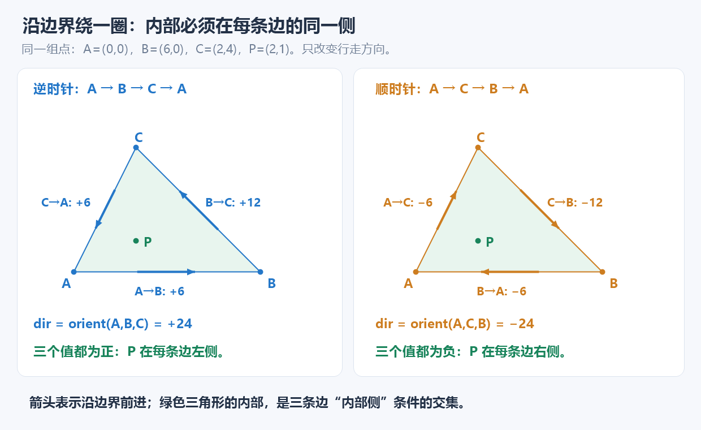

# 凸图形同侧判定：把内部写成半平面的交集

**识别线索：给定图形边界与多个查询点，要求判断内部／外部；图形是三角形或其他凸多边形。** 逐边距离和斜率难以统一竖直边，也不直接表达“内部”。先看图形怎样把平面分成两侧。

约定普通数学坐标系，x 向右、y 向上；凸形面积非零，顶点按边界顺／逆时针排列。

## 1. 从一条边到整圈边界

```text
给每条边一个沿边界前进的方向
    ↓
用 orient 判断查询点在左侧、右侧或直线上
    ↓
只留下该边朝向图形内部的半平面
    ↓
合并所有边的条件，得到整个凸图形
```

**用途速记：** 已知非退化凸多边形及其边界顺序，逐边做叉积符号判断，即可判断一个点是否位于其中；单次 O(n)，不必计算角度、斜率或交点。



## 2. 顶点顺序决定“内部”是哪一侧

对有向边 A→B 与查询点 P：

$$
s=\mathrm{orient}(A,B,P)=(B-A)\times(P-A).
$$

| s | 点相对有向边的位置 |
| --- | --- |
| 正 | 左侧 |
| 负 | 右侧 |
| 0 | 在所在直线上，还未判断是否在线段上 |

交换 A、B 会反转符号。**所有边都按同一边界方向连接**时，才能把这些局部的左右统一起来。

| 顶点排列 | 每条边的内部侧 | 严格内部要求 |
| --- | --- | --- |
| 逆时针 | 左侧 | 所有叉积为正 |
| 顺时针 | 右侧 | 所有叉积为负 |

这里“所有同号”不是任选几条边，也不是把顶点任意排序。相邻顶点连边，最后一条还要连回起点。

## 3. 为什么凸形能这样做？

**凸形没有向内部凹进去的缺口：沿任意边观察，整个图形都在这条边的同一侧。** 因此，每条边都给出一个必须满足的条件；越过任意一条边的外侧，就已经离开图形。

对于按逆时针给出的凸多边形，设第 i 条有向边为 $V_i\to V_{i+1}$，下标循环。保留其内部侧：

$$
H_i=\{P:\mathrm{orient}(V_i,V_{i+1},P)\ge0\}.
$$

所有条件一起满足，正好是原凸多边形（含边界）：

$$
\boxed{\text{凸多边形}=\bigcap_i H_i}.
$$

若只要严格内部，改成每条边都大于 0；顺时针排列则整体反号。**这不是求半平面交的进阶算法，只是把已有图形的位置条件拆成多条简单判断。**

## 4. 边界先按题目的输出目标拆分

| 题目要求 | 处理方式 |
| --- | --- |
| 顶点、边、内部、外部四分类 | 先坐标相等，再 on_segment，再严格同号 |
| 只问内部或边界 | 接纳所有内部半平面，允许叉积为 0 |
| 只问严格内部 | 每条边都必须严格同号，不允许 0 |

**一个叉积为 0 只代表共线，可能落在延长线上。** 单独确认边界用 `on_segment`；若用全体半平面条件，则必须把每条边都检查完，不能见到一个 0 就直接接纳。

输出四分类时，先顶点是因为顶点也属于两条闭线段；先把它单独取出，后面的“在线段上”才只剩非顶点边界。

## 5. 使用前的三个条件

- **非退化凸形：** 至少三个顶点，面积非零；凹多边形不能直接套。凹形的内部点可能位于某条边的外侧，逐边求交会错删它。
- **边界顺序已知：** 整体反转顺序可以，随意打乱不可以；不重复存末尾首点，不传相邻重复点。允许共线的相邻边。
- **数值与边界约定明确：** 本组整数模板沿用坐标绝对值不超过 $10^6$；ll 保存叉积，比较符号而不直接乘两个大叉积；只读、无多测缓存。

通用实现、`side` 变量与边界选项见[7.12 的接口说明](../../notes/07-math/12-basic-geometry.md#两题共同的识别与通用接口)及[几何模板](../../templates/07-math/geometry/README.md)。多个点查询需要 O(Qn)，这里不展开更高阶的预处理优化。

## 6. 本轮例证

- [P1355 复盘](../../notes/07-math/12-basic-geometry.md#p1355先拆边界再判断所有边的同侧)：三条边，同侧模型之外还要分开顶点与边。
- [CF1030B 复盘](../../notes/07-math/12-basic-geometry.md#cf1030b同一模型从三条边推广到四条边)：从三条边换成四条，含边界；核心判准不变。

进一步读法参考 [cp-algorithms 的凸多边形内点问题](https://cp-algorithms.com/geometry/point-in-convex-polygon.html)，用于核对凸性与有序边界前提；本篇使用逐边 O(n) 版本，未采用其二分实现。

[本章范式](README.md) · [7.12 基础几何](../../notes/07-math/12-basic-geometry.md)
