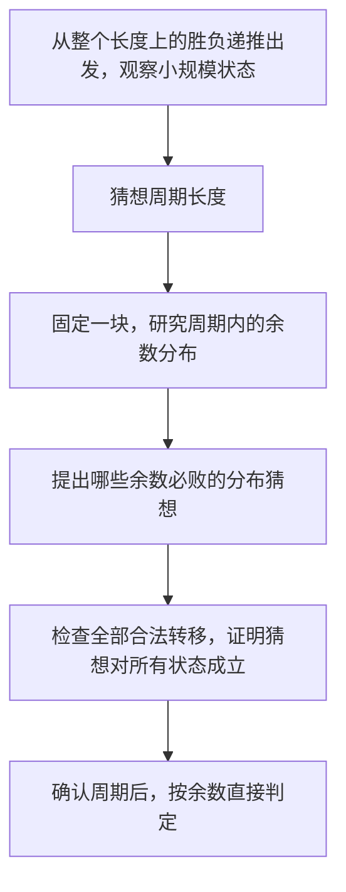

# 博弈中的临界条件：从资源阈值到策略证明

[本章范式索引](README.md) · [全部范式](../README.md)

## 什么时候想到

双方轮流分配同一批资源，胜负只取决于最终频率或某个最早失败的位置，而逐回合分析分支很多时，可以先找：

1. 双方分别需要满足什么条件？
2. 一个数值要让双方同时达标，需要多少资源？
3. 哪个最早不足的位置会截断后续分析？
4. 能否用响应策略保证所分析的分配性质？

这是一条寻找证明的路径，不是所有博弈题都适用的公式。

## 先分清胜负态与一条获胜路线

基础定义与实现见 [7.14 胜负态](../../notes/07-math/14-basic-games.md#3-一步之后换了谁为什么要读-winx-take)：每一步之后轮到对手，有一个必败后继就能赢，全部后继必胜才会输。结论描述的是对手最优应对下的保证，不是存在某条双方配合的路线。

若猜测某类局面是败态，需要证明终点属于其中、内部无法一步互达、外部总能一步进入，并保证游戏结束；[Nim 的异或证明](../../notes/07-math/14-basic-games.md#6-为什么异或能够决定胜负)就是这种检查：先说明异或按位记录奇偶，再证明恢复平衡能通过减少一堆实现；只问胜负时不必执行该操作。不同终局目标的 MEX 资源分配仍需自己的策略证明，不能直接异或频率。

## 核心过程

```text
明确双方目标
    ↓
把目标写成资源约束
    ↓
找到第一个临界位置
    ↓
分析边界两侧的结果
    ↓
证明获胜方能对抗任意回应
```

构造一个看起来合理的终局，只能证明该终局存在；要证明必胜，还必须给出玩家能够强制维持的策略或不变量。

## 从成对响应识别二进制平衡

**触发线索：** 多个数值组成局面，每步只修改其中一个；相同对象之间可以成对回应；整体状态太多，但可能只需要保留“哪几类贡献尚未抵消”。

Nim 的发现链是：**相同两堆可镜像回应 → 尝试将配对细化到二进制每列 → 用异或记录各列 1 的奇偶 → 检查能否合法恢复全部偶数列**。

这里可迁移的是“寻找能被对手破坏、又能由自己恢复的不变量”。选择二进制时，需要有操作或数值结构作为依据，不能看到博弈或数字就猜异或：

1. **记录什么：** 异或保留每列的奇偶；异或为 0 只是候选平衡，还不是胜负证明。
2. **怎样被破坏：** Nim 一次只改一堆，至少翻转一列，因而无法从零异或直接到零异或。
3. **怎样恢复且合法：** 用最高不平衡位挑一堆，目标 `x ^ S` 保证小于 x；允许任取正数，才能把该目标一步实现。
4. **怎样结束：** 空局面属于平衡，且每步总量下降，才能把恢复策略连到胜负。

完整逐位推导、低位可能增大但整堆减少的图，以及只判定无需模拟，见 [7.14 第六节](../../notes/07-math/14-basic-games.md#6-为什么异或能够决定胜负)；实际 `bool nim` 调用见 [P2197](../../notes/07-math/14-basic-games.md#81-洛谷-p2197nim-游戏)。

**适用边界：** 限制每次取走量、一次修改多堆、拆堆或改输赢规则后，以上证明可能失效；不要异或原始堆大小或各堆胜负布尔值来猜答案。更一般的组合博弈可能需要重新定义可合成的状态值，不能把“异或原数”当成困难博弈的通用结论；本篇不铺开 SG。

## 从小状态到周期：先检查新增操作是否破坏旧败态

**触发线索：** 能写出按剩余量枚举后继的胜负递推，但初值太大，无法研究或计算整个长度；希望找到能够代替完整状态值的周期位置。

**难点常在“观察现象 → 猜想规律 → 证明答案分布”。** 周期长度和周期内哪些位置必败，是两个需要分别研究的问题；看出重复，还不等于已经知道所有状态的答案。



1. **观察现象：** 固定其他规则参数，手工列出少量状态，标清必胜/必败。若从已知取法增加特殊操作，先检查新操作能否连接两个旧败态；能做到，旧分布就不能直接沿用。
2. **猜想周期：** 从重复的状态排列或败态间隔提出候选周期 P；比较不同参数时，继续寻找 P 与参数之间的关系。有限几段重复只是线索，不是证明。
3. **研究块内分布：** 暂按 P 分块，用 r=n mod P 表示块内位置，把关注范围从整个 n 的值域缩到一块的 0..P−1。分别观察块首、块尾、普通位置和例外位置；这一步仍以周期猜想为前提。
4. **提出分布猜想：** 将“哪些余数对应败态”写成一个明确集合或条件。猜出 P 不自动给出这个集合；例如周期为 k+1，也不意味着只在余数为 0 时必败。
5. **证明猜想合法：** 检查候选败态的全部合法操作都离开候选集合；再证明其他状态至少有一步合法操作进入集合。结合终点、严格递减和归纳，证明所有块确实共享同一分布，然后才能使用余数判定。

**猜想可以按块内位置提出，证明必须覆盖所有原状态。** 余数相同不自动意味着答案相同；尤其要处理跨块、初始前缀、石子不足而不能执行某操作，以及“代数上能到达，但真实规则不允许”的情况。若只有某个位置之后才出现周期，前缀应单独处理；也不是所有博弈都存在可直接利用的简单周期。

在 [CF1194D 复盘](../../notes/07-math/14-basic-games.md#82-cf-1194d1-2-k-game)中，观察取 1、2、k 的胜负分布后，对 k 为 3 的倍数的情况猜测周期 k+1；再研究一块，猜出败态余数为 0、3……k−3，排除块尾 k；最后通过两方向转移证明。三张图按这一发现过程安排，具体式子只在题目复盘维护。

证明完成后，原来的逐状态枚举可以被直接判定替代。本题由三种固定取法的 O(n) 建表降为 O(1)；其他题能降到多少，取决于周期内分布能否用简短条件表达，不能一概承诺 O(1)。

这与二进制平衡共用的是**候选不变量 → 操作检查 → 策略保证**；一个压缩按位奇偶，一个压缩周期位置，不能混用判定公式。

## 代表题：MEX Game

在 [CF 2271B](<../../problems/CF 2271B_MEX_Game.md>) 中，Alice 希望双方 `mex_k` 不同，Bob 希望相同。对每个数值尽量均分时，双方同时达到 `k` 次的阈值是 `2k`。

设 `t` 是首个 `cnt[t]<2k` 的值：

- `cnt[t]=2k-1`：平衡分配为 `k` 和 `k-1`，两边 MEX 不同。
- `cnt[t]≤2k-2`：平衡分配后两边都不足 `k`，MEX 同为 `t`。

对所有 `x<t`，两边都达到 `k` 次。这项前缀条件不能省略，否则两边可能早在更小值处就已经停止。

### 缺失的证明环节：谁能强制平衡分配

将同值牌尽量配对，奇数频次留下的单张再两两配对。只要每对由双方各拿一张，每个数就会被尽量均分。

- Bob 后手：始终拿 Alice 刚拿之牌的配对牌。
- Alice 先手：首手打开一对，维持“唯一落单牌 + 完整对”。Bob 打开完整对时，她补拿另一张；Bob 拿走落单牌时，她打开新的一对。最后落单牌由 Bob 拿走。

所以两方都能强制这种分配性质：在 MEX 相同的情形由 Bob 使用，在不同的情形由 Alice 使用。完整不变量和边界说明见题目笔记。

## 三种结论不要混淆

| 结论 | 还需要什么依据 |
|---|---|
| 存在一种分配让 Alice 赢 | 只说明存在终局，尚不能判定必胜 |
| 平衡分配都给出相同胜负 | 还要证明获胜方能强制平衡分配 |
| 玩家对对手任意走法都有合法回应，并最终获胜 | 才形成策略证明 |

小规模极小化极大搜索（minimax）适合找反例：Alice 节点取“存在获胜后继”，Bob 节点取“所有后继 Alice 仍获胜”。穷举无反例不代替一般证明。

## 适用边界与常见误判

- `cnt[x]≥2k` 只说明数量上允许双方同时达标，任意分配未必都达标。
- `cnt[x]≤2k-2` 不意味着任意分配时双方都不足 `k`；这里需要平衡性质。
- “双方按排序顺序拿”不能直接当成最优策略；可以作为待验证的判定模型。
- 本题配对策略使用了偶数总牌数、轮流任取一张、先后手固定等条件。操作限制或目标改变后必须重新证明。
- `2k-1` 是本题的临界频率，不是通用博弈模板，也不据此加入 `templates/`。

## 触发器

> 先问“哪个最早的资源不足位置决定结果”，再问“谁能强制我分析的结果性质”。阈值给方向，策略完成证明。
