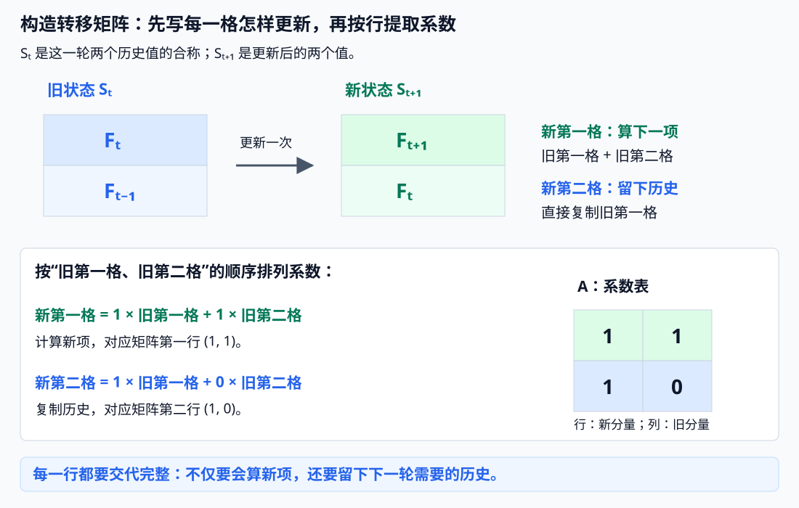

# 从递推式构造矩阵：先留历史，再写每个分量的更新

**识别线索：项数很大，每一项只依赖固定数量的历史项，而且更新系数不随轮次改变。** 普通递推能算，但逐项执行太慢；需要把一轮转移写成矩阵，再用快速幂合并多轮。

构造的入口不是猜一个矩阵，而是问：**为了算下一项，现在必须留下哪些信息？这些信息下一轮分别变成什么？**

## 1. 找依赖：只留最后一个值够不够

以斐波那契递推为例：

$$
F_{t+1}=F_t+F_{t-1}.
$$

计算下一项，需要最近两项。只留 $F_t$ 会丢掉另一个加数，所以状态要同时保留它们：

$$
S_t=\begin{pmatrix}F_t\\F_{t-1}\end{pmatrix}.
$$

**S 是这两个数打包后的简称，下标 t 表示第一格保存第几项。** 它不是第三个数，也不是矩阵的行号。

## 2. 写更新：下一轮的每一格，从旧状态哪里来

当前状态是最近两项，下一轮仍然要保留最近两项：

$$
\begin{pmatrix}F_t\\F_{t-1}\end{pmatrix}
\longrightarrow
\begin{pmatrix}F_{t+1}\\F_t\end{pmatrix}.
$$

第一格要**算出新项**；第二格要**把旧第一格复制下来**，供再下一轮使用。



把两个新分量分别写成旧分量的表达式：

$$
\begin{cases}
\text{新第一格}=1\times\text{旧第一格}+1\times\text{旧第二格},\\
\text{新第二格}=1\times\text{旧第一格}+0\times\text{旧第二格}.
\end{cases}
$$

**第二条不是数列额外的递推公式，只是在搬运历史。** 少了它，下一轮就没有齐全的两个加数。

## 3. 提取系数：一条更新等式，就是矩阵的一行

第一条式子的旧状态系数是 `(1,1)`，第二条是 `(1,0)`，按行放入矩阵：

$$
A=\begin{pmatrix}1&1\\1&0\end{pmatrix}.
$$

于是一次完整更新变成：

$$
\begin{pmatrix}F_{t+1}\\F_t\end{pmatrix}
=
\begin{pmatrix}1&1\\1&0\end{pmatrix}
\begin{pmatrix}F_t\\F_{t-1}\end{pmatrix}.
$$

**行对应新状态，列对应旧状态；每一格表示“这份旧值给这份新值贡献几倍”。** 按行乘列展开，必须逐项回到刚才的两条更新式。

这一步可以用表格检查：

| 新状态 | 旧第一格的系数 | 旧第二格的系数 |
| --- | --- | --- |
| 新算出的下一项 | 1 | 1 |
| 需要留下的上一项 | 1 | 0 |

## 4. 核对起点：指数是更新次数，不直接等于题目下标

确定 A 后，每一轮都满足：

$$
S_{t+1}=AS_t.
$$

如果已经知道第 q 个状态，更新一次得到 $S_{q+1}$，更新两次得到 $S_{q+2}$，因此：

$$
\boxed{S_n=A^{n-q}S_q}.
$$

**先确定初始状态属于哪一项，再用目标下标减去起点下标。** 矩阵本身正确，指数差一也会算成相邻的一项。

P1962 给出 $F_1=F_2=1$。为了统一使用从第 1 项开始的两格状态，可以**额外补一个辅助项 $F_0=0$**：

$$
F_2=F_1+F_0=1+0=1.
$$

它与原有正整数下标的数列一致；这里的 $F_0$ 是为了状态构造而补设，不是把题面给定初值改成别的值。

$$
S_1=\begin{pmatrix}1\\0\end{pmatrix},\qquad
S_n=A^{n-1}\begin{pmatrix}1\\0\end{pmatrix}.
$$

这就解释了原实现中的 `n-1`。也可以从已知的 $S_2=(1,1)$ 出发，但此时应使用 `n-2`，并另行处理 `n=1`；**两套起点与指数不能交叉使用**。

## 5. 选答案：先乘初始状态，再看需要哪个分量

通常求出幂矩阵 P 后，还需计算 $PS_q$。本题初始向量恰好是 `(1,0)`：

$$
P\begin{pmatrix}1\\0\end{pmatrix}
=\begin{pmatrix}P_{0,0}\\P_{1,0}\end{pmatrix}.
$$

右乘这一列，恰好取出 P 的第一列；目标 $F_n$ 又是状态的第一格，所以能直接读 `P[0][0]`。

**直接输出 `[0][0]` 是本题初值与状态顺序共同决定的简化，不是矩阵递推的固定答案位置。** 换了初值或状态顺序，都要重新展开对应的行乘列。

### 初始向量不特殊，就显式相乘

若起点的两格分别为 u、v，而不是恰好 `(1,0)`，先求出幂矩阵 P，再把初始状态写成一列：

```cpp
// A 为转移矩阵，steps 为从初始状态到目标还差的更新次数。
Mat power = mat_pow(A, steps, mod);
Mat initial = {{u}, {v}}; // 初始分量先规范到 [0,mod)。
Mat state = mat_mul(power, initial, mod);

ll answer = state[0][0]; // 若目标是状态第一格，就读这里。
```

方阵乘 2×1 列向量，结果仍为 2×1：`state[0][0]` 是新第一格，`state[1][0]` 是新第二格。

$$
\begin{pmatrix}\text{新第一格}\\\text{新第二格}\end{pmatrix}
=\begin{pmatrix}P_{0,0}u+P_{0,1}v\\P_{1,0}u+P_{1,1}v\end{pmatrix}.
$$

**此时读取的是乘完初始向量的 `state`，不能直接读取幂矩阵 `power`。** 例如从斐波那契的 $(F_2,F_1)=(1,1)$ 出发，新第一格是 P 第一行两项之和；完整显式版本见[P1962 的显式乘向量写法](../../notes/07-math/09-matrix-exponentiation.md#显式写法从题面给出的两项出发)。

## 6. 怎样迁移？变的是新项计算，历史搬运仍要写全

### 系数改变

若递推换成：

$$
G_{t+1}=2G_t+3G_{t-1},
$$

最近两项的状态布局仍然可用。第一行系数改成 `(2,3)`，第二行仍然复制旧第一格：

$$
\begin{pmatrix}G_{t+1}\\G_t\end{pmatrix}
=\begin{pmatrix}2&3\\1&0\end{pmatrix}
\begin{pmatrix}G_t\\G_{t-1}\end{pmatrix}.
$$

**照着每一格的更新填系数，而不是把斐波那契的四个数照抄过去。**

### 需要更久的历史

若下一项依赖最近三项：

$$
H_{t+1}=aH_t+bH_{t-1}+cH_{t-2},
$$

状态就保留三格：第一格计算新项，后两格依次复制旧第一格、旧第二格。

$$
\begin{pmatrix}H_{t+1}\\H_t\\H_{t-1}\end{pmatrix}
=\begin{pmatrix}a&b&c\\1&0&0\\0&1&0\end{pmatrix}
\begin{pmatrix}H_t\\H_{t-1}\\H_{t-2}\end{pmatrix}.
$$

矩阵中的两行 1 是在**把历史向下一格搬运**。状态有几格，就必须交代几格下一轮怎样更新。

### 更新里还有固定常数

若新值为 $x'=2x+3$，只放 x 无法直接表示独立的常数 3；可以把恒为 1 的分量一起保留：

$$
\begin{pmatrix}x'\\1\end{pmatrix}
=\begin{pmatrix}2&3\\0&1\end{pmatrix}
\begin{pmatrix}x\\1\end{pmatrix}.
$$

第二行负责让这一格一直保持 1。**新增状态是为了保留更新必需的信息，不能只加一格却不说明它下一轮怎么变。**

## 7. 适用边界与回顾顺序

| 检查 | 要回答的问题 |
| --- | --- |
| **找依赖** | 算下一步必须留下哪些历史？是否遗漏信息？ |
| **定义状态** | 各格依次保存什么？状态下标表示哪一轮？ |
| **写更新** | 下一轮每一格怎样由旧值算出？哪些格只是复制？ |
| **提取系数** | 行是目标、列是来源，展开乘法能否还原更新？ |
| **核对起点与答案** | 还差几次转移？初始向量是什么？最终取哪个分量？ |

普通递推按固定 d 个系数更新新项，通常为 $O(dn)$；矩阵快速幂为 $O(d^3\log n)$，更适合**历史信息少、下标很大**的情况。若每轮是任意稠密的 d 状态转移，朴素成本则为 $O(d^2n)$；需按实际更新方式比较。

普通矩阵乘法要求新状态是旧状态的固定系数加权和。含 `max/min`、状态之间相乘或系数随轮次任意变化时，**不能直接套同一个矩阵的幂**；需另找模型，不因题目也有递推就照搬。

### 已知初值向前推，还是由约束求未知量

本范式已经知道初始状态，目标是按固定规则计算后面的状态，所以使用矩阵幂。

若题目只给出多个未知数必须满足的线性等式，要求求出这些未知数，则需要[高斯消元](../../notes/07-math/10-gaussian-elimination.md)，通过等价行变换一起处理约束。**同样能按行记录系数，不代表是在做同一种计算；先区分已知什么、要求什么。**

完整题目实现与边界见[P1962 复盘](../../notes/07-math/09-matrix-exponentiation.md#92-p1962-斐波那契数列)。矩阵运算复用[已有模板](../../templates/07-math/matrix/README.md)，不再新建专属于某条数列的通用函数。

与[操作复合](../09-data-structures/composable-transformations.md#同一种线性变换重复很多次矩阵快速幂)的分工：这里回答**一轮矩阵怎样构造**；那里回答**已知变换怎样按顺序合并**。

[返回数学范式索引](README.md)
