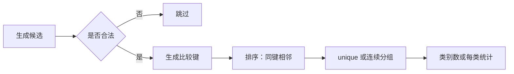

# 筛选候选与比较键：排序去重统计类别

来源：[8.2 P3370 与 CF 271D 复盘](../notes/08-strings/02-string-hash.md#8-典题与复盘)。

**触发线索：**有很多候选对象，只需要统计不同类别；对象较长、比较较贵，而答案不依赖每个对象的完整细节。

## 1. 先确定“什么算同一类”

例如 `aba、ba、aba`，若按字符串内容分类，只有两类。

如果把“出现位置”也放进键，同一个 `aba` 会因位置不同而被拆开；如果只保存长度，`ab` 与 `cd` 又会被错误合并。

> **比较键必须服务于题目规定的相等关系：保留决定类别的信息，去掉与类别无关的信息。**

## 2. 通用流程



1. **生成与筛选：**先确定候选是否有资格参与统计，避免把不合法对象混入答案。

2. **生成键：**把对象转换为容易比较、能表达类别的值。

3. **排序：**让同键候选相邻；固定大小的键通常能在 O(1) 内比较。

4. **去重或分组：**只需类别数时用 unique；还要频次、类内总和等信息时，扫描相邻同键的一段。

**先生成键，再去重。unique 只压缩相邻相同元素，并不负责设计键。**

## 3. 哈希键只是其中一种

| 对象与相等关系 | 可选键 | 是否精确 |
| --- | --- | --- |
| 无向边：端点相同算同一条 | (min(u,v), max(u,v)) | 是；若权重也区分，需加入权重 |
| 分数：数值相等 | 约分后的分子、分母，统一分母为正 | 是；分母非零，运算范围合法 |
| 字符串：内容相同 | (长度, 哈希1, 哈希2) | 指纹，可能碰撞 |
| 单词：字母种类与次数相同算一类 | 26 项字母频次 | 对异位词分类精确，不表示原串顺序相同 |

**精确键**需要做到：同类对象一定同键，不同类对象一定异键。

**指纹键**只保留摘要，可能把不同类压到同一个键。补长度能排除不同长度，却不能排除同长度的哈希碰撞。

## 4. 两道来源题如何复用

| 步骤 | P3370 | CF 271D |
| --- | --- | --- |
| 候选从哪里来 | 输入的整串 | 枚举的子串 |
| 筛选什么 | 原题输入均参与 | 坏字符数不超过 k |
| 键保存什么 | 长度、两份整串哈希 | 长度、两份子串哈希 |
| 收尾怎么做 | 排序、unique、统计个数 | 相同 |

**变化集中在候选生成与合法性判断，分类收尾可以复用。**

这不是“所有题都要哈希”，也不是“没有指定模式串就必须哈希”。先看对象如何比较、候选多少、需要精确还是允许指纹风险，再选表示方式。

## 5. 代码骨架与成本

```cpp
// 以下为流程伪代码；valid、make_key 根据具体对象定义
for (const auto& candidate : candidates) {
    if (!valid(candidate)) continue;

    keys.push_back(make_key(candidate));
}

sort(keys.begin(), keys.end());
int classes = static_cast<int>(
    unique(keys.begin(), keys.end()) - keys.begin()
);
```

设保留下来的候选数为 K，键生成总成本为 G；键为固定大小、比较 O(1) 时：

$$
\text{时间}=O(G+K\log(K+1)).
$$

另加生成和筛选全部候选的成本；保存键通常占 O(K) 空间。若提前按候选上限 reserve，空间应按预留上限估计。

**把长对象压成键，减少的是后续比较成本；外层枚举不会因此消失。**

## 6. 易错点与替代方式

- **只求个数：**unique 返回的迭代器减 begin 即可，不必 erase；后续遍历整个去重容器时再缩短 size。

- **需要频次：**不要直接丢掉重复项，改为连续分组计数；unique 后已不能从保留部分还原原频次。

- **提前 break：**必须证明后续候选不会重新合法，如固定左端后坏字符数随右端扩展不减。

- **需要在线处理：**可考虑 set/map 或哈希容器；C++11 的 tuple 键若用于 unordered_set，通常还需自定义哈希函数，不能照搬排序版接口。

- **需要严格按字符串内容去重：**保留原文进行精确比较，或在碰撞桶内继续区分原文；只给数字键换一种容器，不会消除指纹碰撞。

配套实现见[字符串双哈希模板](../templates/string-hash/README.md)。具体个人代码、复杂度与核验保留在[来源笔记](../notes/08-strings/02-string-hash.md#8-典题与复盘)，这里不重复整题。
