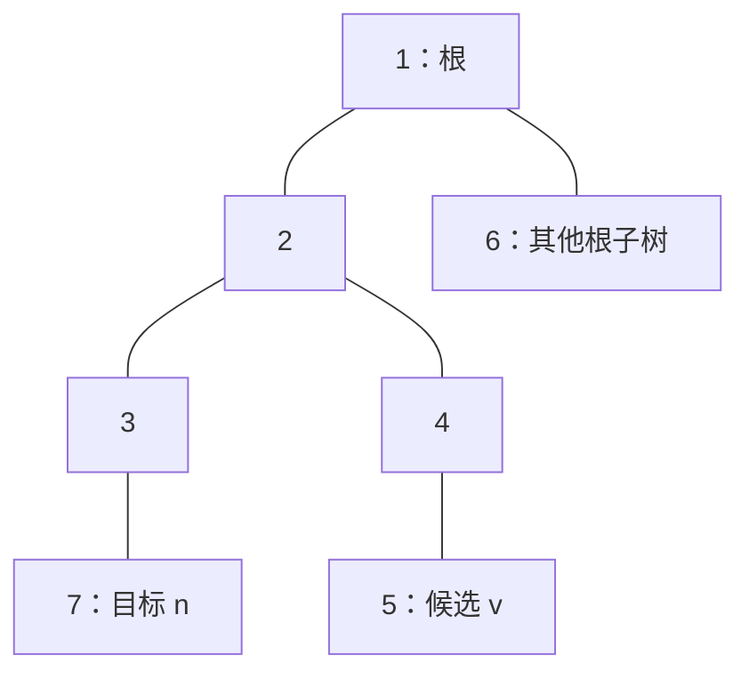
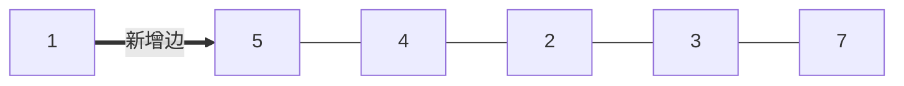

# CF 2277C — Edge Addeleting

题目：[Codeforces 2277C](https://codeforces.com/contest/2277/problem/C)。分类：树的路径、结构约束、LCA、受限 BFS。

收录原因：**先看最终答案能使用哪些操作，再决定需要什么工具。** 从通用路径查询退回固定终点的遍历，把“判断候选是否合法”和“计算候选代价”合在一次搜索里。

## 题目模型

给一棵 n 个节点的无向树，依次进行 m 次操作。第 i 次给定 v：

1. 添加边 (1,v)，产生一个环。
2. 从这个环中删除一条边，**允许直接删除刚添加的边**，重新得到树。

若原来已有 (1,v)，也会再加一条平行边，两个副本组成环。求全部操作结束后，**1 到 n 的最大距离，按边数计算**。

范围：$2\le n\le5\times10^5$，$1\le m\le5\times10^5$，$2\le v\le n$；多测的 n 之和、m 之和分别不超过 $5\times10^5$。

**可以撤销本次新增边，因此操作不会强迫答案变差。** 不需要真的逐次修改邻接表。

## 1. 原实现：用 LCA 判断子树与计算距离

以 1 为根。先识别 v、n 是否位于根的同一棵子树，再计算候选距离。以下保留个人 LCA 实现的逻辑，只整理排版与注释；省略通用主函数，多测逐次调用 solve。

```cpp
struct DFSOrder {
    vector<int> parent, depth;

    explicit DFSOrder(int n) : parent(n + 1), depth(n + 1) {}
};

DFSOrder tree_order(const vector<vector<int>>& g, int root = 1) {
    int n = static_cast<int>(g.size()) - 1;
    DFSOrder t(n);
    vector<int> next(n + 1);
    stack<int> st;

    t.parent[root] = 0;
    t.depth[root] = 0;
    st.push(root);

    while (!st.empty()) {
        int u = st.top();

        if (next[u] == static_cast<int>(g[u].size())) {
            st.pop();
            continue;
        }

        int v = g[u][next[u]++];
        if (v == t.parent[u]) continue;

        t.parent[v] = u;
        t.depth[v] = t.depth[u] + 1;
        st.push(v);
    }

    return t;
}

struct LCA {
    int n, lg;
    vector<int> depth;
    vector<vector<int>> up;

    explicit LCA(const vector<vector<int>>& g, int root = 1)
        : n(static_cast<int>(g.size()) - 1), lg(1) {
        auto t = tree_order(g, root);
        depth = move(t.depth);

        while ((1 << lg) <= n) ++lg;
        up.assign(lg, vector<int>(n + 1));
        up[0] = move(t.parent);

        for (int j = 1; j < lg; ++j) {
            for (int u = 1; u <= n; ++u) {
                int mid = up[j - 1][u];
                up[j][u] = up[j - 1][mid];
            }
        }
    }

    int jump(int u, int k) const {
        if (k < 0 || k > depth[u]) return 0;

        for (int j = lg - 1; j >= 0; --j) {
            if ((k >> j) & 1) u = up[j][u];
        }

        return u;
    }

    int lca(int u, int v) const {
        if (depth[u] < depth[v]) swap(u, v);
        u = jump(u, depth[u] - depth[v]);
        if (u == v) return u;

        for (int j = lg - 1; j >= 0; --j) {
            if (up[j][u] != up[j][v]) {
                u = up[j][u];
                v = up[j][v];
            }
        }

        return up[0][u];
    }

    int distance(int u, int v) const {
        int w = lca(u, v);
        return depth[u] + depth[v] - 2 * depth[w];
    }
};

void solve() {
    int n, m;
    cin >> n >> m;

    vector<vector<int>> g(n + 1);
    for (int i = 1; i < n; ++i) {
        int u, v;
        cin >> u >> v;
        g[u].push_back(v);
        g[v].push_back(u);
    }

    LCA lca(g);
    int ans = lca.depth[n]; // 所有操作都删除新增边，可以保留原距离
    int top_n = lca.jump(n, lca.depth[n] - 1);

    while (m--) {
        int v;
        cin >> v;

        // 跳到深度 1，确定它属于根的哪一棵子树
        int top_v = lca.jump(v, lca.depth[v] - 1);
        if (top_v != top_n) continue;

        int candi = 1 + lca.distance(v, n);
        ans = max(ans, candi);
    }

    cout << ans << '\n';
}
```

### top 表示根下面的哪一棵子树

`jump(u,depth[u]-1)` 把非根节点跳到**深度 1**，得到从根走向 u 时经过的第一个孩子。

$$
\mathrm{top}(u)=\mathrm{jump}(u,\mathrm{depth}[u]-1).
$$

因此：

$$
\mathrm{top}(v)=\mathrm{top}(n)
\quad\Longleftrightarrow\quad
v,n\text{ 位于同一棵根子树}.
$$

**同一根子树内，两点的原树路径不会经过 1；不同根子树之间，唯一路径一定经过 1。** 题目保证 v≥2，所以查询点不是根，跳到深度 1 的含义明确。

通用祖先与路径距离原理见 [6.8 倍增与 LCA](../notes/06-graph-and-tree/08-lca-binary-lifting.md)，可复用 [LCA 模板](../templates/06-graph-and-tree/lca/README.md)。本题范围内距离与中间深度表达式均可用 int 保存。

## 2. 从例子推导：到底怎样改变路径？

取原题第三组的树，n=7；下图仅为了观察父子关系，以 1 为根向下画，实际边是无向的。



原路径是 1→2→3→7：

$$
\mathrm{dist}(1,7)=3.
$$

### 同一根子树：换一个入口

选择 v=5，添加 (1,5)，环是 1→2→4→5→1。删除环中的旧边 (1,2)，新的根入口变成 5：



$$
\text{新距离}=1+\mathrm{dist}(5,7)=1+4=5.
$$

**删掉旧入口后，经过新入口，再沿原树的 v→n 路径前进。** 只要 v、n 属于同一根子树，这条路径就不必再经过 1。

一般地，设根走向 n 的第一个孩子为 c。对同根子树的候选 v，边 (1,c) 一定在新增边形成的环上，删除它就能实现：

$$
\text{候选距离}=1+\mathrm{dist}(v,n).
$$

这个候选未必比原距离更大；因此始终与原距离取 max。

### 不同根子树：不能绕回根再出发

选择 v=6，原树中 6→7 的路径是 6→1→2→3→7。如果直接套公式，会得到：

$$
1\to6\to1\to2\to3\to7.
$$

它重复经过 1，**不是树上的简单路径，不能作为距离**。本例添加 (1,6) 只产生两条平行边，删掉其中一条后结构也没变。

更一般地，其他根子树的环只发生在那一侧，不会改变通向 n 的根入口；不能借它增加 1→n 的距离。

## 3. 多次操作，为什么只需比较单个候选？

**关键限制：所有新增边都连接 1。** 最终树中的 1→n 简单路径，只能在出发时经过 1，此后不能再回来。

$$
\text{最终路径使用的新增边数}\le1.
$$

若使用新增边，它只能作为第一条边；后面全是原树边：

$$
1\xrightarrow{\text{新增边}}v
\xrightarrow{\text{原树路径}}n.
$$

后半段必须避开 1，所以 v 只能来自 n 所在的根子树。若没有使用新增边，整条路径由原树边构成，只能是原来的唯一路径。

这给出了上界。还要说明能达到：**选中的那次保留新增边、删除旧根入口；其他每次都删除刚加的边。** 无论选中的操作出现在什么位置，都能实现对应候选。

因此只需维护：

$$
\mathrm{ans}=\mathrm{dist}(1,n).
$$

每读到一个同根子树的操作点，再更新：

$$
\mathrm{ans}=\max\bigl(\mathrm{ans},\ 1+\mathrm{dist}(v,n)\bigr).
$$

**不是假设操作相互独立，而是先证明最终路径最多利用一次新增。** 只有这个结论成立，才可以省去动态改树。

## 4. Tutorial 思路整理版：从 n 做一次受限 BFS

以下保留 [官方 Tutorial](https://codeforces.com/blog/entry/158113) 的核心算法，代码采用给出的整理版，只进一步澄清访问标记和 continue 的注释。

```cpp
void solve() {
    int n, m;
    cin >> n >> m;

    vector<vector<int>> g(n + 1);
    for (int i = 1; i < n; ++i) {
        int u, v;
        cin >> u >> v;
        g[u].push_back(v);
        g[v].push_back(u);
    }

    // -1：本次受限 BFS 尚未访问；不是说原树中不可达
    vector<int> dist(n + 1, -1);
    queue<int> q;
    dist[n] = 0;
    q.push(n);

    while (!q.empty()) {
        int u = q.front();
        q.pop();

        // 记录到 1 的距离，但不从 1 走入其他根子树
        // 这里只跳过当前点，队列里的其他分支还要继续处理
        if (u == 1) continue;

        for (int v : g[u]) {
            if (dist[v] != -1) continue;

            dist[v] = dist[u] + 1;
            q.push(v);
        }
    }

    int ans = dist[1]; // 允许保留原树，不能只比较新增边候选

    while (m--) {
        int v;
        cin >> v; // 原题保证 2 <= v <= n
        if (dist[v] == -1) continue;

        ans = max(ans, dist[v] + 1);
    }

    cout << ans << '\n';
}
```

### 为什么从 n 开始？

所有候选都要查询同一个终点 n：

$$
\mathrm{dist}(v,n)=\mathrm{dist}(n,v).
$$

**无权无向树中，从 n 做一次 BFS，就能批量得到所有候选所需的距离。** 不必为每个 v 发起一次 LCA 距离查询。

### 为什么到 1 后不再扩展？

把 1 想成一扇门：**允许走到门口记录距离，但不允许穿门去其他根子树**。

从上图的 7 出发，结果为：

| 节点 | 7 | 3 | 2 | 4 | 5 | 1 | 6 |
| --- | --- | --- | --- | --- | --- | --- | --- |
| `dist` | 0 | 1 | 2 | 3 | 4 | 3 | -1 |
| 含义 | 起点 | 同子树 | 同子树 | 同子树 | 同子树 | 边界，访问但不扩展 | 其他根子树，不访问 |

**实际访问集合是“n 所在的根子树，加边界点 1”。** 对题目允许的 v≥2，dist[v]≠-1 恰好代表它是有效候选；dist[1] 另外提供保留原路径的初值。

若仍从 1 向外扩展，6 也会被访问，后面的合法性筛选就失效了。

### 为什么必须用 continue，不能用 break？

按图中边的输入顺序，处理节点 2 时，可把 1 和 4 依次入队。随后弹出 1 时，队列仍有 4：

$$
\text{队列 }[1,4]\ \longrightarrow\ \text{弹出 1 后剩下 }[4].
$$

**continue 只让 1 不生成下一层，4→5 的搜索仍会继续。** 若 break 结束整个 BFS，就可能漏掉有效候选 5；本例也会错过把距离从 3 增加到 5 的方案。

### -1 的含义由本次遍历决定

原树连通，6 在原树中当然能到达 7。这里只是故意不穿过 1，所以它保留 -1。

> **“本次搜索未访问”不等于“原问题的图上不可达”。限制扩展规则后，访问结果也能承担候选筛选。**

每组重新创建 dist、队列与邻接表；重复操作点只是重复比较，不需要特殊去重。n=2 或新增边与旧边平行时，原距离仍能保留。

## 5. 从通用工具退回真正需要的信息

| 需要的信息 | LCA 原实现 | 受限 BFS |
| --- | --- | --- |
| 原距离 | depth[n] | dist[1] |
| v 是否属于同根子树 | 比较 top_v 与 top_n | v≥2 时检查 dist[v]≠-1 |
| 候选到固定终点的距离 | distance(v,n) | dist[v] |
| 每组时间 | O((n+m) log n) | **O(n+m)** |
| 空间 | O(n log n) | **O(n)** |

LCA 原实现能正确表达结构，适合练习祖先跳转与通用路径距离；本题所有查询的终点固定，而且只需筛选一侧连通区域，**一次受限遍历已经提供全部必要信息**。

BFS 中每个点最多入队一次，每条树边最多检查两次；m 个操作各做一次比较。因此线性复杂度不是依靠省略判断，而是避免了反复查询相同终点。

## 6. 可迁移的思考顺序

1. **先看最终答案。** 一条简单路径最多使用几次新增操作？能否把多次操作压缩成有限候选？
2. **再看查询是否固定一端。** 全部求到同一终点的距离时，尝试一次从终点出发的遍历。
3. **最后让遍历承担筛选。** 若合法候选恰好是不能越过某个边界的一片区域，可限制扩展，直接用访问结果判断资格。

本题依赖**树的唯一路径、所有新增边都连 1、允许撤销新增边**。换成一般图、不同端点的新边或不允许撤销，必须重新证明，不能直接照套。

两份实现已做本地核验；平台通过结果未单独提供。BFS 规则与删边论证参考[官方题解](https://codeforces.com/blog/entry/158113)，原实现保留于本文；通用 BFS 概念见 [BFS 与无权最短路](../notes/03-search/02-bfs-shortest-path.md)。题目专属删边与筛选逻辑不另造模板。

[返回 Problems 索引](README.md)
